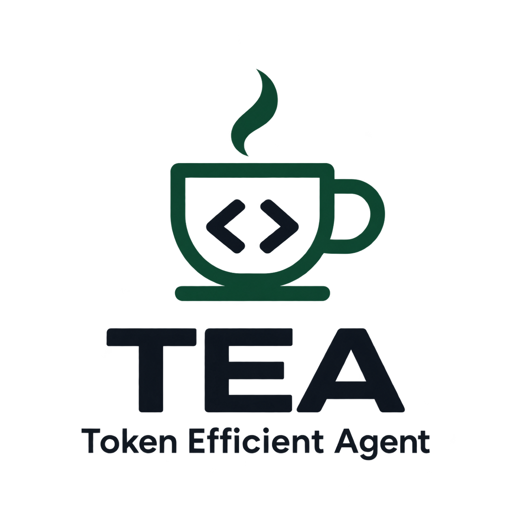
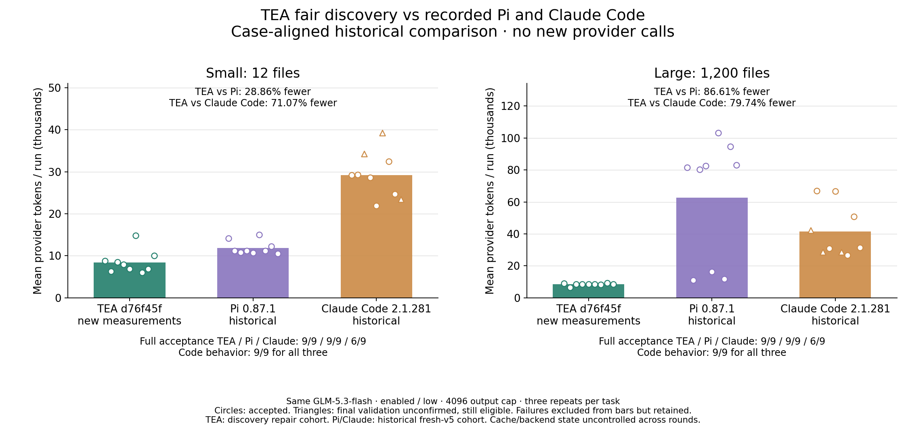
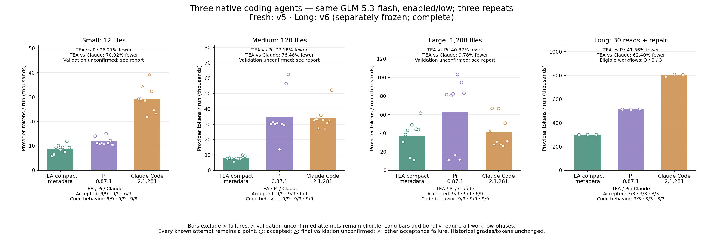
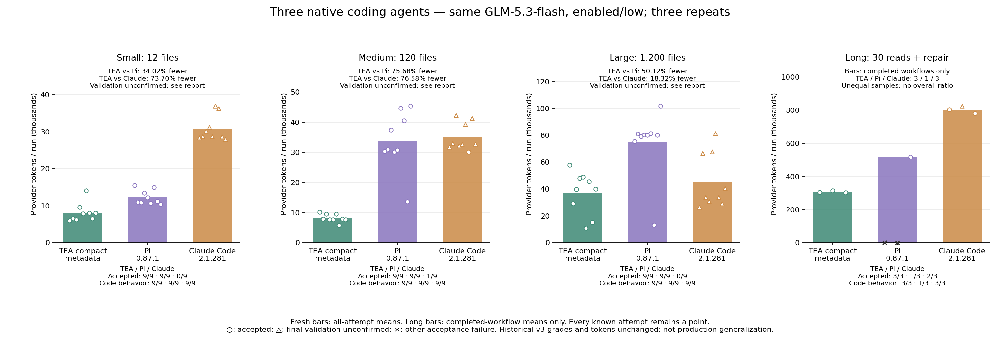
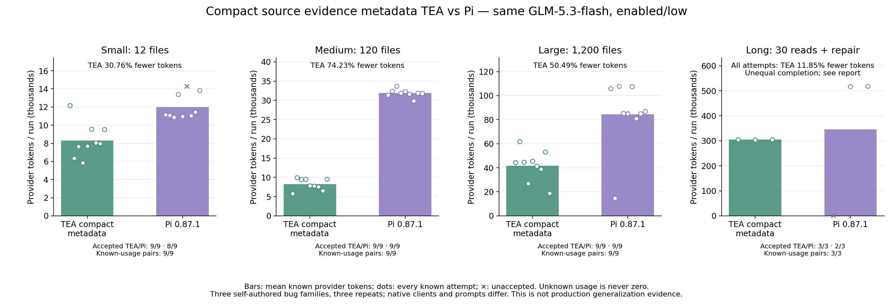
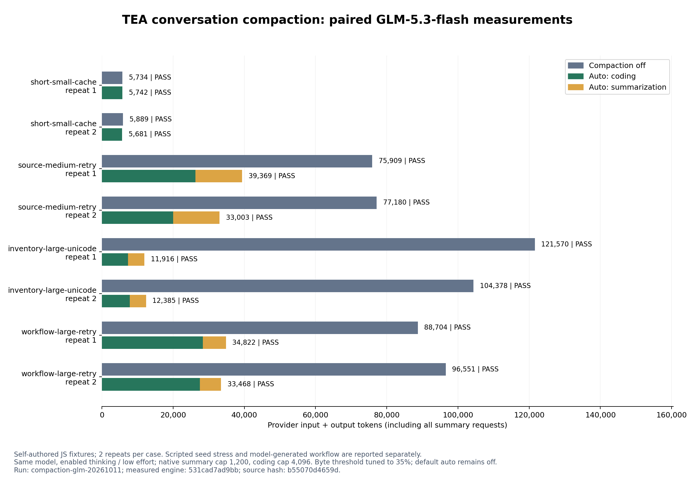
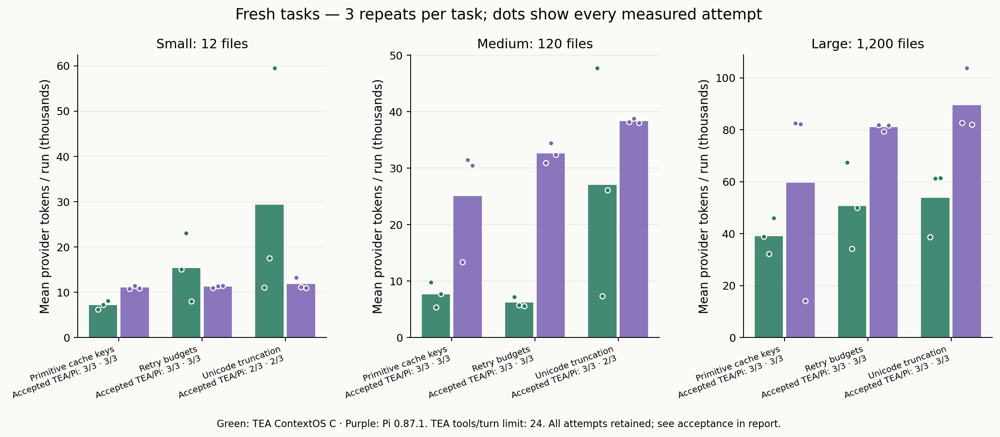

# TEA

<p align="center">
  
</p>

[English](README.md) | **简体中文**

**TEA Coding Agent**

> 一切为了在保证性能的前提下节省 Token。

我们的目标是在保持任务正确率、代码质量和执行性能的前提下减少 Token 消耗，并用可复现的实验衡量每项改进。

TEA 是基于 Node.js 构建的独立终端编程代理，拥有自己的运行循环、工作区工具、Anthropic Messages 适配器、Token 账本和基准测试命令。`baseline-v0` 保存初始项目快照；V1、V2 是经用户授权提交的离线实验检查点，V3 正在进行本地策略与请求边界实验。目前 V1–V5 均未通过真实模型基准测试门禁。

## 实测 Token 用量

### 完整覆盖：新版 TEA / 历史 Pi / 历史 Claude Code

当前 **TEA d76f45f** 恢复为 **每 Agent 30 次**：小/中/大各 9 次，长会话 3 次。相同 **GLM-5.3-flash、enabled/low、4096 输出上限**，初始源码与提示词一致；TEA 为 ContextOS 32,000 字节目标，自动压缩与 GC 开启。**Pi/Claude 复用历史数据，跨轮次对比。**


- **30 次总量：**TEA 对 Pi **减少 54.27%**，对 Claude Code **减少 65.45%**（1,157,270 / 2,530,728 / 3,349,998 Token）。
- **27 次普通任务：**减少 **76.63% / 75.52%**。
- **中型：**减少 **74.96% / 74.20%**；**长会话：**减少 **39.99% / 61.52%**。

完整验收 **TEA/Pi/Claude：30/30、30/30、21/30**；三方代码行为均 **30/30**。Claude 9 次最终验证未确认，保留三角。计入缓存和思考，90 次记录全部保留，用量全部已知；失败不影响柱形均值。原 18 次比例覆盖不同。与更早 TEA GC 历史数据相比，中型增加 **12.93%**、长会话增加 **0.46%**；不是同期配对因果结论，不说明所有场景改善。自建场景与跨轮次缓存/后端变化限制泛化。

[完整报告与对齐审计](benchmarks/reports/tea-complete-coverage-vs-recorded-agents-20261014/README.zh-CN.md) · [TEA 补测报告](benchmarks/reports/tea-coverage-completion-20261014/README.zh-CN.md)

<details>
<summary>上一轮部分覆盖：当前 TEA 的 18 次测量</summary>

### 新版 TEA / 历史 Pi / 历史 Claude Code

公平检索修复版 **TEA d76f45f** 对齐历史 fresh-v5 的 **Pi 0.87.1 / Claude Code 2.1.281** 数据。相同 **GLM-5.3-flash、enabled/low、4096 输出上限**，任务提示与初始源码匹配。**跨轮次历史对比，未重测 Pi/Claude**；只纳入新版已测的小型与大型场景。



- **12 文件：**TEA 对 Pi **减少 28.86%**，对 Claude Code **减少 71.07%**。
- **1,200 文件：**TEA 对 Pi **减少 86.61%**，对 Claude Code **减少 79.74%**。
- **每 Agent 18 次：**TEA 对 Pi **减少 77.41%**，对 Claude Code **减少 76.16%**（151,678 / 671,394 / 636,122 Token）。

完整验收 **TEA/Pi/Claude：18/18、18/18、12/18**；三方代码行为均 **18/18**。Claude 6 次最终验证未确认，保留三角，不改成失败或通过。包含缓存与思考用量，所有尝试保留。跨轮次没有控制缓存/后端随机性，自建场景不保证生产泛化；新版中型与长会话数据不由旧版代替。

[报告、对齐审计与完整数据](benchmarks/reports/tea-fair-discovery-vs-recorded-agents-20261014/README.zh-CN.md)

</details>

<details>
<summary>旧 TEA 版本对比（历史证据）</summary>

### TEA / Pi / Claude Code 最新实测

2026 年 10 月 13–14 日：相同 **GLM-5.3-flash、enabled/low、4096/4095 输出/思考上限**，相同任务与初始源码。受测软件为 **TEA 归档候选 bd41742、Pi 0.87.1、Claude Code 2.1.281 原生 safe-mode CLI**。Claude Code 使用的也是 GLM，不是 Anthropic Claude 模型。

普通任务 81 次为 v5，Long v6 经授权重测完成 9 次，两组独立冻结。v6 将正常完结的要求违规记分后继续，不以漏读或只读违规截断会话；旧 v5 Long 数据保留。不是统一的一次 90 样本源码冻结。



- **12 文件**: TEA vs Pi 减少 26.27%; vs Claude Code 减少 70.02%.
- **120 文件**: TEA vs Pi 减少 77.18%; vs Claude Code 减少 76.48%.
- **1,200 文件**: TEA vs Pi 减少 40.37%; vs Claude Code 减少 9.78%.

普通任务全尝试总量：TEA 对 Pi **减少 50.60%**，对 Claude Code **减少 48.26%**。

Claude Code 完整验收从旧实验 **1/27 变为 18/27**，未确认三角从 **26 个降至 9 个**；主要命令识别问题已修复，剩余复杂命令仍未确认，不伪造通过。普通任务三方代码行为检查均为 **27/27**，完整验收 TEA/Pi/Claude 为 **27/27、27/27、18/27**。

**Long v6 经授权重测已完成：TEA / Pi / Claude 均完整通过 3/3，587 笔请求用量全部已知。TEA 比 Pi 减少 41.36%，比 Claude Code 减少 62.40%（总量分别为 905,432 / 1,544,126 / 2,407,974 token）。上次中断组与 USD 0.2674688 预留单独保留，本次成功不代表旧请求用量已追回。**

圆点完整通过；三角最终验证未确认、其他维度通过；叉号失败不进入柱形均值，仍保留散点和报告。Long 柱形还要求完整流程，显示实际可纳入样本数；失败排除后不对柱形标全尝试百分比。包含全部缓存输入和思考输出；三类自编 JavaScript 缺陷与无关模块扩展，不证明生产泛化。**归档 TEA 候选仍未重新启用，默认运行时保持回退状态。**

[完整报告](benchmarks/reports/tea-pi-claude-current-retry1-glm-20261014/README.zh-CN.md)
[All displayed records](benchmarks/reports/tea-pi-claude-current-retry1-glm-20261014/results.json) · [Chart audit](benchmarks/reports/tea-pi-claude-current-retry1-glm-20261014/chart-audit.json)


</details>

<details>
<summary>旧 v3 比较（历史证据）</summary>

### TEA / Pi / Claude Code 三方对比

2026 年 10 月 13 日，三方在同一 **GLM-5.3-flash、enabled/low 思考、4096/4095 输出/思考上限**下重新测量，任务与初始源码一致。

这里比较的是编程 Agent 软件：**TEA 归档候选 bd41742、Pi 0.87.1、Claude Code 2.1.281 原生 safe-mode CLI**。Claude Code 使用的也是 GLM，不是 Anthropic Claude 模型；各自核心提示与工具保留，宿主插件、技能、MCP 和跨会话自动记忆关闭。



叉号失败样本不参与柱形均值，只保留为散点和报告记录。三角表示最终验证未确认，代码行为检查通过，可纳入柱形并保留标记。Long 柱形还要求完成全部流程，并明确显示各方样本数。

- **12 文件**：TEA 对 Pi 减少 34.02%；对 Claude Code 减少 73.70%。
- **120 文件**：TEA 对 Pi 减少 75.68%；对 Claude Code 减少 76.58%。
- **1,200 文件**：TEA 对 Pi 减少 50.12%；对 Claude Code 减少 18.32%。

普通任务合计：TEA 对 Pi **减少 55.63%**，对 Claude Code **减少 51.93%**。

普通任务代码行为检查（TEA / Pi / Claude Code）：**27/27 / 27/27 / 27/27**；完整验收：**27/27 / 27/27 / 1/27**。命令形式未被固定核查器识别时，保留“最终验证未确认”，不将其当作代码错误。

图例：圆点为完整通过，三角为最终验证未确认，叉号为其他验收失败。后续判定器 v4 已兼容工作区切换后的 Node 测试命令及标准错误合并；旧记录保留 v3 判分，Token 数值不变。[兼容核查](benchmarks/reports/tea-pi-claude-glm-20261013/validation-compatibility.json)。

长会话：从空历史连续读取 30 轮再修复。旧规则在漏读后停止，使 Pi 两次仅消耗 1,586/1,577 tokens，不能据此比较相同完成量。当前 Long 柱形只统计完成全部阶段的会话，样本数 TEA/Pi/Claude 为 **3/1/3**；两次中断仍保留为散点，完整总量和旧图见报告，不给出整体百分比。后续 v5 流程已改为漏读记分后继续，但尚无 v5 付费实测，旧数据不重新判分。

计划 90 次运行，实际 90 次；已提交 968 次请求，其中 0 次用量未知。包含缓存输入、思考输出、失败和单次负收益。样本为三类自编 JavaScript 缺陷、每规模三次重复和一个长会话流程；规模靠无关模块扩展，不证明生产泛化。**受测 TEA 候选仍处于回退状态，默认运行时未重新启用。**

[完整三方报告](benchmarks/reports/tea-pi-claude-glm-20261013/README.zh-CN.md) · [All attempts](benchmarks/reports/tea-pi-claude-glm-20261013/results.json) · [Frozen protocol](benchmarks/reports/tea-pi-claude-glm-20261013/frozen-protocol.md)

<details>
<summary>先前两方实验（2026-10-13）</summary>

**2026 年 10 月 13 日**的对比中，缩短证据元数据候选版在 27 对普通任务上，比 **Pi 0.87.1 少用 54.55% 的服务商 Token**：

- **小型项目，12 个文件：减少 30.76%。**
- **中型项目，120 个文件：减少 74.23%。**
- **大型项目，1,200 个文件：减少 50.49%。**



双方使用 **GLM-5.3-flash、enabled/low 思考、4,096 Token 输出上限**，任务提示和初始源码一致。全部 **60 次运行、653 次请求**的服务商用量完整，包含缓存输入、思考输出、失败和单次负收益。普通任务代码行为检查双方均 **27/27 通过**；完整验收为 **TEA 27/27、Pi 26/27**。Pi 少的一次属于最终验证未确认，代码行为检查通过。

**连续读取 30 轮再修复的长会话**，全部尝试合计 TEA **少用 11.85% Token**，完整验收为 **3/3 对 2/3**。Pi 一条会话在首次读取要求处停止，未进入修复，双方完成量不同。双方均通过的两对会话中，TEA **少用 41.24% Token**；这只是诊断性子集，不能替代包含失败的整组结果。

样本为三类自编 JavaScript 缺陷，每种项目规模重复三次，以及一个长会话流程；新增文件主要是无关模块，尚不能保证生产项目的普遍收益。百分比表示完整实验候选与 Pi 的差距，包含原生提示和工具等差异，不代表元数据缩短的单项贡献。TEA 开启 ContextOS 和能力反馈；双方模型摘要实际执行均为零。**受测候选 `bd41742` 在本分支中仍处于回退状态，图表记录的是其归档实现。**

[完整中文报告](benchmarks/reports/e1-metadata-vs-pi-glm-20261013/README.zh-CN.md) · [全部尝试和用量](benchmarks/reports/e1-metadata-vs-pi-glm-20261013/results.json) · [冻结实验协议](benchmarks/reports/e1-metadata-vs-pi-glm-20261013/frozen-protocol.md) · [源码与验证记录](benchmarks/reports/e1-metadata-vs-pi-glm-20261013/source-audit.json)

</details>

</details>

## 环境要求

- Node.js 20 或更高版本。
- Git：用于源码版本管理和后续版本配对实验。
- 运行真实模型任务时，还需支持 Anthropic Messages 的接口、模型和通过进程环境提供的 API 密钥。日常默认无费用上限，价格仅用于可选费用估算；显式设置费用上限和真实实验时必须填写价格。

项目没有 npm 运行时依赖。

## 本地运行

```powershell
git clone https://github.com/Wh0rigin/tea.git
cd tea
npm link
```

配置 API 后，在目标项目目录直接执行 **`tea`**：默认进入交互模式，开启 **ContextOS、自动压缩和内存 GC**，默认不设置费用上限。项目不会自动读取 `.env` 文件；API 配置来自进程环境。

代理默认使用当前目录作为工作区，也可通过 `--workspace` 指定。它能够列出文件、搜索和读取文本源码、应用唯一匹配的精确文本补丁，以及执行允许的验证命令。修改文件后，必须成功运行测试，运行状态才能变为 `completed`。文件写入限制在指定工作区内。测试及只读白名单以外的 Shell 命令需要交互批准，破坏性命令会被阻止。

默认上下文策略为 `v1`：初始最多提供 8 个按任务相关性排序的文件路径，优先保留适用的 `AGENTS.md`、根目录 README 和项目包清单。当任务描述与路径的词面重合较弱时，使用少量领域同义词扩展查询。文件枚举和搜索支持按目录继续定位，以及按需探索默认排除的普通目录。未知源码后缀通过文本内容检查识别。搜索失败后，模型找到并读取实际对应名称，才可保存本次内存会话的查询映射；运行时校验名称出现和源码证据，语义对应由模型判断。通过 `--context-strategy baseline` 可对照原始的 160 路径清单，通过 `--initial-file-limit N` 可调整候选数量，范围为 1–250。这些策略仍属于实验性启发规则，合成回放不能证明真实模型任务的正确率。

V2 提供可选策略 `--history-strategy compact-tools`，配合 `--history-keep-recent 2` 使用，保留轮数可设为 2–24。该策略将较旧的长发现结果和成功日志替换为带哈希的恢复记录，同时保留源码证据、失败信息、补丁回执、近期结果，以及模型原始思考块和签名。完整原始历史始终保留。是否压缩会计入最终请求的额外说明开销；没有收益的请求使用原始输入。默认仍为 `full`，等待真实模型质量验证。

## 交互式终端

启动持续对话：

```powershell
tea
```

通过 `npm link` 将本地 CLI 链接后，无参数运行 `tea` 会打开相同界面。带引号的任务保持原有单次执行方式；`--interactive "任务"` 可执行初始任务后继续对话。

无需凭据和 API 调用的演示：

```powershell
npm run tea -- --demo
```

界面展示 TEA 标识、按行流式回答、工具进度、局部补丁预览，以及会话 Token 和预算。`/tools` 列出工具记录，`/tools N` 展开结果，`/diff` 预览 Git 差异，`/status` 查看用量，`/help` 查看命令。输入行末添加反斜杠可继续编写多行任务。

**Esc / Ctrl+C** 可中断当前任务，已完成修改会保留，未完成验证仍需继续。`/new` 清空对话和学习词表，保留已消耗预算和待验证修改；`/clear` 仅清屏。费用和累计输入上限覆盖整个终端会话；`/exit` 退出。

演示使用脚本化回答和本地只读工具，不解决真实编程任务，也不产生模型用量测量。CLI 默认 ContextOS，会话历史保存在本地加密日志中，可通过显示的会话 ID 恢复。详见[终端指南（英文）](docs/TERMINAL.md)。

## Agent 记忆管理：ContextOS

CLI 默认开启 ContextOS，完整历史写入本地加密日志，发送给模型的旧工具输出可变为可恢复引用。保留用户要求、近期和当前源码、失败信息及待验证修改；源码变化后旧证据失效。模型需要细节时可通过工具按引用或关键词恢复。使用 `--memory-policy full-history` 可切换为完整历史输入。程序接口 `loadConfig()` 保留完整历史回退，CLI 单独提供 ContextOS 默认值。

```sh
npm run tea -- --interactive --session work --memory-policy contextos --max-cost-usd 1.00
npm run tea -- --interactive --resume work --memory-policy contextos --max-cost-usd 1.00
npm run tea -- sessions inspect work
npm run tea -- sessions delete work
npm run tea -- benchmark contextos --mode preflight --run-id contextos-check
```

恢复保留累计费用，不能提高原预算；`/new` 保留费用和待验证修改。`/memory` 查看上次上下文选择的原因；`--memory-policy full-history` 可关闭选择并保留持久化。目标大小使用 UTF-8 字节，不是服务商 Token。[A/B 已淘汰](benchmarks/reports/contextos-glm-20261011/README.zh-CN.md)，[C 已通过冻结实测门槛](benchmarks/reports/contextos-c-glm-20261011/README.zh-CN.md)：七个自编场景、每组重复三次，C 21/21 通过；实际 Token 比完整历史少 **62.99%**，真实 30 轮少 **52.12%**。额外重读核查为旧版/完整历史/C 21/21、20/21、21/21，暴露了原验收漏掉一次完整历史重读缺失。样本不能证明未见项目泛化，仍需主动开启。详见[中文指南](docs/CONTEXTOS.zh-CN.md)、[架构](docs/CONTEXTOS_ARCHITECTURE.md)和[实验协议](docs/CONTEXTOS_BENCHMARK.md)。

## 会话压缩

交互终端中使用 `/compact [保留重点]`，可把旧对话整理成摘要。自动压缩现在默认开启，可用 `--compaction off` 关闭。后续请求使用结构化摘要和近期完整消息；默认检查点 GC 将已覆盖原文保留在本地加密载荷中，并释放旧常驻正文，用户要求和待验证状态继续保留。详见[垃圾回收与资源限制](docs/MEMORY_GC.zh-CN.md)。

摘要请求计入会话 Token 和费用上限。摘要仍受原预算约束；默认计量账本保存哈希，本地加密会话保存可恢复原文。GLM-5.3-flash 配对实验使用自编 JavaScript 样本和 35% 实验阈值，固定历史压力配置净节省 **72.33%**，模型生成历史的检查/修复多轮任务净节省 **63.14%**，均包含全部摘要开销；复测 16/16 通过验收。这是小样本实验结果，不是默认 80% 阈值的收益。详见[报告和图表](benchmarks/reports/compaction-glm-20261011/README.zh-CN.md)及[设计与配置](docs/COMPACTION.zh-CN.md)。



## 配置真实模型调用

在启动进程中配置凭据、接口与模型。价格仅用于费用估算或显式费用上限，日常无上限运行不要求填写。不要将真实 API 密钥保存到仓库、`.env`、基准测试文件或 Shell 历史中。下列密钥和价格均为占位符。

```powershell
$env:ANTHROPIC_API_KEY = '你的API密钥'
$env:ANTHROPIC_BASE_URL = 'https://cf.api.fan'
$env:ANTHROPIC_MODEL = 'glm-5.3-flash'
$env:TEA_INPUT_PRICE_USD_PER_MTOK = '你的Token分组输入单价'
$env:TEA_OUTPUT_PRICE_USD_PER_MTOK = '你的Token分组输出单价'
$env:TEA_MAX_REQUEST_INPUT_TOKENS = '12000'
$env:TEA_MAX_OUTPUT_TOKENS = '1200'
$env:TEA_REASONING_EFFORT = 'low' # 可选 low、high、max
$env:TEA_THINKING_MODE = 'enabled'
tea
```

缺少价格时仍统计 Token，费用显示未知。填写两个价格后，可用 `--max-cost-usd 1` 设置可选费用上限；已有费用上限环境变量也会生效，可用 `--max-cost-usd none` 覆盖。恢复会话保留既有较严格上限，真实实验继续要求有限预算。项目不会猜测服务商价格。设置费用上限时，每次请求前，TEA 按配置的输入/输出上限和单价预留最坏情况下的费用。输入总量包含普通输入、缓存读取和缓存写入。缓存读取按完整输入单价计算；缓存写入默认按输入单价的两倍保守预留，依据是 [Anthropic 缓存价格说明](https://platform.claude.com/docs/en/build-with-claude/prompt-caching)，并非 PackyAPI 实测账单。

传输失败的请求会保留费用预留。用量缺失、无效或流式响应中断时，整次运行的完整实际 Token 总量为 `null`；已报告的有效计数作为下界保留。真实模型测试套件共用费用和输入预算，出现失败或未知用量后停止后续调用。

目前 Anthropic Messages 适配器按照提供的兼容性提示，请求自适应思考模式和 `output_config.effort`。Z.AI 的 GLM-5.3-Flash 文档列出的推理档位为 `low`、`high`、`max`，不支持关闭思考。所选 Token 分组是否开放该模型的 Anthropic Messages 协议，需要在 PackyAPI 模型广场核对。PackyAPI 已公开的 Anthropic 示例使用 `https://cf.api.fan` 和 `/v1/messages`；用户提供的 `https://www.packyapi.ai` 是产品网站地址，尚未验证为 API 端点。

参考资料：[GLM-5.3-Flash 指南](https://docs.z.ai/guides/vlm/glm-5.3-flash)、[GLM Chat Completion 参数](https://docs.z.ai/api-reference/llm/chat-completion)、[PackyAPI Anthropic Messages 配置示例](https://docs.packyapi.com/docs/cli/7-kimi-code.html)。项目约定见[决策记录](docs/DECISIONS.md)和[基准测试规范](docs/BENCHMARK_SPEC.md)。

## 基准测试与实验

```powershell
npm run benchmark:replay
tea benchmark run --suite core --mode replay
tea benchmark run --suite core --mode replay --strategy v1 --initial-file-limit 8
tea benchmark report --run replay-YYYY-MM-DDTHH-MM-SS.sssZ
tea benchmark compare --base-run RUN_A --candidate-run RUN_B
npm run benchmark:runtime
tea benchmark run --suite runtime-smoke --mode runtime --strategy baseline
tea benchmark run --suite runtime-smoke --mode live --max-cost-usd 0.10
tea benchmark run --suite runtime-smoke --mode runtime --history-strategy compact-tools --fixture-variant extended
tea benchmark memory --history-keep-recent 2
node scripts/policy-experiment.mjs --run-id v3-policy-NEW
node scripts/request-budget-experiment.mjs v3-request-budget-NEW
```

运行 ID 必须唯一；示例中的 `NEW` 应替换为本次实验的新标识。

### Replay：离线回放

使用 23 条自编轨迹筛查输入体积。此前候选的启发式 Token 估算为 13,431 → 2,106，下降 84.32%。这只是诊断估算，不是服务商实际用量，也不是正确率证据。

### Runtime：可执行测试样本

`runtime` 模式执行 12 个自编 JavaScript 小仓库，包含可复现的初始 Git 提交、脚本化工具选择、真实补丁、公开测试和独立验收测试。此前一轮实验中，两种上下文策略均通过 12/12 验收，工具输出字符数从 15,551 降至 11,911，下降 23.41%。这验证的是给定补丁下的运行时行为，不能解释为模型任务成功率。

这里的 `baseline` 使用当前引擎配合原始文件清单和读取设置，并非执行历史 Git 版本。`live` 模式只有在明确配置凭据、当前价格和总预算后，才会通过服务商运行相同的冒烟样本；目前尚未运行。正式的 40–60 项核心任务、100 项以上留出任务，以及 Git 版本间的配对调度尚未完成。

这些样本没有操作系统隔离，测试和答案位于项目清单中，不能视为保密的生产验收。当前所有实验均不具备正式优化门禁资格。详见 [V1 运行时实验](benchmarks/reports/v1-runtime.md)。

### V2：选择性工具历史

在人工构造的重复长日志轨迹上，集成历史消融实验的累计适配器输入字节减少 **20.90%**，两侧脚本化验收均为 **12/12**。普通轨迹的收益为 **0%**，未触发压缩。

另有 7 条辅助记忆轨迹，在不同的固定系统提示下测得输入体积减少 **54.02%**。这些是口径不同的离线体积测量，不能替代实际服务商 Token 或模型成功率结果。详见 [V2 实验报告](benchmarks/reports/v2.md)。

### V3：双向路由与预算边界

策略仿真覆盖 13 条预设状态轨迹和 4 种路由对照；另一个真实适配器到本地 HTTP 服务的实验检查 9 项请求预算约束。候选代码尚未提交，路由尚未接入真实模型运行。目前没有测得 V3 的真实 Token 或模型质量提升。详见 [V3 实验报告](benchmarks/reports/v3.md)。

### 早期 TEA / Pi 对比

2026-10-11 至 12 日完成早期主动开启的 **ContextOS C** 与原生 **Pi 0.87.1** 对比：共同 **GLM-5.3-flash、enabled/low 思考、4,096 输出上限**，相同初始 Git 内容。每配置重复三次；全部服务商输入、缓存和思考输出计入。这些实验与上方 10 月 13 日候选对比单独记录。

- **短任务，CLI 已有的默认每轮 24 次工具额度**：12/120/1,200 文件，27 组配对。TEA **708,844** / Pi **1,080,626** Token，TEA **少 34.40%**；完整验收 **26/27 对 25/27**。[默认额度报告](benchmarks/reports/contextos-c-vs-pi-default24-glm-20261011/README.zh-CN.md)。
- **从空会话实际读取 30 轮，再修复和测试**：3 组配对。TEA **905,224** / Pi **1,558,908**，TEA **少 41.93%**，双方 **3/3**。这组使用原每轮 10 次工具配置；P95 TEA/Pi **485.60/463.18 秒**，没有速度提升证据。[长会话及主实验失败记录](benchmarks/reports/contextos-c-vs-pi-glm-20261011/README.zh-CN.md)。
- **原 10 次额度短任务**：TEA 验收 **16/27 对 27/27**，额度与验证完成问题全部保留，低 Token 不能算保持性能的收益。补测开始前已选定重跑全部短任务，没有只挑失败项。

默认额度分规模差异明显：小型任务 TEA **多用 52.26%**（双方完整验收 8/9）；中型、大型分别**少 57.42%、37.64%**。补测双方独立代码与范围检查均为 27/27；完整验收还要求原生测试和正常结束，保守的命令识别可能有假阴性，不能将完整验收率解释成 TEA 代码更正确。

这些是自编 JavaScript 缺陷，规模增加主要添加无关模块；三次重复不能证明未见项目泛化。保留双方原生提示、工具与缓存策略。ContextOS 仍需主动开启，Token 降幅不等于账单降幅，压缩也可能降低缓存复用。旧完整历史 TEA/Pi 的 64k 多 4.49%、80k 大型多 8.78% 结果[单独保留](benchmarks/reports/tea-vs-pi-glm-20261011/README.zh-CN.md)。[对比说明](docs/PI_COMPARISON.zh-CN.md)。

[小任务专项诊断](benchmarks/reports/contextos-c-vs-pi-small-diagnosis-20261012/README.zh-CN.md)：79/46 次请求、21 次 Shell 拒绝和一个显著的恢复循环构成主要成本问题；解决方案的实际收益尚未测量。

[改进计划](docs/SMALL_TASK_IMPROVEMENT_PLAN.zh-CN.md)：先完善评测，再逐项处理能力反馈、结构化验证、进度与结束判断、版本化补丁回执，最后做独立任务确认。每项与直接父版对照，计划目标不写成已实现收益。

[S0 评测检查](benchmarks/reports/small-task-s0-20261012/README.zh-CN.md) 已完成：254/254 测试、18/18 双提交原生合约任务、20/20 冻结故障任务预检。没有付费调用或真实 Token 收益，停在 S0，尚未进入 S1。

[S1 反馈改进的真实对照](benchmarks/reports/small-task-s1-glm-20261012/README.zh-CN.md)：102 次父版/候选运行，实际 Token 全体**减少 11.38%**、小任务**减少 41.44%**、长会话**增加 3.67%**；候选完整验收 51/51 对 47/51。实验开关 `TEA_CAPABILITY_FEEDBACK=1` 默认关闭，等待审核；不表示每个任务或未见项目都省 Token。




## 日志与验证

每次服务商请求的用量写入 `.tea/runs/<run-id>/`。默认账本只保存哈希和计数，不保留提示词或源码。只有确认内容适合保存在本地时，才启用 `TEA_STORE_RAW=1`。基准测试工作区会保留样本代码，并由 Git 忽略。逐任务检查点会在验收前保存费用和失败信息。

长命令输出保留开头、结尾和完整输出流的哈希；成功命令使用更小的返回上限。输出量不再导致测试进程提前终止，超时限制仍然生效。`npm test` 明确选择项目测试文件，避免扫描归档的基准测试工作区。

## 当前完成状态

- **已实现**：独立 CLI 和运行循环、文件工具、有界命令输出、验证命令分类、UTF-8 流式处理和用量计量、费用预检、离线回放和可执行冒烟测试框架、初始上下文排序、重复读取证据引用、可选工具历史压缩、手动/自动会话摘要，以及集成测试。
- **已测量**：上述 TEA/Pi 和会话摘要 off/auto 自编样本的真实服务商 Token 和任务验收结果，包含失败与负收益。
- **尚未测量**：直接父版本配对的真实优化基线、多语言真实项目与保密留出集的成功率，以及 V1–V5 的正式门禁结果。
- **尚未实现**：多语言固定版本的 40–60 项核心任务与 100 项以上留出任务、隔离的保密验收、跨 Git 版本的配对 A/B，以及基于真实模型证据的发布报告。

确切的 Git 状态和后续步骤见[项目进度](PROGRESS.md)。

逐项方法、实验收益和适用范围见 [Token 优化与改进点记录](docs/TOKEN_OPTIMIZATIONS.md)。

## 参与贡献

所有代码、文档和实验报告改动都通过 PR 提交到 `main`。开发步骤、验证命令和实验要求见 [贡献指南](CONTRIBUTING.zh-CN.md)。

## 开源协议

[MIT](LICENSE) — Copyright (c) 2026 Wh0rigin。

## 公平检索修复

仅测 TEA、对比上一版 GC 与公平检索修复：18 对实验累计 Token **减少 70.05%**，大型 **减少 82.02%**，小型 **减少 11.65%**；两版各 18/18 最终验收通过。但**小型 Unicode 增加 26.73%**。两版均开启 ContextOS、自动压缩和 GC，没有触发摘要。6 个自建 JavaScript 场景、各重复 3 次，未测本轮长会话或真实项目留出集。[报告、图表与完整证据](benchmarks/reports/discovery-repair-20261014/README.zh-CN.md)。
