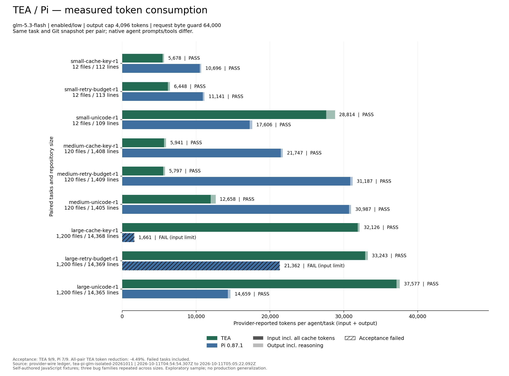
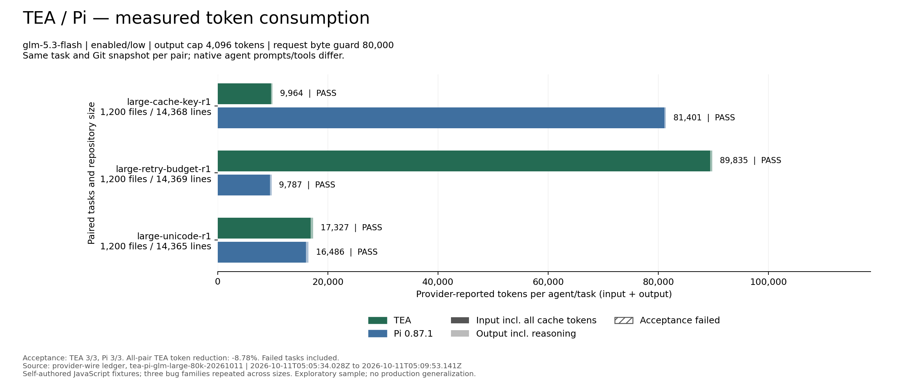

# TEA

<p align="center">
  
</p>

[English](README.md) | **简体中文**

**TEA Coding Agent**

> 一切为了在保证性能的前提下节省 Token。

我们的目标是在保持任务正确率、代码质量和执行性能的前提下减少 Token 消耗，并用可复现的实验衡量每项改进。

TEA 是基于 Node.js 构建的独立终端编程代理，拥有自己的运行循环、工作区工具、Anthropic Messages 适配器、Token 账本和基准测试命令。`baseline-v0` 保存初始项目快照；V1、V2 是经用户授权提交的离线实验检查点，V3 正在进行本地策略与请求边界实验。目前 V1–V5 均未通过真实模型基准测试门禁。

## 环境要求

- Node.js 20 或更高版本。
- Git：用于源码版本管理和后续版本配对实验。
- 运行真实模型任务时，还需支持 Anthropic Messages 的服务商、通过进程环境提供的 API 密钥、所选 Token 分组的当前输入/输出单价，以及正数费用上限。

项目没有 npm 运行时依赖。

## 本地运行

```powershell
cd token-efficient-coding-agent
npm test
npm run tea -- --help
```

代理默认使用当前目录作为工作区，也可通过 `--workspace` 指定。它能够列出文件、搜索和读取文本源码、应用唯一匹配的精确文本补丁，以及执行允许的验证命令。修改文件后，必须成功运行测试，运行状态才能变为 `completed`。文件写入限制在指定工作区内。测试及只读白名单以外的 Shell 命令需要交互批准，破坏性命令会被阻止。

默认上下文策略为 `v1`：初始最多提供 8 个按任务相关性排序的文件路径，优先保留适用的 `AGENTS.md`、根目录 README 和项目包清单。当任务描述与路径的词面重合较弱时，使用少量领域同义词扩展查询。文件枚举和搜索支持按目录继续定位，以及按需探索默认排除的普通目录。未知源码后缀通过文本内容检查识别。搜索失败后，模型找到并读取实际对应名称，才可保存本次内存会话的查询映射；运行时校验名称出现和源码证据，语义对应由模型判断。通过 `--context-strategy baseline` 可对照原始的 160 路径清单，通过 `--initial-file-limit N` 可调整候选数量，范围为 1–250。这些策略仍属于实验性启发规则，合成回放不能证明真实模型任务的正确率。

V2 提供可选策略 `--history-strategy compact-tools`，配合 `--history-keep-recent 2` 使用，保留轮数可设为 2–24。该策略将较旧的长发现结果和成功日志替换为带哈希的恢复记录，同时保留源码证据、失败信息、补丁回执、近期结果，以及模型原始思考块和签名。完整原始历史始终保留。是否压缩会计入最终请求的额外说明开销；没有收益的请求使用原始输入。默认仍为 `full`，等待真实模型质量验证。

## 交互式终端

启动持续对话：

```powershell
npm run tea -- --interactive --workspace ../my-project --max-cost-usd 0.10
```

通过 `npm link` 将本地 CLI 链接后，无参数运行 `tea` 会打开相同界面。带引号的任务保持原有单次执行方式；`--interactive "任务"` 可执行初始任务后继续对话。

无需凭据和 API 调用的演示：

```powershell
npm run tea -- --demo
```

界面展示 TEA 标识、按行流式回答、工具进度、局部补丁预览，以及会话 Token 和预算。`/tools` 列出工具记录，`/tools N` 展开结果，`/diff` 预览 Git 差异，`/status` 查看用量，`/help` 查看命令。输入行末添加反斜杠可继续编写多行任务。

**Esc / Ctrl+C** 可中断当前任务，已完成修改会保留，未完成验证仍需继续。`/new` 清空对话和学习词表，保留已消耗预算和待验证修改；`/clear` 仅清屏。费用和累计输入上限覆盖整个终端会话；`/exit` 退出。

演示使用脚本化回答和本地只读工具，不解决真实编程任务，也不产生模型用量测量。默认会话保存在内存中；使用 `--session` 或 ContextOS 可启用本地持久化和恢复。详见[终端指南（英文）](docs/TERMINAL.md)。

## Agent 记忆管理：ContextOS

主动开启 `--memory-policy contextos` 后，完整历史写入本地加密日志，发送给模型的旧工具输出可变为可恢复引用。保留用户要求、近期和当前源码、失败信息及待验证修改；源码变化后旧证据失效。模型需要细节时可通过工具按引用或关键词恢复。默认仍使用完整历史模式。

```sh
npm run tea -- --interactive --session work --memory-policy contextos --max-cost-usd 1.00
npm run tea -- --interactive --resume work --memory-policy contextos --max-cost-usd 1.00
npm run tea -- sessions inspect work
npm run tea -- sessions delete work
npm run tea -- benchmark contextos --mode preflight --run-id contextos-check
```

恢复保留累计费用，不能提高原预算；`/new` 保留费用和待验证修改。`/memory` 查看上次上下文选择的原因；`--memory-policy full-history` 可关闭选择并保留持久化。目标大小使用 UTF-8 字节，不是服务商 Token。真实收益正在按冻结门槛验证。详见[中文指南](docs/CONTEXTOS.zh-CN.md)、[架构](docs/CONTEXTOS_ARCHITECTURE.md)和[实验协议](docs/CONTEXTOS_BENCHMARK.md)。

## 会话压缩

交互终端中使用 `/compact [保留重点]`，可把旧对话整理成摘要。通过 `tea --interactive --compaction auto --max-cost-usd 0.10` 开启自动压缩。后续请求使用结构化摘要和近期完整消息，原始对话保留在内存中；待验证修改由运行时独立保存。

摘要请求计入会话 Token 和费用上限。自动压缩需主动开启，默认账本保存哈希而非摘要原文。GLM-5.3-flash 配对实验使用自编 JavaScript 样本和 35% 实验阈值，固定历史压力配置净节省 **72.33%**，模型生成历史的检查/修复多轮任务净节省 **63.14%**，均包含全部摘要开销；复测 16/16 通过验收。这是小样本实验结果，不是默认 80% 阈值的收益。详见[报告和图表](benchmarks/reports/compaction-glm-20261011/README.zh-CN.md)及[设计与配置](docs/COMPACTION.zh-CN.md)。


## 配置真实模型调用

在启动进程中配置凭据和价格。不要将真实 API 密钥保存到仓库、`.env`、基准测试文件或 Shell 历史中。下列密钥和价格均为占位符。

```powershell
$env:ANTHROPIC_API_KEY = '你的API密钥'
$env:ANTHROPIC_BASE_URL = 'https://cf.api.fan'
$env:ANTHROPIC_MODEL = 'glm-5.3-flash'
$env:TEA_INPUT_PRICE_USD_PER_MTOK = '你的Token分组输入单价'
$env:TEA_OUTPUT_PRICE_USD_PER_MTOK = '你的Token分组输出单价'
$env:TEA_MAX_COST_USD = '0.10'
$env:TEA_MAX_REQUEST_INPUT_TOKENS = '12000'
$env:TEA_MAX_OUTPUT_TOKENS = '1200'
$env:TEA_REASONING_EFFORT = 'low' # 可选 low、high、max
$env:TEA_THINKING_MODE = 'adaptive'
tea "修复会话过期错误" --max-cost-usd 0.10
```

项目不会猜测服务商价格。每次请求前，TEA 按配置的输入/输出上限和单价预留最坏情况下的费用。输入总量包含普通输入、缓存读取和缓存写入。缓存读取按完整输入单价计算；缓存写入默认按输入单价的两倍保守预留，依据是 [Anthropic 缓存价格说明](https://platform.claude.com/docs/en/build-with-claude/prompt-caching)，并非 PackyAPI 实测账单。

传输失败的请求会保留费用预留。用量缺失、无效或流式响应中断时，整次运行的完整实际 Token 总量为 `null`；已报告的有效计数作为下界保留。真实模型测试套件共用费用和输入预算，出现失败或未知用量后停止后续调用。

目前 Anthropic Messages 适配器按照提供的兼容性提示，请求自适应思考模式和 `output_config.effort`。Z.AI 的 GLM-5.3-Flash 文档列出的推理档位为 `low`、`high`、`max`，不支持关闭思考。所选 Token 分组是否开放该模型的 Anthropic Messages 协议，需要在 PackyAPI 模型广场核对。PackyAPI 已公开的 Anthropic 示例使用 `https://cf.api.fan` 和 `/v1/messages`；用户提供的 `https://www.packyapi.ai` 是产品网站地址，尚未验证为 API 端点。

参考资料：[GLM-5.3-Flash 指南](https://docs.z.ai/guides/vlm/glm-5.3-flash)、[GLM Chat Completion 参数](https://docs.z.ai/api-reference/llm/chat-completion)、[PackyAPI Anthropic Messages 配置示例](https://docs.packyapi.com/docs/cli/7-kimi-code.html)。项目约定见[决策记录](docs/DECISIONS.md)和[基准测试规范](docs/BENCHMARK_SPEC.md)。

## 基准测试与实验

```powershell
npm run benchmark:replay
tea benchmark run --suite core --mode replay
tea benchmark run --suite core --mode replay --strategy v1 --initial-file-limit 8
tea benchmark report --run replay-YYYY-MM-DDTHH-MM-SS.sssZ
tea benchmark compare --base-run RUN_A --candidate-run RUN_B
npm run benchmark:runtime
tea benchmark run --suite runtime-smoke --mode runtime --strategy baseline
tea benchmark run --suite runtime-smoke --mode live --max-cost-usd 0.10
tea benchmark run --suite runtime-smoke --mode runtime --history-strategy compact-tools --fixture-variant extended
tea benchmark memory --history-keep-recent 2
node scripts/policy-experiment.mjs --run-id v3-policy-NEW
node scripts/request-budget-experiment.mjs v3-request-budget-NEW
```

运行 ID 必须唯一；示例中的 `NEW` 应替换为本次实验的新标识。

### Replay：离线回放

使用 23 条自编轨迹筛查输入体积。此前候选的启发式 Token 估算为 13,431 → 2,106，下降 84.32%。这只是诊断估算，不是服务商实际用量，也不是正确率证据。

### Runtime：可执行测试样本

`runtime` 模式执行 12 个自编 JavaScript 小仓库，包含可复现的初始 Git 提交、脚本化工具选择、真实补丁、公开测试和独立验收测试。此前一轮实验中，两种上下文策略均通过 12/12 验收，工具输出字符数从 15,551 降至 11,911，下降 23.41%。这验证的是给定补丁下的运行时行为，不能解释为模型任务成功率。

这里的 `baseline` 使用当前引擎配合原始文件清单和读取设置，并非执行历史 Git 版本。`live` 模式只有在明确配置凭据、当前价格和总预算后，才会通过服务商运行相同的冒烟样本；目前尚未运行。正式的 40–60 项核心任务、100 项以上留出任务，以及 Git 版本间的配对调度尚未完成。

这些样本没有操作系统隔离，测试和答案位于项目清单中，不能视为保密的生产验收。当前所有实验均不具备正式优化门禁资格。详见 [V1 运行时实验](benchmarks/reports/v1-runtime.md)。

### V2：选择性工具历史

在人工构造的重复长日志轨迹上，集成历史消融实验的累计适配器输入字节减少 **20.90%**，两侧脚本化验收均为 **12/12**。普通轨迹的收益为 **0%**，未触发压缩。

另有 7 条辅助记忆轨迹，在不同的固定系统提示下测得输入体积减少 **54.02%**。这些是口径不同的离线体积测量，不能替代实际服务商 Token 或模型成功率结果。详见 [V2 实验报告](benchmarks/reports/v2.md)。

### V3：双向路由与预算边界

策略仿真覆盖 13 条预设状态轨迹和 4 种路由对照；另一个真实适配器到本地 HTTP 服务的实验检查 9 项请求预算约束。候选代码尚未提交，路由尚未接入真实模型运行。目前没有测得 V3 的真实 Token 或模型质量提升。详见 [V3 实验报告](benchmarks/reports/v3.md)。

### TEA / Pi 对比

已于 **2026-10-11** 使用 **GLM-5.3-flash、enabled/low 思考、4,096 Token 输出上限**完成真实测试，Pi 为 **0.87.1**。同一组使用相同 Git 快照，共同网关记录服务商输入、输出及缓存 Token。

- **64,000 字节请求上限，9 组任务**：TEA **168,282** Token，Pi **161,046**；TEA **多消耗 4.49%**。验收 TEA **9/9**、Pi **7/9**，Pi 两组触发输入上限。失败运行仍计入总量，因此这不是相同完成率下的节省比例。
- **80,000 字节上限，单独重跑全部 3 组大型任务**：TEA **117,126** Token，Pi **107,674**；TEA **多消耗 8.78%**，双方验收均为 **3/3**。

当前结果**不能证明稳定节省 Token**。每种配置只跑一轮；这些是 12/120/1,200 文件的自编 JavaScript 样本，大仓库主要增加无关模块。两种配置分开报告，受祖先目录指令变化影响的早期试跑已排除。详见 [真实实验报告](benchmarks/reports/tea-vs-pi-glm-20261011/README.zh-CN.md)和 [对比说明](docs/PI_COMPARISON.zh-CN.md)。





## 日志与验证

每次服务商请求的用量写入 `.tea/runs/<run-id>/`。默认账本只保存哈希和计数，不保留提示词或源码。只有确认内容适合保存在本地时，才启用 `TEA_STORE_RAW=1`。基准测试工作区会保留样本代码，并由 Git 忽略。逐任务检查点会在验收前保存费用和失败信息。

长命令输出保留开头、结尾和完整输出流的哈希；成功命令使用更小的返回上限。输出量不再导致测试进程提前终止，超时限制仍然生效。`npm test` 明确选择项目测试文件，避免扫描归档的基准测试工作区。

## 当前完成状态

- **已实现**：独立 CLI 和运行循环、文件工具、有界命令输出、验证命令分类、UTF-8 流式处理和用量计量、费用预检、离线回放和可执行冒烟测试框架、初始上下文排序、重复读取证据引用、可选工具历史压缩、手动/自动会话摘要，以及集成测试。
- **已测量**：上述 TEA/Pi 和会话摘要 off/auto 自编样本的真实服务商 Token 和任务验收结果，包含失败与负收益。
- **尚未测量**：直接父版本配对的真实优化基线、多语言真实项目与保密留出集的成功率，以及 V1–V5 的正式门禁结果。
- **尚未实现**：多语言固定版本的 40–60 项核心任务与 100 项以上留出任务、隔离的保密验收、跨 Git 版本的配对 A/B，以及基于真实模型证据的发布报告。

确切的 Git 状态和后续步骤见[项目进度](PROGRESS.md)。

逐项方法、实验收益和适用范围见 [Token 优化与改进点记录](docs/TOKEN_OPTIMIZATIONS.md)。

## 参与贡献

所有代码、文档和实验报告改动都通过 PR 提交到 `main`。开发步骤、验证命令和实验要求见 [贡献指南](CONTRIBUTING.zh-CN.md)。

## 开源协议

[MIT](LICENSE) — Copyright (c) 2026 Wh0rigin。
