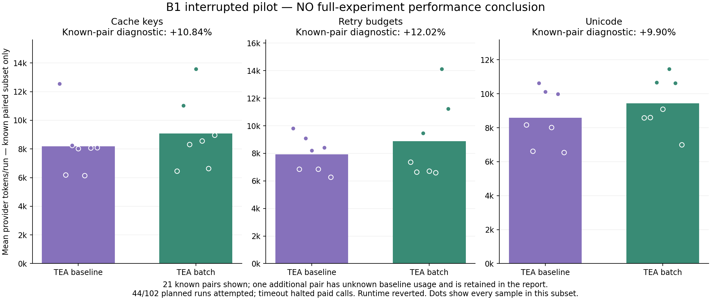

# B1: Pi-inspired batch patches — interrupted pilot

[中文](README.zh-CN.md)

**The planned comparison is incomplete. No full-experiment token percentage or release benefit is established. Runtime changes were reverted; candidate code remains in Git history.**

## Implementation

Candidate `5bc1d477a5bc6fc2b7da1a5c6a14c4a63c0d6809` against direct parent `ffd07a1a0c6e57047486661e2936f02660011a11`. Only `src/tools.mjs` changes at runtime: retain single search/replace and accept 1–64 independent edits in one file; match against the original file, reject missing/ambiguous/overlapping matches before writing, assemble then write once. This does not promise crash-atomic filesystem writes. Keep path/credential/command policy, source freshness and actual post-edit validation. Borrow Pi 0.87.1's interface idea and narrow/batched-edit guidance; no Pi code is copied. No diff or extra summarization call is added. S1b directory cap remains reverted. This is TEA A/B, not a new Pi comparison.

## What happened

- Planned 102 runs / 51 pairs: small 60, medium/large 36, long 6. Attempted **44 small runs / 22 pairs**; remaining cohorts never started.
- Baseline `small-cache-key-r8` first request aborted at **90,016 ms**, without terminal provider usage. No tools executed in that run. The fixed guard halted subsequent paid calls; **zero retries**.
- **218 submitted requests**: 217 have complete usage, one remains unknown. Unknown total tokens stay null; zero lower-bound counters are not zero billing.
- Candidate acceptance **22/22**; baseline **21/22**, with the interrupted run unaccepted. This is not evidence of improved correctness.
- **21 completely accounted pairs, diagnostic subset only:** baseline 172,951 → candidate 191,790 tokens, **candidate +10.89%**. Requests 104 → 107. This subset is not substituted for the incomplete planned experiment. The additional candidate run has known usage and remains in all-attempt evidence alongside its unknown baseline partner.
- Candidate 25 patch calls: 2 use edits, both with a single replacement; **zero multi-replacement batches**. No observed live batch-consolidation benefit on these small defects.
- Holding recorded history fixed, the expanded patch declaration adds **393 serialized bytes to every request**. This is byte overhead, not a measured token contribution or proof that it explains the entire diagnostic increase. Different live execution paths also contribute.

## Verification, rollback and accounting

Candidate full suite **278/278**, no skips; native streaming contract **18/18**, 72 scripted requests, zero paid calls. The contract's test-only predecessor has identical runtime source. Candidate [six CI checks](https://github.com/Wh0rigin/tea/actions/runs/38268515185) passed on Windows/Ubuntu × Node 20/22/24. Added original-snapshot matching, failure without partial writes, overlap, duplicate, invalid/mixed inputs, paths, CRLF, evidence freshness and actual post-batch validation coverage.

Scripted three-edit loop: prescribed actions reduce six requests/six tools to four requests/four tools, normalized serialized request bytes 29,038 → 19,908, identical final source and actual tests pass. First request grows 3,662 → 4,055 bytes. These are mechanism checks, not real provider token savings.

All **44 closed journals and 218 payloads** audited read-only: exact native/gateway SHA-256 and byte matches, original journals unchanged. Known conservative usage USD 0.3255168; unresolved request reservation USD 0.2674688; committed plus reserved USD 0.5929856 / USD 8 guard. Reservation is retained and is not an actual bill or refunded amount. Rates: input/cache-read 0.80, output 2.80 USD per million. Same GLM-5.3-flash, enabled/low thinking, output 4096, ContextOS 32k bytes, v1 inventory, summaries off, capability feedback on, 24 tools/turn, 100 requests/run, 90s request/180s turn, 160k-byte input guard.

Reverts `9f3e3af`, `4b98a1f` restore runtime bytes to the direct parent. Restored local suite **268/268**, no skips. Final documentation-head CI is recorded separately in summary. No next optimization or paid replacement experiment was started. A first zero-paid preflight omitted capability feedback; retained and corrected before paid calls. A complete-only audit initially could not handle the zero-tool interrupted run; the read-only audit was adapted to preserve its missing validation and unknown usage, without changing frozen acceptance.

Three self-authored one-defect families and irrelevant-file scale expansion do not establish generalization. These tasks may require one replacement, exposing declaration cost without exercising batching. A later experiment would need genuine multi-location tasks and a smaller declaration, under a new frozen plan; this report does not claim those changes are implemented or beneficial.

[Summary](summary.json) · [Every attempted run/request](results.json) · [Frozen protocol](frozen-protocol.md) · [Frozen configuration](frozen-config.json) · [Source/rollback audit](source-audit.json) · [Journal audit](journal-audit.json) · [Native payload audit](small-projection-audit.json) · [Scripted batch loop](batch-loop-diagnostic.json) · [Hashes](evidence.sha256)
