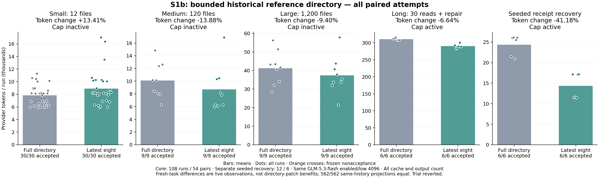
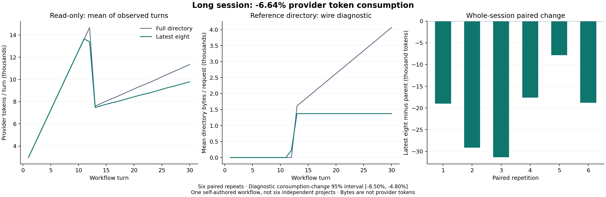

# S1b：限制历史引用目录

[English](README.md)

## 结果与保留决定

**原有 108 次运行 / 54 组配对：2,561,901 → 2,422,093 实际 Provider Token，消耗变化 -5.46%。** 单列的旧记录恢复实验：146,262 → 86,029（-41.18%）。全部 120 次 / 60 组汇总：2,708,163 → 2,508,122（-7.39%）。有预置历史的诊断不能冒充空会话任务。

候选未通过，运行时已回退到基线，保留实验记录，未合并 main。 本轮只执行原计划的方案 5；完成后停下等待审核，没有开始助手回复压缩、工具合并或 S2–S5。

- **long-session**：1,864,219 → 1,740,351，消耗 **-6.64%**；完整验收 6/6 → 6/6。
- **small**：235,379 → 266,955，消耗 **+13.41%**；完整验收 30/30 → 30/30。
- **large**：371,386 → 336,488，消耗 **-9.40%**；完整验收 9/9 → 9/9。
- **medium**：90,917 → 78,299，消耗 **-13.88%**；完整验收 9/9 → 9/9。
- **recovery-control**：146,262 → 86,029，消耗 **-41.18%**；完整验收 6/6 → 6/6。

全部运行计入总量，23/60 组候选消耗更高。双方各 60/60 完整验收通过，未发现逐组质量下降。

## 做了什么

运行时只修改 `src/context-assembler.mjs`。当旧的无签名工具轮次引用超过八条时，目录只显示最近八条完整记录，并明确告诉模型通过 `search_history` 找其他记录，再通过 `recall_context` 恢复原文。完整原始消息与全量索引保留，现有活跃/已修改源码保护保留，不加入领域词表、语义任务分类、嵌入服务或额外摘要模型。

八条是记录数量上限，不是任意超长文件路径的字节上限。源码版本检查、引用 ID、用户原文、签名思考、失败日志、权限、完整能力说明及验证规则均保持。诊断记录目录总数、显示数和隐藏数。

冻结双版本的同输入请求检查中，10 种情形里的八种不受影响情形原生请求完全相同。九条合成记录时搜索说明使请求多 **15 字节**，40 条时少 **3,146 字节**，二者都保留。它们是字节诊断，不是 Token 收益，也说明阈值附近不能保证单次字节减少。

## 长会话分解

只读阶段：1,657,900 → 1,560,988，消耗变化 -5.85%；修复阶段：206,319 → 179,363，变化 -13.07%。所有历史查找、恢复和修复调用均计入。整场消耗变化的配对重复 bootstrap 95% 诊断区间为 **[-8.50%, -4.80%]**，10,000 次抽样、种子 20261012。六次重复属于同一个流程，不是六个独立项目。

`long-diagnosis.json` 用冻结版本与当时记录的源码有效性决定重建每条原生请求，避免拿最终修改后的文件倒推历史。字节组成用于解释请求流量，不能精确分摊某项变化贡献了多少 Token。模型回复和调用组合会变化；未受影响情形中的规模差异也不能自动归因于这项改动。

## 小任务负对照

双方均 30/30 通过，但候选实际 Token **增加 13.41%**（235,379 → 266,955），P95 耗时 **增加 13.36%**。请求 142 → 157，工具 151 → 163。全部 **299/299 原生请求哈希**重建一致；固定各自已经记录的历史、回复、缓存与有效性判断，两套冻结组装器生成的 **299/299 请求完全相同**，没有显示或隐藏目录。故这组数据不能证明目录改动直接造成 Token 退步；实际模型轨迹、运行时点与工作区名称仍有差异。但按事先规定的观测门槛，该组仍未通过，不补跑有利样本，也不事后更改阈值。

中型和大型同样没有隐藏引用（最多只显示三条）。补齐当时动态词表工具的可用状态后，**263/263 请求**重建一致、**263/263 双版本同历史投影**一致。因此，观测到的 13.88% / 9.40% 降幅也不归因于目录补丁。只读对照回放最初遗漏了未解决查询状态，发布前已修正；没有额外模型调用或付费成绩变更。

## 旧记录恢复专项

六组配对 / 12 次运行，复用旧历史收据夹具。双方使用同一份冻结脚本历史，来自真实执行成功的旧命令和源码读取。禁止重读或重跑旧测试；额外要求检索成功输出实际观察到的收据。全部付费查询、恢复、修复和验证均计入，历史构建不计费，也不称为模型生成。

旧版/候选恢复调用数：11 / 9。额外只读核查确认 12/12 检索来自原始 observed 工具记录，而非仅数字吻合；没有发现重读或重跑旧观察的信号。单个夹具不证明任意长历史的语义检索或多语言真实项目泛化；中文、过期和恢复另有专项离线覆盖。

## 质量与预先固定的门槛

逐组退步：

- None / 无。

门槛：

- `stableKnownComplete`：通过
- `longSavings`：通过
- `longReadOnlySavings`：通过
- `longBootstrapLowerBoundAboveZero`：通过
- `otherScaleAndRecoveryTokenNonregression`：未通过
- `quality`：通过
- `scope`：通过
- `historicalObservationAndRecovery`：通过
- `latency`：未通过
- `commonControlsMatched`：通过

没有事后修改验收、阈值或替换不利样本。各组 P95 耗时变化与质量维度保存在 `summary.json`，全部运行成绩与用量保存在 `results.json`。

## 配置、核查与复现

- Parent: `d40056a66212c6e901f09254f5949bd78dc31694`
- Candidate: `a7ac3b3e2b26f9718b971c1b8e07e1c87b4fba2c`
- Same GLM-5.3-flash, thinking enabled / low effort / output 4096; Anthropic Messages streaming; S1 full capability feedback enabled; ContextOS 32,000-byte target; v1 inventory; semantic summaries off; approval unavailable.
- 100 requests/run, 24 tools/turn, request 90 s / turn 180 s; request guard 160,000 bytes; per-run USD 1.4, shared USD 8.
- Conservative user-supplied USD 0.80 input / 2.80 output per million, counting cache at full input price for guards. Accounted USD 4.2824660; not an invoice.

- 专项 39 项、实现全套 275/275，无跳过；最终交付全套 268/268。候选阶段新增七项（回退后移除，冻结提交中保留），覆盖隐藏引用检索与原文恢复、源码过期/中文路径、日志恢复、签名协议和未触发请求一致性。
- 双冻结版本核心客户端合约 18/18、72 次脚本请求；旧记录恢复合约 6/6、36 次脚本请求，目录 34 → 八条。脚本用量不作为真实 Token 收益。[实现 CI](https://github.com/Wh0rigin/tea/actions/runs/38244641744) 六项跨平台检查通过。
- 只读核查 120 份已结束加密会话，1419 个原生/网关请求哈希一致，日志原字节未改，没有新付费请求。所有非目标运行时文件与 package 和父版相同。
- 最初的零付费恢复合约误以为预置历史会话有首次 Workspace 头；在冻结付费计划前修正，失败脚本证据保留。没有付费替换或重试。
- 公开的是脱敏聚合与哈希，没有凭据、原始对话、思考/签名、原始命令或私有绝对路径。`evidence.sha256` 可核查报告与绘图脚本。
- `frozen-protocol.md`、`frozen-config.json` 固定规则与配置。原核心脚本不变，恢复脚本与合约位于候选 Git 提交；付费恢复种子来自准备阶段，双方相同，只公布哈希。`scripts/plot-bounded-directory-s1b.py` 从公开数据重新绘图。

原始运行 ID：

- `bounded-directory-s1b-long-glm-20261012-1791805441427116200`
- `bounded-directory-s1b-small-glm-20261012-1791805441427116200`
- `bounded-directory-s1b-scale-glm-20261012-1791805441427116200`
- `bounded-directory-s1b-recovery-glm-20261012-1791805441427116200`

局限：收益依赖足够多的旧无签名工具轮次；带签名轮次保持完整，不会从这项目录策略获得缩减。没有其他模型的实测。自编 JavaScript 三种缺陷家族、无关文件数量压力、单个长流程与单个预置旧记录夹具；不是未见真实项目 Agent 实测，没有新 Pi 对比、默认完整历史收益、账单收益或普遍提升结论。
