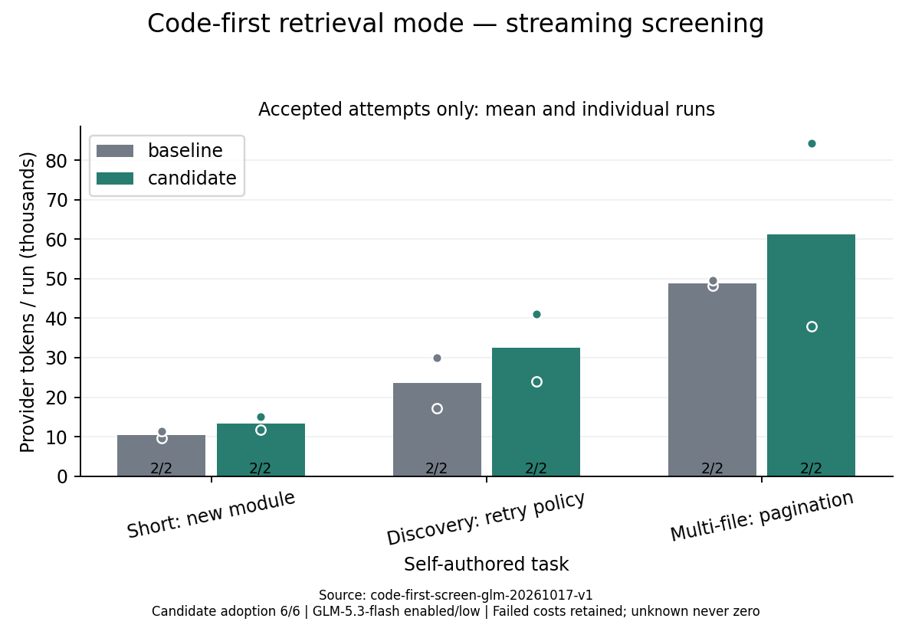

# 强制代码优先检索：真实流式筛选

三题 × 两轮 × 两边，计划 12 次；完成 12 次，覆盖及用量完整：True。

本轮基线 85124ff；候选及入口指纹见 summary.json。相同任务、模型、思考等级、流式与验收；候选替换检索入口、模式说明与能力声明，命令限于验证。比较整个模式，不只解释器。

全尝试已知 Token：165,794 → 214,244。完整组变化 **+29.22%**。

完整验收 6/6 → 6/6；代码行为 6 → 6。

模型请求数 49 → 63。候选采用 6/6；编排 34 次，错误 13 次，子操作 39 次，成功 38 次。

候选多子操作程序 8 次，其中完整成功 6 次；路由拒绝 0 次。

同题首次输入候选减基线：+28.00 provider Token（配对均值）。

质量门槛 True，完整覆盖、质量不下降且总量减少的筛选门槛 **False**。

以上为预先声明的数值门槛。代码优先还需要实际成功编排的机制证据；空目录创建任务允许不检索。若实际采用率为零，即使数值门槛通过，也没有编排减少往返的真实证据，不能据此默认开启或宣称 Code Agent 收益。

## 逐题结果

- Short: new module：验收 2/2 → 2/2；已知 Token 20,920 → 26,831；候选采用 2 次任务。
- Discovery: retry policy：验收 2/2 → 2/2；已知 Token 47,195 → 65,055；候选采用 2 次任务。
- Multi-file: pagination：验收 2/2 → 2/2；已知 Token 97,679 → 122,358；候选采用 2 次任务。

## 轮次和限制

- 第 1 轮：完成 3 / 3；已知 Token 74,826 → 120,189。
- 第 2 轮：完成 3 / 3；已知 Token 90,968 → 94,055。

缓存输入和输出中的思考均包含且不重复累加；失败成本保留在总量，成功柱排除失败，未知不画成零。工具尝试包含子操作；外层调用与子操作分别报告。

只有三道先前已使用的自编 Node 任务、每题两次，不是保密留出或生产泛化证明。首次输入差和生成路径波动不等于全部涨跌的因果份额。重试题是检索密集对照，短任务用于观察固定开销。

每次 1 USD 预留、组上限 4 USD；请求 90 秒、命令 120 秒、任务 600 秒、工具上限 24（包括子操作）。用量未知保留预留并停止，不自动重试；预算价格非发票。源码、入口和任务指纹核对，真实用量及编排计数从 ledger 审计，编辑和验证计数由加密事件独立核对。

筛选结束等待审核，不自动部署、合并或开始下一阶段。运行时是否撤销及失败原因另见实验协议的实际结果节。

[逐次数据](summary.json) · [设计、协议及实际决定](../../../docs/CODE_FIRST_EXPERIMENT.zh-CN.md)
