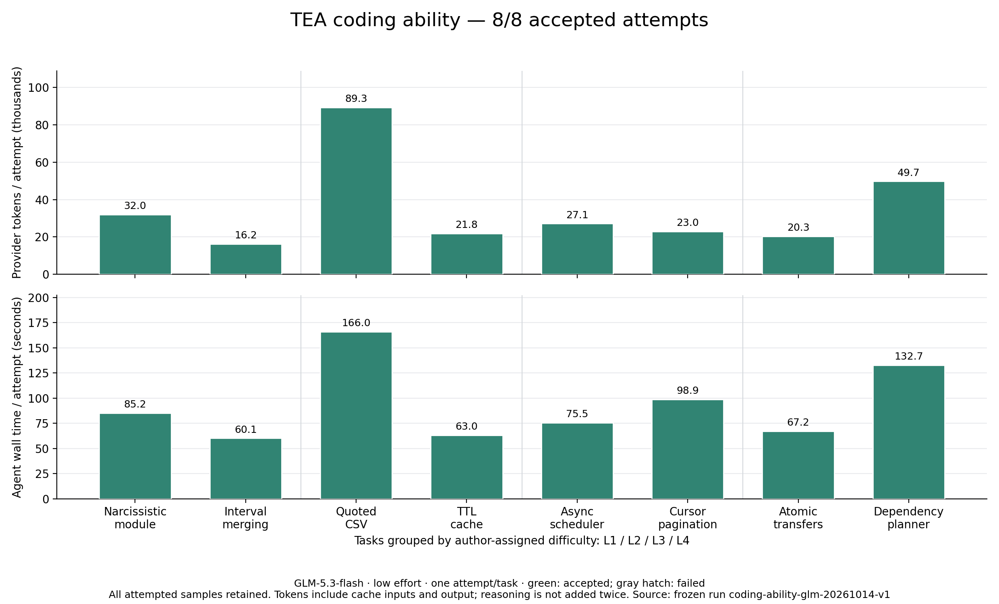

# TEA 编码能力分级测试

运行：`coding-ability-glm-20261014-v1`。模型：GLM-5.3-flash，enabled thinking / low，每题一次。

共计划 8 题，实际运行 8 题；完整验收通过 **8/8**，功能验收通过 **8/8**。

实际累计 Token：**279,529**（含缓存输入及输出，思考输出不重复相加）。

## 每题结果

### L1 · 新建水仙花数模块

- 完整验收：**通过**；执行状态：`completed`。
- Token：32,037；耗时：85.2 秒；工具调用：11；失败工具调用：2。
- 功能验收：True；原有测试：True；独立边界测试：True；保护文件保持：True。
- 新增回归测试文件：1；实际验证次数：3。

### L1 · 区间合并与输入保护

- 完整验收：**通过**；执行状态：`completed`。
- Token：16,248；耗时：60.1 秒；工具调用：8；失败工具调用：1。
- 功能验收：True；原有测试：True；独立边界测试：True；保护文件保持：True。
- 新增回归测试文件：1；实际验证次数：2。

### L2 · 带引号的 CSV 状态机

- 完整验收：**通过**；执行状态：`completed`。
- Token：89,318；耗时：166.0 秒；工具调用：18；失败工具调用：5。
- 功能验收：True；原有测试：True；独立边界测试：True；保护文件保持：True。
- 新增回归测试文件：1；实际验证次数：5。

### L2 · TTL 缓存跨文件修复

- 完整验收：**通过**；执行状态：`completed`。
- Token：21,825；耗时：63.0 秒；工具调用：10；失败工具调用：1。
- 功能验收：True；原有测试：True；独立边界测试：True；保护文件保持：True。
- 新增回归测试文件：1；实际验证次数：2。

### L3 · 异步并发调度器

- 完整验收：**通过**；执行状态：`completed`。
- Token：27,091；耗时：75.5 秒；工具调用：12；失败工具调用：3。
- 功能验收：True；原有测试：True；独立边界测试：True；保护文件保持：True。
- 新增回归测试文件：1；实际验证次数：2。

### L3 · 多层 API 游标分页

- 完整验收：**通过**；执行状态：`completed`。
- Token：22,959；耗时：98.9 秒；工具调用：9；失败工具调用：1。
- 功能验收：True；原有测试：True；独立边界测试：True；保护文件保持：True。
- 新增回归测试文件：1；实际验证次数：1。

### L4 · 事务与幂等转账

- 完整验收：**通过**；执行状态：`completed`。
- Token：20,313；耗时：67.2 秒；工具调用：10；失败工具调用：1。
- 功能验收：True；原有测试：True；独立边界测试：True；保护文件保持：True。
- 新增回归测试文件：1；实际验证次数：1。

### L4 · 依赖图与增量重建

- 完整验收：**通过**；执行状态：`completed`。
- Token：49,738；耗时：132.7 秒；工具调用：15；失败工具调用：2。
- 功能验收：True；原有测试：True；独立边界测试：True；保护文件保持：True。
- 新增回归测试文件：1；实际验证次数：2。

## 本轮发现

- **编码结果**：四个难度档均为 2/2 通过；8 题均新增了可执行回归测试，原有测试与保护文件保持不变。71 次真实模型请求的用量全部完整。
- **工具选择**：7 道修改已有文件的题目都出现一次 `write_file` 覆盖尝试，被保护规则拒绝后才改用补丁。共 7 次可避免的创建工具失败，值得优化工具描述与选择策略。
- **验证效率**：共记录 8 次测试失败和 1 次额外 Shell 失败；模型均在同一任务内继续修复。水仙花数题曾遗漏测试预期中的 54748，说明模型生成的测试本身也需要核验。
- **消耗分布**：CSV 题占全轮 Token 的 31.95%，发生 4 次测试失败；最终通过不代表修复效率已经足够好。事务题仅用 20,313 Token，题目难度与 Token 用量没有单调关系。
- **压缩范围**：本轮摘要压缩请求为 0；这里的结果不能作为自动压缩收益证据。

## 验收说明与局限

先验证初始版本能通过公开测试且不能通过新增验收，再验证参考实现两者均通过。真实模型只看到任务工作区和题意；完整验收还要求保护文件不变、新增测试通过、任务完成且修改后运行过实际验证。功能通过与工作流通过分开记录。

这是 8 道自编 Node.js 题的首轮诊断，难度等级由作者指定，每题仅一次，不能外推通用正确率或与以前的 Pi/Claude 不同任务数据直接比较。独立验收位于同一主机，不具有 OS 沙箱隔离。失败和未知样本均保留，无静默重试。

费用核算值：0.259721 USD，采用此前记录的服务商价格作为保护配置，未核验账户账单。每题保护 1 USD，全轮 6 USD。

Agent 源码提交：`451551fb9a04f61cea00bca701947fc9ef501ba4`；源码在运行期间未变：`True`。冻结题目、工具参数与源代码指纹见 [summary.json](summary.json)；原始本地输出保留在 Git 忽略的 results 目录。

复现方法见 [编码能力评测说明](../../../docs/CODING_ABILITY.md)。
