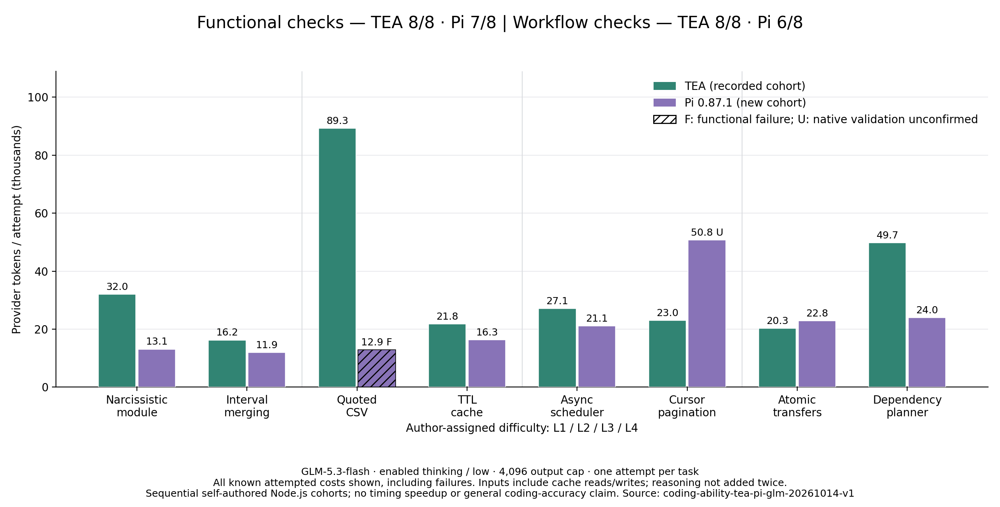

# TEA / Pi 编码能力横向对比

模型：GLM-5.3-flash / enabled thinking / low；输出上限 4,096 Token。相同 8 道自编 Node.js 题，每题一次。复用先前 TEA 数据，新增 Pi 原生运行。

完整验收：**TEA 8/8，Pi 6/8**。Pi 功能验收 7/8；功能正确与工作流验证分开计数。

全尝试累计 Token：TEA **279,529**；Pi **172,953**。TEA 相比 Pi 增加 **61.62%**。此总量包含失败样本的实际消耗，需结合验收率阅读。

双方功能均通过的 **7 道题**：TEA 190,211 Token；Pi 160,055 Token。TEA 增加 **18.84%**。

双方完整工作流均通过的 **6 道题**：TEA 167,252 Token；Pi 109,260 Token。TEA 增加 **53.08%**。

## 每题结果

- **L1 · 新建水仙花数模块**：TEA 32,037 Token（通过）；Pi 13,106 Token（通过）。
- **L1 · 区间合并与输入保护**：TEA 16,248 Token（通过）；Pi 11,915 Token（通过）。
- **L2 · 带引号的 CSV 状态机**：TEA 89,318 Token（通过）；Pi 12,898 Token（功能未通过/未运行）。
- **L2 · TTL 缓存跨文件修复**：TEA 21,825 Token（通过）；Pi 16,347 Token（通过）。
- **L3 · 异步并发调度器**：TEA 27,091 Token（通过）；Pi 21,057 Token（通过）。
- **L3 · 多层 API 游标分页**：TEA 22,959 Token（通过）；Pi 50,795 Token（功能通过，原生验证未确认）。
- **L4 · 事务与幂等转账**：TEA 20,313 Token（通过）；Pi 22,845 Token（通过）。
- **L4 · 依赖图与增量重建**：TEA 49,738 Token（通过）；Pi 23,990 Token（通过）。

## 本轮发现

- Pi 的 CSV 实现把 `""` 当作没有记录，返回 `[]`，题意要求返回 `[[""]]`。这是明确的功能失败；其消耗保留在图中，斜线和 F 表示功能未通过。
- Pi 分页实现通过了独立功能检查，但原生 Shell 事件中的命令与输出不能确认声明的 Node 测试在最后修改后执行完成。U 只表示验证未确认，不判为功能错误；完整工作流统计将其单列。
- TEA 71 次请求 / 93 次工具调用；Pi 55 次请求 / 58 次工具调用。TEA 多轮修复及已有文件误用创建工具是需要进一步验证的改进方向；本轮单次样本不能单独归因全部差异。
- 两边的摘要压缩请求均为 0；这轮不能用于宣称自动摘要收益，也不能与以前的长会话任务直接合并计算节省率。

## 方法与限制

独立验收与 TEA 首轮相同：原有公开测试、额外边界测试、保护文件、增加的测试、任务完成与修改后实际验证。功能失败样本保留消耗，图中用斜线和 F 标记；U 表示代码通过独立检查，但原生验证未确认，不直接当作编码错误。没有将失败计作零，也没有静默重试。

两组先后运行，每题仅一次，不能证明稳定优势或给出通用成功率。相同模型/思考/输出参数通过新 Pi 请求观察及旧 TEA 冻结配置匹配；旧 TEA 未记录服务端地址指纹，地址连续性依赖此前配置记录。保留原生工具和压缩策略，Pi 原生 PowerShell 与 TEA 批准策略不同。Pi 模型容量匹配相同保守配置，其摘要预留保持原生默认值。

费用是有限预算下的保守核算，非账户账单。原始会话和临时路径未发布；源码指纹、完整逐题数据、实际用量及限制见 [summary.json](summary.json)。复现方法见 [横向评测说明](../../../docs/CODING_PI_COMPARISON.md)。
