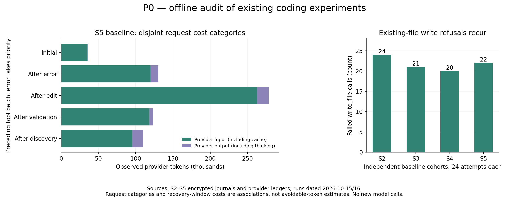

# P0：编码消耗归因与下一阶段决策

本次只审计历史记录，新增模型调用 **0**，不修改运行时。细分审计覆盖 S2–S5 的 **192/192** 次运行；S1 的 48 次缺少工作区定位文件，明确标为不可用，仅参考既有报告。

主分析使用 S5 基线 24 次，累计 678,865 provider Token；S5 候选及前几轮分别保留。不同轮次不合并计算优化百分比。完整读取证据及重复读取指标仅识别 read_file，批量读取不计入；因此前置读取计数是保守的单文件证据。



## 发现一：已有文件写入拒绝确实高频，但主要不是重复读取

- 基线 19/24 次任务出现此类错误，共 **22 次**；候选 18/24 次，共 19 次。
- 基线 **22/22** 次之前已有完整读取，且之后没有观察到该文件的成功编辑；候选为 19/19。这是历史证据，不证明执行瞬间磁盘版本仍相同。
- 基线只有 **1 次**在拒绝后、下一次成功编辑前再次读取同一路径；其余并未经历此前猜测的“失败后重读”链条。
- 基线 22 次最终都有同路径成功编辑。失败写入的 content 合计 29,186 UTF-8 字节；后续成功补丁 replace 与失败 content 逐字节完全相同的次数为 0，不能声称全部重复生成了完全相同的代码。
- 失败结果之后、下一次成功同路径编辑意图之前的请求合并去重，共 **20 次、63,425 Token**，约占整组 9.34%；其中输入 54,667、输出 8,758。

这个窗口包含必要的分析和补丁生成；并未包含最初失败代码生成或后续所有历史重发。窗口消耗既不是可节省 Token，也不是完整优化空间的上界。

跨轮基线的写入拒绝依次为 24 / 21 / 20 / 22 次（S2/S3/S4/S5，每轮各 24 次）。只用于确认问题反复出现。

## 发现二：重复全文读取的优先级应下降

S5 基线 103 次成功单文件读取中，同版本、同范围重复返回全文 **0 次**；返回已有证据引用 1 次。候选读取 98 次，重复全文 0 次。

全部 192 次审计共发现 2 次重复全文；只覆盖单文件 read_file，不把批量读取、重叠范围、修改后新版本读取算入。这里没有足够证据支持优先增加一层去重机制。

## 发现三：成功测试日志短，收益窗口也短

- S5 基线 32 次成功验证，输出合计 14,448 字节，平均 451.5 字节，最大 654 字节；超过 2 KiB 的有 0 次。
- 其中 27/32 次之后只有一个模型请求；有多个后续请求的为 5 次。
- 假设保留 512 字节预览，按完整规范历史及全部后续请求计算的原始输出累计字节缩减机会只有 1,340 字节；ContextOS 可能已投影掉部分内容。按 fullWireBytes=sentWireBytes、零淘汰且无压缩/恢复事件的严格条件核实，缩减量为 0 字节。

512 字节只是离线筛查阈值，没有实现截断。上述字节忽略 JSON 转义、引用开销、缓存与模型后续行为，不能换算 provider Token 或账单收益。暂缓短编码任务的成功日志压缩。

## 请求消耗分布

按请求之前的工具批次互斥分类：有错误优先标记 after-error，其次成功编辑、验证、定位；首请求单独列出。一个批次可包含多种操作，分类不代表模型内部思考阶段或错误的因果成本。

- initial：24 请求，36,340 Token（5.35%）。
- after-error：32 请求，130,565 Token（19.23%）。
- after-edit：70 请求，278,394 Token（41.01%）。
- after-validation：28 请求，123,438 Token（18.18%）。
- after-discovery：40 请求，110,128 Token（16.22%）。

after-edit 最大，包含写实现、新增测试、检查及继续修改等多种行为。不能把它全部视为无效操作，或据此减少必要验证。

## 决策：下一项仅试验版本校验的完整替换

S6 的目标调整为：让已读取旧版本、且模型已有完整新内容的编辑，有一条明确授权的替换路径，减少创建被拒后重新构造补丁的往返。保持现有创建语义；只有显式提交版本依据才能进入替换路径，不自动覆盖已有文件。

进入付费对比前必须完成：

1. 校验普通文本、空文件、中文及换行；文件外部修改、取消、版本缺失/错误、敏感路径与用户修改均有回归覆盖。
2. 明确版本指纹针对原始字节还是脱敏内容，避免把现有脱敏证据哈希当作无条件磁盘覆盖许可。
3. 说明检查到提交之间的并发窗口；普通“检查哈希再写入”不能宣称原子 CAS，临时文件改名也不能单独消除外部编辑竞争。无法满足既有变更保护要求时，停止该实现方向。
4. 固定同一编辑状态，对比创建失败→补丁与显式版本替换的执行轨迹；离线字节与构造请求只作机制控制。
5. 单列新增参数/说明的固定开销；不能重演 S2 的低使用率高开销，也不重做 S1 的提示增强。
6. 冻结协议后运行真实同条件配对；报告总体及逐题完整验收、独立代码行为、全部尝试 Token、触发比例、请求数及外部修改保护结果。有收益再用预先确定的新题确认。

本阶段到此停止；没有实现 S6，也没有新的节省百分比。

## 复现与核验

```sh
node scripts/audit-coding-costs.mjs --self-check
node scripts/audit-coding-costs.mjs --output-id=p0-new coding-s1-paired-glm-20261014-v1 coding-s2-paired-glm-20261015-v1 coding-s3-paired-glm-20261015-v1 coding-s4-paired-glm-20261015-v1 coding-s5-paired-glm-20261016-v1
python scripts/report-coding-costs.py p0-new
```

需保留原私有日志及工作区。脚本拒绝覆盖已有报告目录。缺少 S1 定位信息明确标记 unavailable；可用样本的逐请求总量与原报告完全核对，写入拒绝数与实时观察器核对。构造检查覆盖重复窗口去重、读取版本变化、投影/GC 暴露量、互斥分类和未知用量拒绝。

公开 [summary.json](summary.json) 仅含哈希、计数和审阅后的运行标识；无原始代码、命令、错误全文、密钥或私有绝对路径。完整输出与会话仍保持私有。
