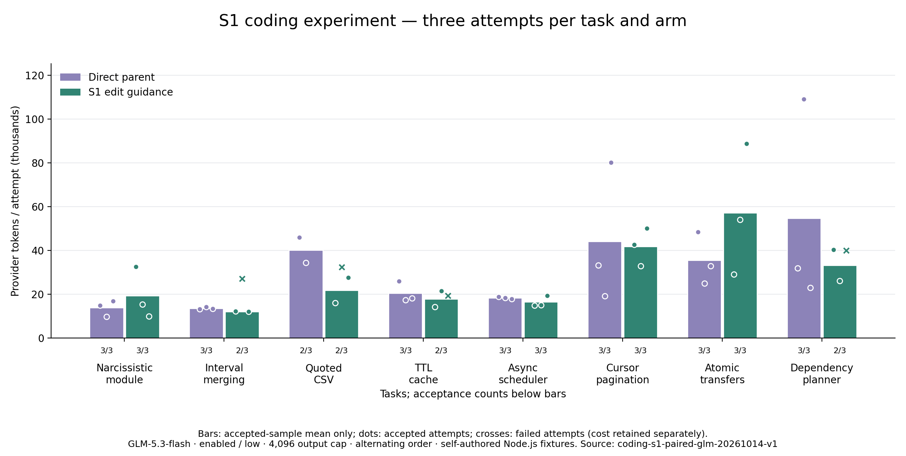

# S1 编码 Token 优化实验

修改：明确创建/编辑边界；读取结果增加简短编辑提示；缩短创建覆盖失败反馈。创建保护、补丁逻辑和验证标准保持原样。

真实运行计划：八题 × 三次 × 两个版本 = 48 次；已完成 48 次，完整覆盖与用量：True。

修改前验收：23/24；候选：20/24。

单看独立代码行为（原有测试、新增测试及隐藏断言）：修改前 **23/24**，候选 **22/24**。完整验收另外要求保护文件保持不变。

全尝试累计 Token：修改前 701,983，候选 692,320；候选 减少 **1.38%**。

已有文件创建误用：22 → 9。
质量门槛通过：False；综合门槛（完整覆盖、各题质量不降低、全尝试 Token 更低）：**False**。

## 每题结果

- **新建水仙花数模块**：修改前 3/3，候选 3/3；Token 总量 41280 / 57668。
- **区间合并与输入保护**：修改前 3/3，候选 2/3；Token 总量 40699 / 51226。
- **带引号的 CSV 状态机**：修改前 2/3，候选 2/3；Token 总量 101271 / 75818。
- **TTL 缓存跨文件修复**：修改前 3/3，候选 2/3；Token 总量 61287 / 54844。
- **异步并发调度器**：修改前 3/3，候选 3/3；Token 总量 54902 / 49283。
- **多层 API 游标分页**：修改前 3/3，候选 3/3；Token 总量 132429 / 125534。
- **事务与幂等转账**：修改前 3/3，候选 3/3；Token 总量 106267 / 171628。
- **依赖图与增量重建**：修改前 3/3，候选 2/3；Token 总量 163848 / 106319。

## 方法与限制

两个版本从已提交源码提取并冻结，工作区在没有祖先指令的临时目录，每次独立初始化。同题配对轮流先运行前版/候选；模型、思考、输出、费用、超时及独立验收一致。失败保留真实用量，未知用量停止且保留预留，不自动付费重试。

柱形图仅展示验收通过样本均值，不替代含失败的全尝试汇总。门槛检查包括总验收与每题验收不下降；每题只有三次，仍是小样本，不证明生产环境泛化或显著性。

候选未通过质量门槛，运行时改动已撤销，保留冻结源码和实验记录。冻结指纹、逐次明细及逐轮结果见 [summary.json](summary.json)。

## 失败分类与解释

- 候选 CSV 第 2 次：对合法的带引号输入抛出 SyntaxError。
- 候选依赖图第 3 次：重复依赖时漏掉应重建的任务。
- 修改前 CSV 第 3 次：空引号字段返回空记录列表，遗漏一个空字段。
- 候选还有 3 次修改受保护的原有测试文件：区间第 2 次仅多出一个空行，缓存第 3 次追加测试，依赖图第 3 次追加测试且同时存在上述代码错误。未发现删除或弱化原有断言；但冻结的文件不变规则仍然不通过，未在结果出来后放宽。

创建误用从 22 次降为 9 次（少 59.09%），但模型请求从 188 次增加到 200 次。减少一种工具错误并未稳定减少总修复成本。

逐轮 Token：232,318 → 201,524；246,629 → 224,076；223,036 → 266,720。首轮正向结果没有在第三轮保持。每题三次仍不足以断言提示本身造成质量下降，但本轮证据不能支持采用该候选。
