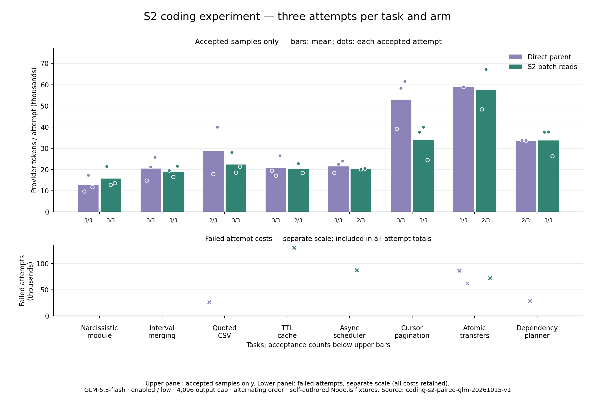

# S2 编码 Token 优化实验

修改：提供可选 read_files 工具，一次最多读取四个相关文件，每个文件最多 2500 字符；沿用范围读取、脱敏、版本指纹和覆盖保护。ContextOS 按依赖检查整批有效性，任一文件变化则保守地停止召回整批旧内容。

真实运行计划：八题 × 三次 × 两个版本 = 48 次；已完成 48 次，完整覆盖与用量：True。

修改前验收：20/24；候选：21/24。

单看独立代码行为（原有测试、新增测试及隐藏断言）：修改前 23/24，候选 23/24。完整验收还要求保护文件保持不变。

全尝试累计 Token：修改前 775,728，候选 864,709；候选 增加 **11.47%**。

已有文件创建误用：24 → 18。
质量门槛通过：False；综合门槛（完整覆盖、各题质量不降低、全尝试 Token 更低）：**False**。

## 每题结果

- **新建水仙花数模块**：修改前 3/3，候选 3/3；Token 总量 38754 / 48007。
- **区间合并与输入保护**：修改前 3/3，候选 3/3；Token 总量 61991 / 57587。
- **带引号的 CSV 状态机**：修改前 2/3，候选 3/3；Token 总量 84078 / 67953。
- **TTL 缓存跨文件修复**：修改前 3/3，候选 2/3；Token 总量 63148 / 171628。
- **异步并发调度器**：修改前 3/3，候选 2/3；Token 总量 65033 / 127885。
- **多层 API 游标分页**：修改前 3/3，候选 3/3；Token 总量 159204 / 102208。
- **事务与幂等转账**：修改前 1/3，候选 2/3；Token 总量 207406 / 187703。
- **依赖图与增量重建**：修改前 2/3，候选 3/3；Token 总量 96114 / 101738。
双方均通过的配对：18 对；Token 总量 534365 / 472124；变化 -11.65%。

累计 Token 包含缓存输入；输出包含思考，不重复累加思考。此处使用 provider 实测，不使用字符或字节估算。

模型请求数：208 → 216；候选批量读取调用：8；请求的文件范围数量（含被拒绝的批次项，非磁盘 I/O 次数）：112 → 135。

## 方法与限制

两个版本从已提交源码提取并冻结，工作区在没有祖先指令的临时目录，每次独立初始化。同题配对轮流先运行前版/候选；模型、思考、输出、费用、超时及独立验收一致。失败保留真实用量，未知用量停止且保留预留，不自动付费重试。

柱形图仅展示验收通过样本均值，不替代含失败的全尝试汇总。门槛检查包括总验收与每题验收不下降；每题只有三次，仍是小样本，不证明生产环境泛化或显著性。

未通过门槛的运行时修改已撤销；通过时也等待用户审核。冻结指纹、逐次明细及逐轮结果见 [summary.json](summary.json)。

## 原因与采用决定

只有 3/24 个候选任务使用 read_files，共 8 次调用，其中 2 次参数错误。基线已有 30 轮一次发起多个读取；模型请求总数仍从 208 增至 216。减少读取调用数不等于减少模型往返。

同题首次请求输入差异平均 174.12 Token，范围 170–178。新增工具定义形成固定开销；不能将全部涨幅归因于定义，也包含不同实现与修复路径。

第一轮候选缓存任务消耗 130,364 Token 后触及工具限制；并发任务消耗 87,261 Token 后触及任务时间限制。缓存源码及独立测试通过，但产生 tests/_debug.mjs 超出允许变更范围，并未完成最后验证；并发隐藏断言与新增测试未通过。基线也有 CSV 实际缺陷、转账验证未完成和原有测试文件变动。

基线最后一次依赖图任务保留原测试全文并追加 1170 字符，未观察到削弱断言；按冻结规则仍属于修改受保护文件，因此完整验收失败。独立代码行为计分与保护/流程计分分开，未调整验收规则。

18 对双方均通过子集的减少不代表整体收益：排除失败会改变样本构成。全部尝试计入后增加 11.47%，且缓存、并发各题验收下降。因此撤销 S2 运行时改动，保留实验证据，等待用户审核。

## 离线取消反例与恢复验证

候选还存在交付边界缺陷：读取已更新去重缓存，整批结果交付前取消；后续读取返回“原文仍在历史中”，但模型没有收到原文。此反例是额外确定性检查，未计入 provider Token 或用于归因真实实验失败。候选已撤销。

无 API 复现：`node scripts/check-coding-s2-cancellation.mjs`。脚本固定检查历史提交 7ea8d82；退出成功表示历史反例成功复现，不能解读为当前运行时失败。见 [反例结果](cancellation-counterexample.json)。

候选最初专项及完整测试 325/325；上述反例补充了当时缺失的交付边界检查。恢复版首跑 319/320：本地模拟网关 fetch bad port。未改源码或测试，专项重跑 14/14、全量重跑 320/320。运行时源码与 e9ff015 一致。

原实测脚本来自 7ea8d82，记录的 Windows CRLF SHA-256 为 44fcdafc6722aeb482b0e32bfd14b162804f8ce4846ea69060ab6ced15ddb90c；其 Git LF blob SHA-256 为 f333ebf2a0ee3ee66b8420a636ad5c0f1453bc312e52ee51d5987fb8ae274e71。已核对仅换行不同。当前发布入口只把默认 candidate-ref 从 HEAD 固定为 7ea8d82；原实测已显式指定该候选。
