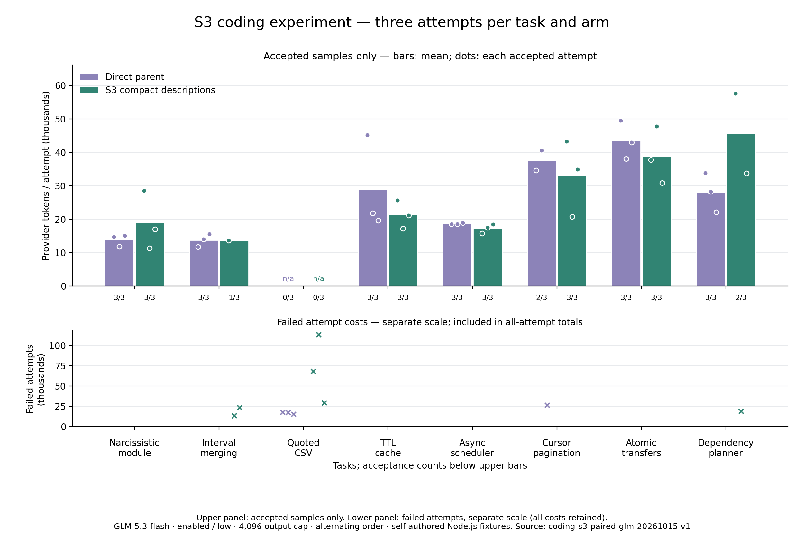

# S3 编码 Token 优化实验

修改：只精简七个标准工具的 description；参数结构、系统提示、能力通知、执行器、权限与验证条件保持原样。ContextOS 与词表学习工具保留原说明。实验 SDK 开关 compactToolDescriptions 默认关闭。

真实运行计划：八题 × 三次 × 两个版本 = 48 次；已完成 48 次，完整覆盖与用量：True。

修改前验收：20/24；候选：18/24。

单看独立代码行为（原有测试、新增测试及隐藏断言）：修改前 20/24，候选 22/24。完整验收还要求保护文件保持不变。

全尝试累计 Token：修改前 594,355，候选 761,024；候选 增加 **28.04%**。

已有文件创建误用：21 → 20。
质量门槛通过：False；综合门槛（完整覆盖、各题质量不降低、全尝试 Token 更低）：**False**。

## 每题结果

- **新建水仙花数模块**：修改前 3/3，候选 3/3；Token 总量 41775 / 56963。
- **区间合并与输入保护**：修改前 3/3，候选 1/3；Token 总量 41432 / 50738。
- **带引号的 CSV 状态机**：修改前 0/3，候选 0/3；Token 总量 51019 / 211323。
- **TTL 缓存跨文件修复**：修改前 3/3，候选 3/3；Token 总量 86755 / 64092。
- **异步并发调度器**：修改前 3/3，候选 3/3；Token 总量 56198 / 51862。
- **多层 API 游标分页**：修改前 2/3，候选 3/3；Token 总量 102087 / 99115。
- **事务与幂等转账**：修改前 3/3，候选 3/3；Token 总量 130714 / 116487。
- **依赖图与增量重建**：修改前 3/3，候选 2/3；Token 总量 84375 / 110444。

双方均通过的配对：17 对；Token 总量 458496 / 458654；变化 0.03%。

累计 Token 包含缓存输入；输出包含思考，不重复累加思考。此处使用 provider 实测，不使用字符或字节估算。

模型请求数：180 → 203；单文件读取调用：103 → 101。

## 方法与限制

两个版本从已提交源码提取并冻结，工作区在没有祖先指令的临时目录，每次独立初始化。同题配对轮流先运行前版/候选；模型、思考、输出、费用、超时及独立验收一致。失败保留真实用量，未知用量停止且保留预留，不自动付费重试。

柱形图仅展示验收通过样本均值，不替代含失败的全尝试汇总。门槛检查包括总验收与每题验收不下降；每题只有三次，仍是小样本，不证明生产环境泛化或显著性。

最终处置见采用决定。冻结指纹、逐次明细及逐轮结果见 [summary.json](summary.json)。

## 每轮结果

- 第 1 轮：验收 7/8 → 7/8；Token 226464 → 290854；候选变化 28.43%。
- 第 2 轮：验收 7/8 → 5/8；Token 190904 → 260823；候选变化 36.63%。
- 第 3 轮：验收 6/8 → 6/8；Token 176987 → 209347；候选变化 18.28%。

## 固定开销与解释边界

首次配对输入差异（候选减基线）均值 -41.21 Token，范围 -47–-36。这是 provider 首次请求用量，区别于下列离线字节指标。

- 小目录：工具定义 2717 → 2421 UTF-8 字节；除 description 外的工具定义 SHA-256 相同：656394bf998d6403538fc67f59f8348664afc7fc9c375c46bbcac67a916c2012。
- 大目录：工具定义 2953 → 2613 UTF-8 字节；除 description 外的工具定义 SHA-256 相同：474f65f67b17359d617530b54ab4a108c270b6c4a5f3e18e8f8e1ef2c5793e3c。

缩短定义只能解释固定输入开销变化。实现、补丁、测试和修复轨迹也会因模型输出而变化，不能将全部 Token 差异归因于删除的文字。仅三次重复，未证明统计显著性或生产泛化。

## 未通过的尝试

- l2-csv-r1-baseline：status=completed；public=True；hidden=False；addedTests=True；protectedFiles=True；allowedChanges=True；validation=True；Token=17995。
- l2-csv-r1-candidate：status=completed；public=True；hidden=True；addedTests=True；protectedFiles=False；allowedChanges=True；validation=True；Token=68283。
- l1-intervals-r2-candidate：status=completed；public=True；hidden=True；addedTests=True；protectedFiles=False；allowedChanges=True；validation=True；Token=13585。
- l2-csv-r2-candidate：status=completed；public=True；hidden=False；addedTests=True；protectedFiles=True；allowedChanges=True；validation=True；Token=113453。
- l2-csv-r2-baseline：status=completed；public=True；hidden=False；addedTests=True；protectedFiles=True；allowedChanges=True；validation=True；Token=17516。
- l4-dependency-plan-r2-candidate：status=completed；public=True；hidden=True；addedTests=True；protectedFiles=False；allowedChanges=True；validation=True；Token=19053。
- l1-intervals-r3-candidate：status=completed；public=True；hidden=True；addedTests=True；protectedFiles=False；allowedChanges=True；validation=True；Token=23444。
- l2-csv-r3-baseline：status=completed；public=True；hidden=False；addedTests=True；protectedFiles=False；allowedChanges=True；validation=True；Token=15508。
- l2-csv-r3-candidate：status=completed；public=True；hidden=False；addedTests=True；protectedFiles=True；allowedChanges=True；validation=True；Token=29587。
- l3-pagination-r3-baseline：status=completed；public=True；hidden=False；addedTests=True；protectedFiles=True；allowedChanges=True；validation=True；Token=26816。

## 采用决定

未达到预设门槛，候选运行时改动撤销，保留实验记录，等待用户审核。

首次通知与系统提示未被删除或移出请求。能力通知沿用原有“首次/能力变化时追加”机制，仍会随历史提交。S1/S2 保持撤销。
