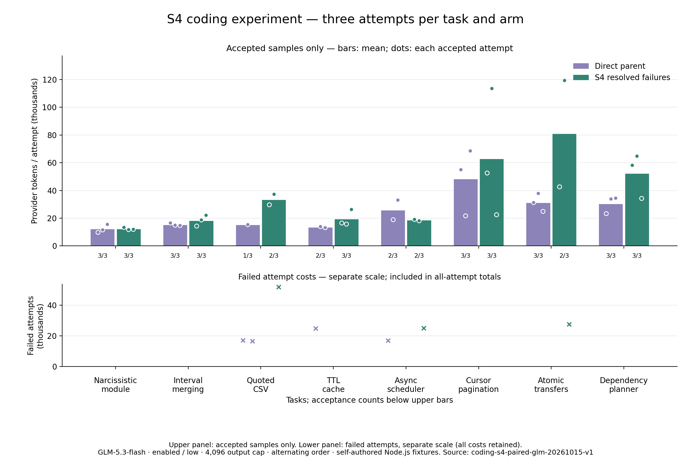

# S4 编码 Token 优化实验

修改：同一用户回合内，完全相同的验证命令随后成功时，旧失败允许变为 ContextOS 可召回历史引用。保留最近输出、未解决失败、原始历史与验证状态；净请求字节不减则回退。实验 SDK 开关 compactResolvedTests 默认关闭。

真实运行计划：八题 × 三次 × 两个版本 = 48 次；已完成 48 次，完整覆盖与用量：True。

修改前验收：20/24；候选：21/24。

单看独立代码行为（原有测试、新增测试及隐藏断言）：修改前 23/24，候选 22/24。完整验收还要求保护文件保持不变。

全尝试累计 Token：修改前 585,626，候选 869,033；候选 增加 **48.39%**。

已有文件创建误用：20 → 21。
预设完整验收门槛通过：False；综合门槛（完整覆盖、各题完整验收不降低、全尝试 Token 更低）：**False**。

## 每题结果

- **新建水仙花数模块**：修改前 3/3，候选 3/3；Token 总量 37098 / 37207。
- **区间合并与输入保护**：修改前 3/3，候选 3/3；Token 总量 46482 / 55358。
- **带引号的 CSV 状态机**：修改前 1/3，候选 2/3；Token 总量 49186 / 119007。
- **TTL 缓存跨文件修复**：修改前 2/3，候选 3/3；Token 总量 52321 / 58904。
- **异步并发调度器**：修改前 2/3，候选 2/3；Token 总量 69082 / 62570。
- **多层 API 游标分页**：修改前 3/3，候选 3/3；Token 总量 145315 / 188993。
- **事务与幂等转账**：修改前 3/3，候选 2/3；Token 总量 94269 / 189644。
- **依赖图与增量重建**：修改前 3/3，候选 3/3；Token 总量 91873 / 157350。

双方均通过的配对：18 对；Token 总量 451928 / 698565；变化 54.57%。

累计 Token 包含缓存输入；输出包含思考，不重复累加思考。此处使用 provider 实测，不使用字符或字节估算。

模型请求数：174 → 216；单文件读取调用：96 → 104。

## 方法与限制

两个版本从已提交源码提取并冻结，工作区在没有祖先指令的临时目录，每次独立初始化。同题配对轮流先运行前版/候选；模型、思考、输出、费用、超时及独立验收一致。失败保留真实用量，未知用量停止且保留预留，不自动付费重试。

柱形图仅展示验收通过样本均值，不替代含失败的全尝试汇总。门槛检查包括总验收与每题验收不下降；每题只有三次，仍是小样本，不证明生产环境泛化或显著性。

最终处置见采用决定。冻结指纹、逐次明细及逐轮结果见 [summary.json](summary.json)。

## 每轮结果

- 第 1 轮：验收 5/8 → 8/8；Token 195274 → 247190；候选变化 26.59%。
- 第 2 轮：验收 8/8 → 8/8；Token 168838 → 399629；候选变化 136.69%。
- 第 3 轮：验收 7/8 → 5/8；Token 221514 → 222214；候选变化 0.32%。

## 固定开销与解释边界

首次配对输入差异（候选减基线）均值 0.33 Token，范围 -4–6。这是 provider 首次请求用量，区别于下列离线字节指标。

- 小目录：固定工具定义 2717 / 2717 UTF-8 字节，完整定义指纹一致；不是 Token 估算。
- 大目录：固定工具定义 2953 / 2953 UTF-8 字节，完整定义指纹一致；不是 Token 估算。

## 固定历史的离线投影控制

serialized adapter-input UTF-8 bytes; offline, no provider tokens or API calls

- no-failure：3806 → 3806 字节；请求指纹相同：True。
- unresolved：15724 → 15724 字节；请求指纹相同：True。
- small-resolved：3808 → 3808 字节；请求指纹相同：True。
- large-resolved：15733 → 5332 字节；请求指纹相同：False。

这些是固定历史上的请求序列化字节，不代表模型实际 Token 或独立编码正确率。

## 实际触发

- baseline：0/24 次任务触发，0 条不同的旧失败被引用；0 次请求投影包含这类引用，累计 0 次引用出现。
- candidate：11/24 次任务触发，19 条不同的旧失败被引用；11 次请求投影包含这类引用，累计 19 次引用出现。

触发计数来自请求发出前的 ContextOS 投影，非 provider Token。没有触发的任务不能把随机用量变化归因于 S4；即使全组成本更低，也要结合触发样本判断机制是否有实证。

已解决匹配不保证后来源码仍正确；待验证状态、最新失败与最后验证结果继续保留。每题三次，未证明统计显著性或生产泛化。

## 触发边界审计

候选投影中共观察到 23 条不同的测试/命令失败；其中 19 条有完全相同命令的后续成功，19 条实际转为引用。有符合条件的失败但整体无净字节收益的投影共 0 次；符合条件但仍受近期保护的出现次数为 0。

审计读取加密日志中的结构化投影诊断，只公开计数。失败必须先在请求投影中出现才计入；基线未计算候选专用资格字段。详见 summary.json 的 triggerAudit。

候选首次使用旧失败引用后，总共继续调用工具 0 次。成功执行的源码补丁 31 → 40，测试补丁 15 → 27；这些是实际执行轨迹计数，不能单独当作因果关系。

有 11 次触发任务的引用仅用于最后一次模型请求，且之后没有工具调用。这些任务累计 615,943 Token，其中 546,920 发生于最后请求之前，最后请求 69,023。这是执行时间窗口的实测用量分解，不是反事实节省估计；S4 不能减少此前已经消耗的修复成本。

## 未通过的尝试

- l2-csv-r1-baseline：status=completed；public=True；hidden=True；addedTests=True；protectedFiles=False；allowedChanges=True；validation=True；Token=17082。
- l2-ttl-cache-r1-baseline：status=completed；public=True；hidden=True；addedTests=True；protectedFiles=False；allowedChanges=True；validation=True；Token=24988。
- l3-scheduler-r1-baseline：status=completed；public=True；hidden=True；addedTests=True；protectedFiles=False；allowedChanges=True；validation=True；Token=16942。
- l2-csv-r3-baseline：status=completed；public=True；hidden=False；addedTests=True；protectedFiles=False；allowedChanges=True；validation=True；Token=16591。
- l2-csv-r3-candidate：status=completed；public=True；hidden=False；addedTests=True；protectedFiles=True；allowedChanges=True；validation=True；Token=52012。
- l3-scheduler-r3-candidate：status=cancelled；public=False；hidden=True；addedTests=False；protectedFiles=True；allowedChanges=True；validation=False；Token=25141。
- l4-transfers-r3-candidate：status=completed；public=True；hidden=True；addedTests=True；protectedFiles=False；allowedChanges=True；validation=True；Token=27585。

## 采用决定

未达到预设门槛，候选运行时改动撤销，保留实验记录，等待用户审核。

S1/S2/S3 的运行时修改均未包含在本轮；此处只评估 S4。

人工核查的成本解释、失败最小复现及撤销验证见 [FINDINGS.zh-CN.md](FINDINGS.zh-CN.md)。
