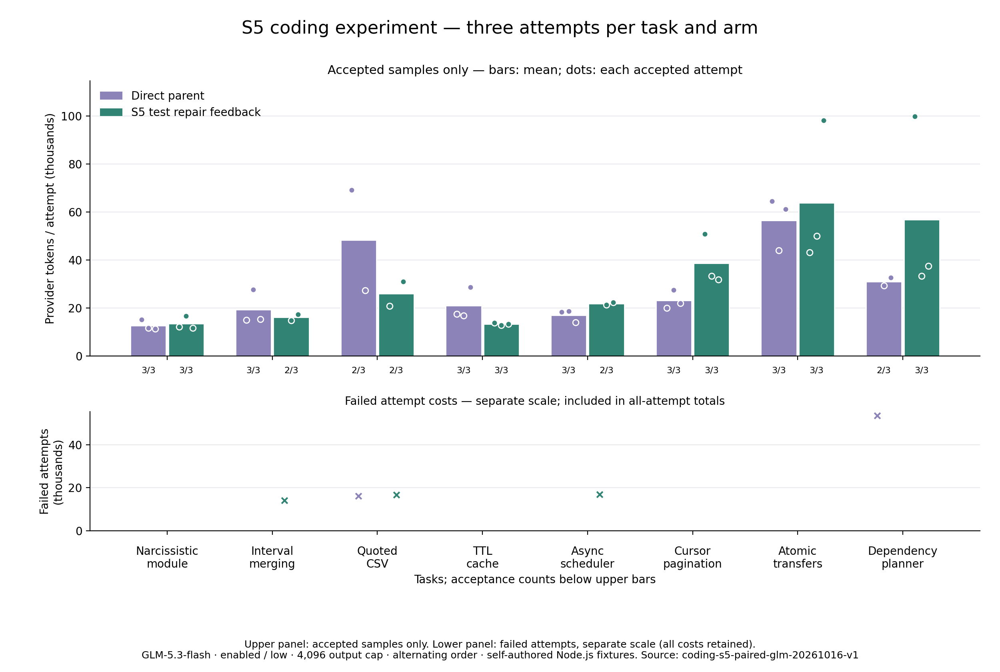

# S5 编码 Token 优化实验

修改：仅在验证失败时反馈任务约定/断言核查建议，或对执行器命令超时提供诊断后再重试的建议。未添加固定提示、工具或自动执行；原始输出、验证与权限保持不变。实验 SDK 开关 testRepairFeedback 默认关闭。

八题 × 三次 × 两个版本 = 48 次计划；已结束 48 次，覆盖及用量完整：True。

完整验收：22/24 → 21/24。
独立代码行为（原有、新增及隐藏测试）：23/24 → 23/24。

所有尝试累计 provider Token：678,865 → 735,468，候选 **增加 8.34%**。

质量门槛（总体及逐题的完整验收和代码行为不下降）：False；综合采用门槛：**False**。

Token 包含缓存输入，思考包含在输出中且不重复累加；来自 provider，不使用字符或字节估算。

## 每题结果

- **新建水仙花数模块**：完整验收 3/3 → 3/3；代码行为 3/3 → 3/3；累计 Token 38451 → 40730。
- **区间合并与输入保护**：完整验收 3/3 → 2/3；代码行为 3/3 → 3/3；累计 Token 58283 → 46572。
- **带引号的 CSV 状态机**：完整验收 2/3 → 2/3；代码行为 2/3 → 2/3；累计 Token 112780 → 68688。
- **TTL 缓存跨文件修复**：完整验收 3/3 → 3/3；代码行为 3/3 → 3/3；累计 Token 63350 → 40349。
- **异步并发调度器**：完整验收 3/3 → 2/3；代码行为 3/3 → 3/3；累计 Token 51253 → 60688。
- **多层 API 游标分页**：完整验收 3/3 → 3/3；代码行为 3/3 → 3/3；累计 Token 69592 → 116324。
- **事务与幂等转账**：完整验收 3/3 → 3/3；代码行为 3/3 → 3/3；累计 Token 169646 → 191348。
- **依赖图与增量重建**：完整验收 2/3 → 3/3；代码行为 3/3 → 3/3；累计 Token 115510 → 170769。

双方均通过：20 对；累计 Token 575,789 → 587,996；变化 2.12%。子集不替代整组结果。

## 每轮结果

- 第 1 轮：验收 7/8 → 6/8；代码行为 8/8 → 8/8；Token 273781 → 272020；变化 -0.64%。
- 第 2 轮：验收 7/8 → 7/8；代码行为 7/8 → 7/8；Token 192289 → 199571；变化 3.79%。
- 第 3 轮：验收 8/8 → 8/8；代码行为 8/8 → 8/8；Token 212795 → 263877；变化 24.01%。

## 实际触发及修复轨迹

- baseline：新反馈触发任务 0/24，结果 0 次；验证失败反馈 12 次，命令超时 0 次，其中新超时分类 0 次；超时后无成功文件编辑的同命令重试 0 次。
  新反馈之后源码/测试编辑 0/0 次，模型请求 0 次。
- candidate：新反馈触发任务 10/24，结果 15 次；验证失败反馈 15 次，命令超时 0 次，其中新超时分类 0 次；超时后无成功文件编辑的同命令重试 0 次。
  新反馈之后源码/测试编辑 4/20 次，模型请求 48 次。

总模型请求 194 → 198；工具错误 35 → 35。
工具成功执行的全部源码编辑 42 → 35；全部测试编辑 37 → 46。
计数由实时观察器与加密日志逐项交叉验证。基线未启用 S5，其“新反馈后”计数为零不代表没有普通修复。重试计数不判断是否有新的诊断证据，反馈后的编辑也不单独证明因果改善。未触发的独立任务用量变化不能归因于 S5。

## 无固定开销控制

冻结引擎的离线首次请求完全相同：True；序列化 5127 字节，不调用 API。
- success：反馈一致 True，JSON 字节 4 → 4。
- assertion：反馈一致 False，JSON 字节 196 → 454。
- command-timeout：反馈一致 False，JSON 字节 220 → 414。
- network-timeout：反馈一致 True，JSON 字节 220 → 220。
- non-validation：反馈一致 True，JSON 字节 221 → 221。
- permission：反馈一致 True，JSON 字节 272 → 272。
- cancellation：反馈一致 True，JSON 字节 194 → 194。

真实首次输入配对差（候选减基线）均值 -0.75 Token，范围 -6–5；独立临时工作区标识可能造成分词差异。

新失败反馈本身更长，且会随历史发送；能否减少往返必须由实测判断。离线字节差不是 provider Token 收益。

## 未通过样本

- l1-intervals-r1-candidate：status=completed；public=True；hidden=True；addedTests=True；protectedFiles=False；allowedChanges=True；validation=True；Token=14177。
- l3-scheduler-r1-candidate：status=completed；public=True；hidden=True；addedTests=True；protectedFiles=False；allowedChanges=True；validation=True；Token=16882。
- l4-dependency-plan-r1-baseline：status=completed；public=True；hidden=True；addedTests=True；protectedFiles=False；allowedChanges=True；validation=True；Token=53397。
- l2-csv-r2-candidate：status=completed；public=True；hidden=False；addedTests=True；protectedFiles=False；allowedChanges=True；validation=True；Token=16655。
- l2-csv-r2-baseline：status=completed；public=True；hidden=False；addedTests=True；protectedFiles=True；allowedChanges=True；validation=True；Token=16103。

## 方法与限制

固定相同模型、思考模式、等级、输出上限、初始源码及验收；同题交替先运行版本。每次新工作区，源码和入口冻结，八题初始/参考控制先于付费调用。有限预算、超时，用量未知停止，不付费重试；所有失败保留。

柱形图仅含成功样本；失败成本在独立刻度显示，同时计入全量累计。三个重复为自编任务诊断证据，不证明统计显著性、生产泛化或所有模型适用。两条独立模型轨迹的差异不等于新反馈的因果效果。

原始日志和工作区私有；公开字段、配置指纹、逐次结果与审计计数见 [summary.json](summary.json)。

## 采用决定

未满足预设门槛，按方案不采用运行时变动；最终代码与回归验证见阶段文档。

S1/S2/S3/S4 运行时变动未纳入本轮；阶段结束等待审核，不继续下一项。
