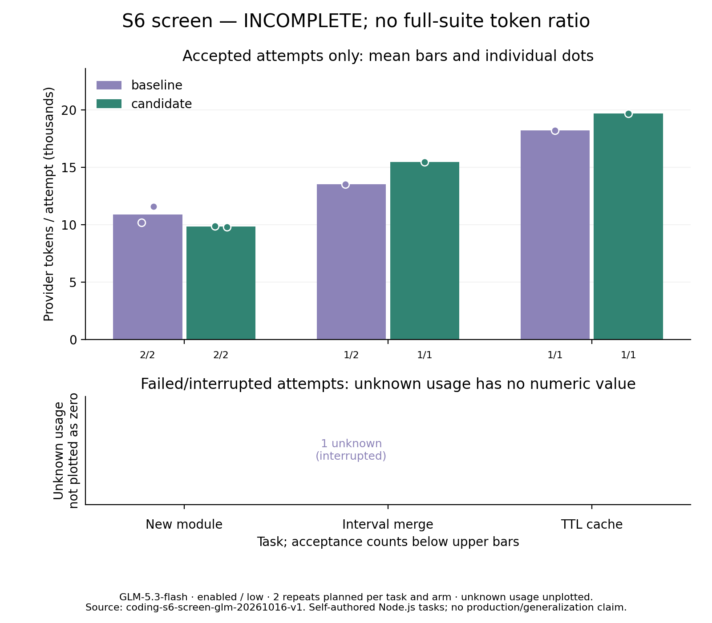

# S6 screen：版本校验完整替换

计划 12 次，尝试 9 次，其中用量完整 8 次；覆盖与用量完整：False。

用量或覆盖不完整，不给整组百分比；未知不按零处理。

**运行中断，不能据此推断 Agent 正确率下降。** 原测试进程已不存在，第九次尝试有一个未结算请求；原始结果快照保留，离线结束记录，不重试模型请求。
已完成且用量完整的样本：基线验收 4/4、代码行为 4/4；候选验收 4/4、代码行为 4/4。
中断尝试的已确认请求片段另有 1,422 Token；该尝试总用量未知，预留 1 USD 保持，不伪造为完整计费。

质量门槛：False；综合门槛：**False**。Token 包含缓存输入与输出中的思考，不重复累加。

## 每题与每轮

- 新建水仙花数模块：验收 2 → 2；代码行为 2 → 2；Token 21779 → 19640。
- 区间合并与输入保护：验收 1 → 1；代码行为 1 → 1；Token None → 15461。
- TTL 缓存跨文件修复：验收 1 → 1；代码行为 1 → 1；Token 18197 → 19659。
- 第 1 轮：验收 3 → 3；Token 41905 → 44984。
- 第 2 轮：验收 1 → 1；Token None → 9776。

双方均通过 4 对，累计 Token 53490 → 54760，变化 2.37%。此子集不替代总体。

## 触发与成本

- baseline：版本替换 0 次尝试、0 成功、0 错误，0 次任务采用；创建遇到已有文件拒绝 1 次；模型请求 None 次，工具错误 1 次，单文件读取 15 次。
- candidate：版本替换 0 次尝试、0 成功、0 错误，0 次任务采用；创建遇到已有文件拒绝 2 次；模型请求 20 次，工具错误 2 次，单文件读取 14 次。

首次输入配对差均值 **52.00 provider Token**（候选减基线，范围 51–54）。固定工具定义及能力说明有开销，工作区标识也有少量分词差异。

加密工具事件与实时观察器逐项核对；每次 provider ledger 总量与结果一致。审计同时记录模型哈希不匹配、证据不可用及版本过期计数，前两者可能重叠，见 summary.json。

## 未通过样本

- l1-intervals-r2-baseline：status=interrupted_unknown_usage；公开=True；隐藏=False；新增测试=True；保护文件=True；允许变更=True；验证=False；Token=未知。

## 方法与解释边界

同模型、思考等级、任务与初始文件；交替顺序，每次新工作区，题目/源码/入口冻结。有限预算和超时，未知用量停止并保留预留，不付费重试。成功柱排除失败，失败成本另图并计入全量。

短筛选只决定是否进入完整确认，不证明统计显著性。独立生成轨迹的变化不能全部归因于替换机制；未触发样本尤其不能作机制归因。筛选与确认分开报告，不挑选合并百分比。

替换有提交前复核与暂存失败保护，最终复核到 rename 仍有外部竞争窗口，且 rename 改变 inode；自定义 ACL/扩展属性等生产语义未完整保证。实验开关默认关闭，不宣称原子 CAS 或生产可用。

[公开逐次数据与配置指纹](summary.json)；原始日志及工作区私有。阶段协议见 [S6](../../../docs/CODING_S6_EXPERIMENT.md)。

## 决定

未通过预设门槛，停止后续付费确认并撤销运行时改动；最终回归记录见阶段文档。
