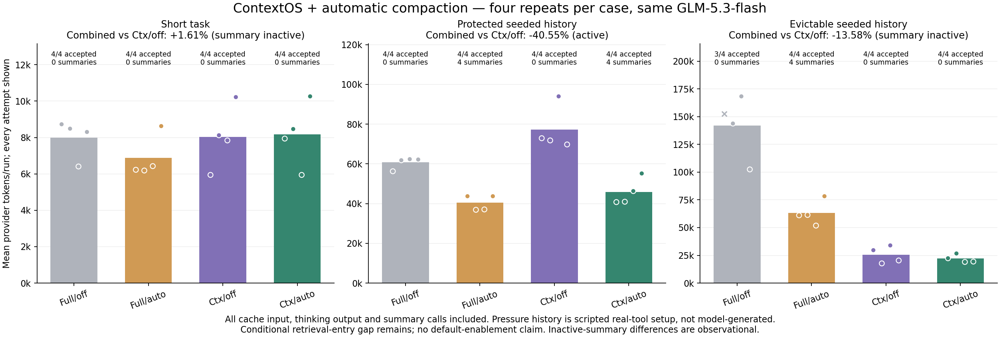

# ContextOS + automatic compaction: four-arm comparison

[中文](README.zh-CN.md)

## Result

48 runs, twelve matched four-arm blocks; four repeats per case. Same GLM-5.3-flash, enabled/low thinking, initial repository contents, historical seed and task prompt. Runtime modules and package unchanged. Automatic compaction remains off by default.

- **short**: combined vs ContextOS alone increased 1.61%; summaries executed: 0. Automatic summary inactive; observed trajectory variation, not compaction benefit.
- **protected**: combined vs ContextOS alone decreased 40.55%; summaries executed: 4. Automatic summary active; include its cost.
- **evictable**: combined vs ContextOS alone decreased 13.58%; summaries executed: 0. Automatic summary inactive; observed trajectory variation, not compaction benefit.

All-case combined vs ContextOS alone: **decreased 31.26%**. This total includes inactive-summary controls and does not prove the same saving on every task.

- full_off: 842,498 tokens; 11/12 accepted; 0 summary requests, 0 summary tokens, 0 committed checkpoints.
- full_auto: 442,426 tokens; 12/12 accepted; 8 summary requests, 47,609 summary tokens, 8 committed checkpoints.
- contextos_off: 443,394 tokens; 12/12 accepted; 0 summary requests, 0 summary tokens, 0 committed checkpoints.
- contextos_auto: 304,771 tokens; 12/12 accepted; 4 summary requests, 18,126 summary tokens, 4 committed checkpoints.

Compared with summary alone, combined total decreased 31.11%, but protected-history combined tokens increased 13.61% (161,659 → 183,653). Composition is not uniformly better than either individual mechanism.

In the live protected combined arm, 12 of 27 task requests after the checkpoint omitted history-search declarations; the first post-checkpoint request lacked the entry in all four runs. Later ContextOS eviction can open it. Ordinary repair still succeeded. Full/off evictable repeat 1 stopped before repair: next request was 81,838 bytes, above the 80,000 guard; its 152,643 already billed tokens remain included.

## Compatibility finding

Scripted native checks meet **17/18** expectations. Canonical transcripts remain intact; summaries cannot discharge pending validation; real current-source repair/tests complete; stale source is withheld; unchanged-workspace resume retains the checkpoint. One expectation fails: when protected historical source is covered by a semantic checkpoint without earlier ContextOS eviction, the old result stays internally indexed and directly recoverable but `search_history` is absent from the model's declared tools. ContextOS currently opens history tools based on its own selected/previously evicted references, not every prefix covered by semantic compaction. This conditional entry gap is not a claim that every compaction loses retrieval or that ordinary repairs fail.

Four-arm live acceptance checks code correctness independently (public and hidden tests), full current source read, actual positive validation after the last edit, normal completion and unchanged scope. These successful repair checks do **not** prove historical-detail retrieval completeness. No runtime fix, default enablement or next optimization was performed. Combined acceptance declines vs ContextOS alone: 0 blocks. Smaller tokens alone do not resolve the compatibility gap.

## Configuration and limits

Cases: short empty-history small cache-key repair; protected medium retry repair after repeated real README reads; evictable large Unicode repair after real inventory reads. Pressure seeds use actual tools but are scripted and unbilled, not naturally generated long conversations. Read deduplication is disabled during common seed construction to create deliberate pressure; ordinary runtime v1 read deduplication stays enabled. In normal use, deduplication can prevent some of this repeated-read pressure. Three synthetic defects and unrelated-file scale expansion do not establish real-project generalization.

Projected preflight requests: short 4,235 bytes for all arms; protected 64,981 for all; evictable full 68,497 vs ContextOS 18,154. These are serialized bytes, not provider tokens. Actual summary requests and committed checkpoints are reported separately. Four arm positions rotate across repeats. All attempts and failures retained; no paid retries. B1's previous unknown reservation stays separate and retained.

Wire guard 80,000 bytes; auto trigger 0.8; recent retention 24,000 bytes; ContextOS target 32,000 bytes, latest two tool rounds retained. These are default ratios with an explicit test guard, not all out-of-box settings. Task output 4096, native summary output 1200; enabled thinking budgets derived by the existing adapter. 24 tools/turn, 24 provider attempts/run including summaries, two compaction attempts/turn, 180s request / 300s turn. Shared guard USD 8 / USD 0.60 per run. Input/cache-read USD 0.80 and output USD 2.80 per million; conservative accounted usage USD 1.6702452, not invoice rates or a bill. Summary tokens, all cache input and thinking output count once in totals.

## Evidence

Existing deterministic suite 268/268, no skips. The separate 17/18 native combination diagnostic intentionally records the unresolved compatibility expectation; CI passing the existing suite does not turn that expectation into a pass. An initial checkpoint-state checker searched escaped JSON instead of raw text; fixed before paid calls, zero-paid attempts retained.

Native model request observations are encrypted in local session journals without API headers or credentials. Read-only audit checks captured payload SHA-256/byte counts against native settled events and ledger hashes, exact usage equality, unchanged journal bytes and unchanged canonical seed messages. Published artifacts contain counts, hashes, controls and sanitized grades, not raw payloads, model thoughts or private workspace paths. Fixed-history observations are not counterfactual provider token measurements.

[Summary](summary.json) · [All attempts](results.json) · [Functional checks](functional-contract.json) · [Native payload audit](native-audit.json) · [Frozen plan](frozen-plan.json) · [Protocol](frozen-protocol.md) · [Unchanged source audit](source-audit.json) · [Hashes](evidence.sha256)
