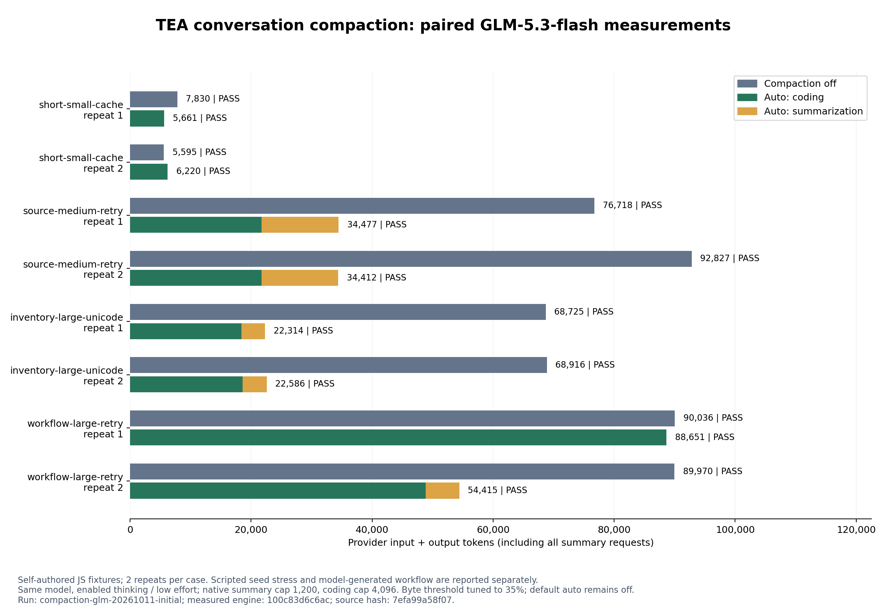

# 会话压缩专项测试与真实 Token 收益 — 2026-10-11

[English](README.md)

## 后续修复

本目录保留引擎 `100c83d` 的首轮完整结果。多轮任务第 1 次重复没有提交摘要：保留算法为达到近期字节下限，加入了一个过大的旧完整工具批次，导致没有可有效摘要的前缀。确定性回归复现该边界问题。引擎 `531cad7` 改为保留最新完整组，更旧组只有放得下才加入；[完整配对复测](../compaction-glm-20261011/README.zh-CN.md)单独记录结果。

首轮保守费用 $0.6327104，复测 $0.6214348，累计 **$1.2541452**，在共享 $2.20 上限内；共 32/32 验收通过，未知用量为 0。不同引擎不拼接收益率。每案例只有两轮且工具选择随机，不能据此给边界修复单独归因一个精确百分比。下方测试数量是首轮验证检查点的离线覆盖记录，不改变付费引擎身份。

## 结果

- 固定历史压力测试：320,611 → 125,670 Token，净节省 **60.80%**，有效配对 6/6。
- 模型自行生成历史的“检查 → 修复”多轮任务：180,006 → 143,066 Token，净节省 **20.52%**，有效配对 2/2。
- 验收 **16/16**：同时要求公开测试、独立隐藏测试、修改范围和任务完成。未知 usage 0 次。
- 所有摘要请求均计入总 Token，包括被拒绝的摘要。保守费用 **$0.632710**，不是账户账单。

## 各案例

- **short-small-cache**（12 文件、112 行，固定历史 2 字节）：13,425 → 11,881，净节省 11.50%；各轮 27.70%, -11.17%；摘要消耗 0；有效配对 2/2。
- **source-medium-retry**（120 文件、1,409 行，固定历史 51,495 字节）：169,545 → 68,889，净节省 59.37%；各轮 55.06%, 62.93%；摘要消耗 25,414；有效配对 2/2。
- **inventory-large-unicode**（1,200 文件、14,365 行，固定历史 52,566 字节）：137,641 → 44,900，净节省 67.38%；各轮 67.53%, 67.23%；摘要消耗 7,856；有效配对 2/2。
- **workflow-large-retry**（1,200 文件、14,369 行，固定历史 2 字节）：180,006 → 143,066，净节省 20.52%；各轮 1.54%, 39.52%；摘要消耗 5,545；有效配对 2/2。

未提交摘要的配对：**short-small-cache/1, short-small-cache/2, workflow-large-retry/1**。这些配对的 Token 差异不能归因于压缩，只能视为模型随机波动。

## 方法和复现

传输：通过 `https://cf.api.fan/v1/messages` 发送非流式 Anthropic Messages 请求。证据记录端点指纹和共同参数，凭据只通过进程环境提供。

共同配置：glm-5.3-flash; enabled thinking; low effort; coding output 4,096; summary output 1,200 (thinking budget 1,199); 80,000 UTF-8 wire bytes; trigger 0.35; recent retention 8,000 bytes; history full; v1 context; 2 attempts/turn; 18 tools/turn; 24 requests/run; 90 s/request; 300 s/turn; $0.30/run; $2.2000000 cap for this experiment.

每组从相同固定 Git 快照、相同任务开始，两轮按 off/auto、auto/off 交替顺序。没有自动重试；未知计费保留完整预留并停止实验。项目规模为 12、120、1,200 文件。固定历史由脚本真实调用只读工具生成，两边输入完全相同；**这部分不是模型自然产生的完整会话**。多轮任务从空会话开始，检查目录到修复的全部模型请求都计费，检查阶段要求源码不变。

总输入包括普通输入、缓存读取和缓存写入。思考已含在供应商输出中，不重复相加。字节缩减不充当 Token 收益。收益率只统计双方验收通过且 usage 完整的配对；失败、缺失、未知及其费用仍留在[公开证据](evidence.json)和图中。

实测引擎 commit `100c83d6c6acfe0cf46c802309ddf8bde043e467`；源码哈希 `7efa99a58f079de5c25cf872feb6ee1927f91cad808dfbb9d7f371a4ff63fd9f`，实验期间未变。公开证据包含初始快照、历史哈希、任务、全部参数、逐请求 usage、压缩/拒绝事件和验收哈希；不发布密钥、原始模型消息或运行工作区路径。

`npm test` 运行确定性测试。凭据与明确单价放入环境变量，使用记录的配置，执行 `node scripts/compare-compaction.mjs benchmarks/results/<新目录>`。`python scripts/report-compaction.py <comparison.json> <报告目录> <实际通过的全套测试数>` 校验并绘图，仅绘图需要 Matplotlib。付费执行器不会覆盖旧结果目录。

## 专项测试和限制

新增 **40 项**测试，全套 **168/168** 在 Windows 通过。覆盖完整工具配对、异常历史、重复/部分压缩、用户原文保留、近期思考与签名原样保留、Unicode、摘要格式/截断/无收益拒绝、源码缓存清理、账本提交前与提交期间取消、账本失败、待验证状态、/new、自动尝试上限、共享预算、未知计费、摘要缓存用量、负收益及失败配对。

只有 8 组配对、每案例 2 轮、一个模型与供应商，样本是自编 JavaScript 项目。尚不能证明长期语义保留、未见真实仓库的泛化能力或优于 Pi。35% 为实验阈值，不是默认 80% 的收益；自动压缩仍默认关闭。不同用途的输出上限如上记录，提交相同用途时配置相同。Token 减少不保证耗时减少，工具选择有随机波动；短会话对照组没有触发摘要，其正负差异只能视为随机波动，不能归因为压缩收益。本轮没有真实测量与 compact-tools 叠加的收益。

2026-10-11 重查[公开价格 API](https://www.packyapi.ai/api/pricing)：模型倍率 0.4、输出倍率 3.5、适用分组倍率 1，依据[计费公式](https://docs.newapi.pro/en/docs/guide/console/settings/rate-settings)，输入/输出采用每百万 $0.80/$2.80；缓存读不打折，缓存写按双倍输入做预算。费用是保守估算，不是账户账单。
