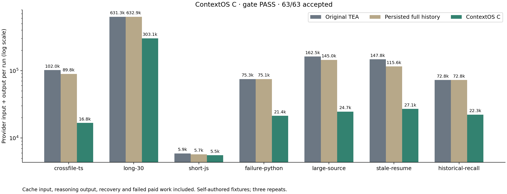
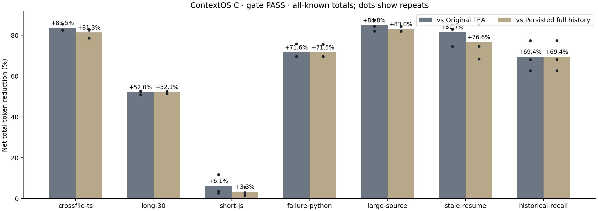
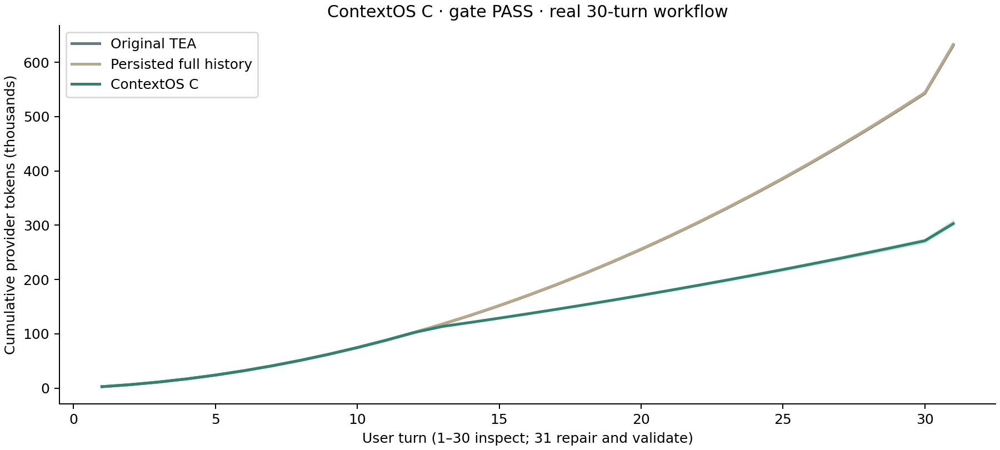

# ContextOS C · controlled live comparison

[中文](README.zh-CN.md) · [Complete aggregate evidence](comparison.json) · [Rejected A/B](../contextos-glm-20261011/README.md) · [Verified B failure diagnosis](../contextos-b-diagnosis-20261011/README.md)

## Result and units

**Frozen gate PASS.** Complete=True; unchanged engine=True; 63/63 accepted; unknown/partial accounting runs=0. Source `454b09b5893be77ff388ccbe7f35dcd5d56933aa`, engine SHA256 `1501f0380b2c30d03f73abe49011939c3277019acf5ccc9eb917c98b4f2c7c43`; assembler unchanged from `66b3350`; original baseline `8dfc6dafb257f183a31a76a28b5e93a8413f7919`. Gate reasons: [].

All-known aggregate token reduction is 64.85% vs original and 62.99% vs persisted full history. Predeclared long/repeated target group: 62.31% / 61.19%; real empty-start 30-turn workflow separately: 51.99% / 52.12%. If the gate is rejected, these descriptive reductions do not establish an accepted optimization. All cache input, reasoning output and recovery follow-ups are counted; reasoning is not added twice. No paid semantic summary requests.

## Cases: all attempts remain visible

- **crossfile-ts** — legacy: 305,919 known tokens; 3/3 accepted; full: 269,499 known tokens; 3/3 accepted; contextos: 50,385 known tokens; 3/3 accepted. All-known net reduction: 83.53% vs original / 81.30% vs full.
- **long-30** — legacy: 1,893,830 known tokens; 3/3 accepted; full: 1,898,833 known tokens; 3/3 accepted; contextos: 909,150 known tokens; 3/3 accepted. All-known net reduction: 51.99% vs original / 52.12% vs full.
- **short-js** — legacy: 17,737 known tokens; 3/3 accepted; full: 17,213 known tokens; 3/3 accepted; contextos: 16,649 known tokens; 3/3 accepted. All-known net reduction: 6.13% vs original / 3.28% vs full.
- **failure-python** — legacy: 225,798 known tokens; 3/3 accepted; full: 225,442 known tokens; 3/3 accepted; contextos: 64,162 known tokens; 3/3 accepted. All-known net reduction: 71.58% vs original / 71.54% vs full.
- **large-source** — legacy: 487,544 known tokens; 3/3 accepted; full: 434,929 known tokens; 3/3 accepted; contextos: 74,137 known tokens; 3/3 accepted. All-known net reduction: 84.79% vs original / 82.95% vs full.
- **stale-resume** — legacy: 443,265 known tokens; 3/3 accepted; full: 346,704 known tokens; 3/3 accepted; contextos: 81,186 known tokens; 3/3 accepted. All-known net reduction: 81.68% vs original / 76.58% vs full.
- **historical-recall** — legacy: 218,381 known tokens; 3/3 accepted; full: 218,451 known tokens; 3/3 accepted; contextos: 66,933 known tokens; 3/3 accepted. All-known net reduction: 69.35% vs original / 69.36% vs full.

## All-run cost and latency

- **Original TEA** — 21/21 accepted; provider input 3,582,537, output 9,937, cache input 3,304,576; total 3,592,474; 291 requests, 0 recovery calls; USD 2.893853; USD 0.137803/accepted task; median/P95 tokens 95,496/631,189; median/P95 latency 31.19/342.70s.
- **Persisted full history** — 21/21 accepted; provider input 3,401,699, output 9,372, cache input 3,185,856; total 3,411,071; 282 requests, 0 recovery calls; USD 2.747601; USD 0.130838/accepted task; median/P95 tokens 89,508/632,545; median/P95 latency 34.49/366.58s.
- **ContextOS C** — 21/21 accepted; provider input 1,252,775, output 9,827, cache input 585,408; total 1,262,602; 290 requests, 5 recovery calls; USD 1.029736; USD 0.049035/accepted task; median/P95 tokens 21,781/300,072; median/P95 latency 33.72/373.50s.

Quantiles use nearest rank on these 21 runs per arm when complete. They are descriptive and not a population confidence interval or service SLA. Latency includes tool and local journal work with up to three concurrent independent runs. A failed paid run is included in totals and spend per accepted task. Equally accepted subsets remain separate in JSON.

## Cache-price sensitivity

- **all** — legacy: 92.24% cached input, illustrative USD 1.010245; full: 93.65% cached input, illustrative USD 0.931663; contextos: 46.73% cached input, illustrative USD 0.696053. Illustrative cost reduction: +31.10% vs legacy / +25.29% vs full.
- **long-30** — legacy: 95.04% cached input, illustrative USD 0.501361; full: 95.69% cached input, illustrative USD 0.496214; contextos: 50.35% cached input, illustrative USD 0.477840. Illustrative cost reduction: +4.69% vs legacy / +3.70% vs full.

[Calculation and rates](cache-price-sensitivity.json): USD 0.80/M uncached input, USD 0.23/M cache reads, USD 2.80/M output; public relay cache ratio 0.2875. This is a pricing sensitivity, not an account invoice. Eligibility and internal relay routing are unverified. Total-token savings count cached tokens too, and must not be presented as the same percentage of actual money saved. A changing reference directory at the start may break a reusable prefix; [Anthropic's prefix documentation](https://platform.claude.com/docs/en/build-with-claude/prompt-caching) motivates a future placement experiment, but does not establish this GLM relay's cache algorithm. Cache creation pricing is not guessed.

## Additional audits and an unadopted direction

[Requirement audit](requirement-audit.json) verifies 270 actual inspection outputs against complete-source SHA256, with no inspection edits/tests. Resumed checkpoint checks record 8/9 fresh reads of the externally changed version. Historical receipt acceptance and forbidden old-command access are listed individually. These supplementary checks are posthoc and do not redefine the frozen gate.

**Acceptance coverage gap:** full-history `stale-resume` repeat 2 requested no checkpoint read after resume, confirmed by its authenticated journal. The frozen acceptance checks service behavior and exact external-file preservation, so it did not catch this additional instruction omission. Under the stricter supplementary fresh-read requirement, original is 21/21, full is 20/21 and C is 21/21. C refreshes the checkpoint in all three repeats. The primary 63/63 statement refers specifically to frozen acceptance; broader instruction correctness must not be inferred from functional tests alone. The original frozen report and failed stricter check are both preserved.

[Offline prefix counterfactual](prefix-counterfactual.json) reconstructs 60 paid C read-only requests with exact original native hash matches, then relocates the unchanged reference directory immediately before the latest anchor. For the 35 moved requests with a previous comparison, mean wire bytes were 19594.94 → 19580.29; mean common serialized prefix 9655.91 → 10428.77 bytes. Neither number is a tokenizer result or a cache hit. The runtime change is not adopted: there is no measured provider-token, cost or live-correctness benefit, and no paid D experiment is claimed.

## Previous failure, diagnosis and C mechanism

A was rejected after a short-task increase of 19.70% vs full, including 1,002 avoidable wire bytes from stale-only retrieval schemas. Its unknown request retains a full USD 0.2674688 reservation. B finished 62/63 accepted: one ContextOS run unnecessarily patched the shadow text.mjs despite the user/project scope allowing only points.ts. Original B evidence is unchanged. Reconstructed original requests prove both rules and goal were present; deleted constraints are not the cause. Compression causation and a specific attention mechanism remain unproven.

C repeats the current user goal verbatim and observed valid project rules near recent results; pages whole unsigned old tool rounds while retaining signed thinking and complete original history; repins omitted user text across optional checkpoints; propagates source versions through read/search/recall copies. No task-specific scope parser, extra memory LLM, embeddings or hidden-test feedback is used to choose the patch. All added anchor/schema bytes and retrieval follow-ups count. This combined experiment does not isolate which individual component produced a change, and three repeats cannot prove that scope violations are eliminated.

## Controls, gate and reproduction

Seven identical self-authored initial fixtures/prompts match B hashes, but C changes global case order to test cross-file failure first. Within C, all three arms use the same requested GLM-5.3-flash, relay endpoint fingerprint, enabled thinking (4095 budget), low effort, max output 4096, stream off, V1 inventory, full history, compaction off and provider-default temperature (not controlled). Internal relay model routing is not independently verified. Max native wire request 160,000 bytes; ContextOS soft target 32,000 bytes; recent two rounds; 10 tools/turn, 100 attempts/run, 90s/request and 180s/turn. Each independently preallocated run cap is at most USD 1.40 and one-third of the suite remainder. Native reservation bounds use exact current serialized wire bytes, identically for every arm. Unknown usage halts further work.

All seven cases require three equally accepted pairs against both original and full, no acceptance decline, no case aggregate token regression over 20%, target group reduction at least 5%, real 30-turn reduction separately at least 5%, no run over eight recovery calls, complete known accounting and unchanged source. Candidate independent-acceptance failure stops future submissions; concurrent already-submitted calls are accounted. This stopping/scheduling policy differs from completed B and does not change the correctness threshold.

Windows / Node 24.14.0 / Python 3.13.9. Conservative rates USD 0.80/M input and USD 2.80/M output, without cache discounts; [public relay pricing](https://www.packyapi.ai/api/pricing). Costs are estimates/reservations, not invoices. A USD 0.5767008 + B USD 6.4853088 + C USD 6.6711896 = **USD 13.7331992**, within combined USD 16 cap; C starts with USD 8.9379904. Every rejected attempt remains included.

Reproduce with `TEA_CONTEXTOS_CASE_ORDER=crossfile-ts,long-30,short-js,failure-python,large-source,stale-resume,historical-recall` and frozen profile/finite budgets, then `node scripts/compare-contextos.mjs benchmarks/results/contextos-new`. Output must not exist. Preflight uses `--preflight`; offline replay uses `node scripts/replay-contextos.mjs benchmarks/results/replay-new`. See [protocol](../../../docs/CONTEXTOS_BENCHMARK.md). Source fixture hashes, full synthetic prompts, usage rows, failures and controls are in comparison.json; no raw responses, original thinking, signatures, credentials or private workspace paths are published.

## Limits

Self-authored tasks, three repeats, 12/120/1200-file fixtures and deliberately scripted seed histories are diagnostic evidence. The Python prior failure is synthetic; historical receipt is actual scripted successful command output. Empty-start 30-turn inspections are actual provider calls. Stale/resume rehydrates native journals into new session objects; legacy keeps its equivalent object. Real two-process recovery is verified separately offline. TypeScript uses Node 24 stripping without type checking; Java has source/protocol replay only. No unseen real-project or cross-model generalization claim. Full history remains in RAM; already truncated stdout cannot be recovered; hashes prove versions, not semantics; arbitrary inferred notes may still contain obsolete assumptions. Conditional retrieval and signed-thinking retention can exceed the soft target. Default remains full history; ContextOS is opt-in.
