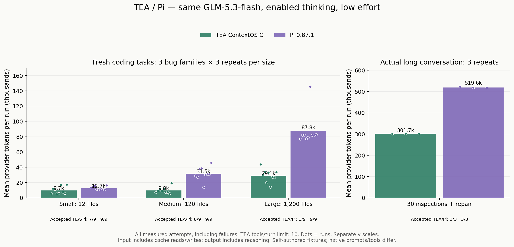
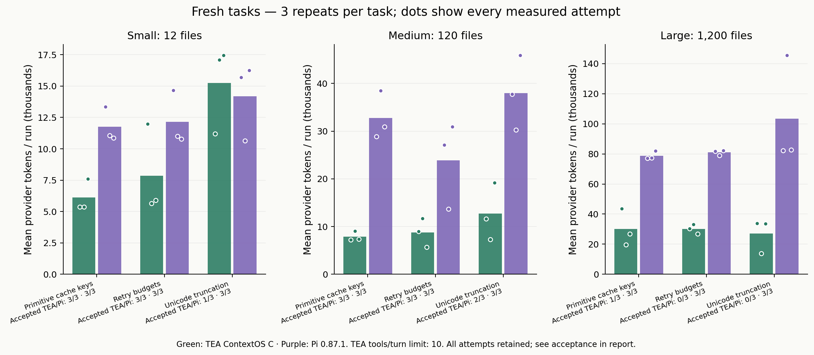
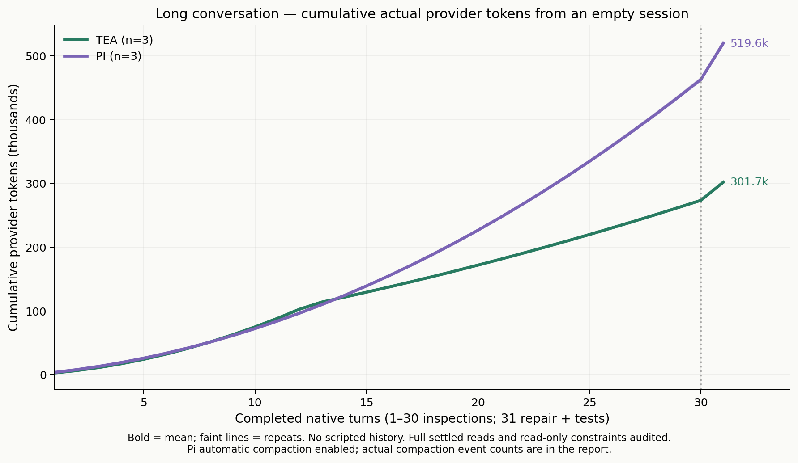

# TEA ContextOS C / Pi — measured provider tokens

[中文](README.zh-CN.md)

Run `contextos-pi-glm-20261011`; 2026-10-11T14:22:11.890Z → 2026-10-11T15:42:47.601Z.

## Controls and units

GLM-5.3-flash, enabled thinking, low effort, 4,096 output cap; Pi **0.87.1**, TEA frozen commit `b391a6b305fb849fea2aab5051ee61f6d3dc4651`. Thirty pairs / sixty runs, three repetitions per task.

Three self-authored JavaScript bug families at 12, 120 and 1,200 files; separately, an actual empty-start conversation with 30 complete source inspections followed by repair and tests. These are not production holdout repositories or evidence for other models.

Provider tokens = uncached input + cache reads + cache writes + output; reasoning is already included in output. All failures are retained. Task text and initial Git contents are identical. One gateway normalizes model controls while retaining native prompts and tools.

## Fresh coding tasks

- All 27 pairs: TEA **437,860**, Pi **1,187,808**; TEA used **63.14% fewer tokens**.
- Acceptance: TEA **16/27**, Pi **27/27**.
- Both-accepted subset (16 pairs): TEA 149,021 / Pi 407,285; 63.41% fewer tokens. This subset does not replace the all-attempt result.
- Requests TEA/Pi: 187/153; P95 elapsed: 65.44/55.14 seconds.

TEA acceptance declined; this group cannot establish an optimization preserving performance.

## Actual 30-turn conversation

- All 3 pairs: TEA **905,224**, Pi **1,558,908**; TEA used **41.93% fewer tokens**.
- Acceptance: TEA **3/3**, Pi **3/3**.
- Both-accepted subset (3 pairs): TEA 905,224 / Pi 1,558,908; 41.93% fewer tokens. This subset does not replace the all-attempt result.
- Requests TEA/Pi: 195/192; P95 elapsed: 485.60/463.18 seconds.

## Fresh project sizes

- small: TEA 87,604 / Pi 114,295; 23.35% fewer tokens; accepted TEA/Pi 7/9 · 9/9.
- medium: TEA 88,171 / Pi 283,742; 68.93% fewer tokens; accepted TEA/Pi 8/9 · 9/9.
- large: TEA 262,085 / Pi 789,771; 66.82% fewer tokens; accepted TEA/Pi 1/9 · 9/9.

## Audits and limits

- Complete usage in 30/30 pairs; unchanged TEA source and Pi CLI hashes; common controls, initial snapshots and ledger sums agree. Complete settled inspection reads, TEA/Pi: 90/90 and 90/90.
- TEA recovery-tool calls: 0; Pi automatic-compaction events: 0. Pi auto-compaction is enabled with a 200,000-token advertised window; TEA uses a 32,000-byte ContextOS soft target with model summarization off. Untriggered compaction features do not establish measured savings.
- Every inspection requires a complete settled read of the correct path with no edit/shell/test call. Repairs require an actually completed public test after the latest edit, plus independent hidden and scope acceptance.
- Conservative accounted cost **USD 3.3269960**, within the new USD 8 suite budget; per-run USD 1.40 / 100 requests, 180-second turn timeout. This is a supplied-rate budget estimate, not an invoice; token reduction is not monetary reduction. Earlier A/B/C costs remain recorded separately.
- Native prompts, tool protocols and cache directives differ; TEA allows 10 tools per turn while Pi retains its loop policy. Provider cache state cannot be reset; agent order alternates. Three repeats do not prove generalization.
- The earlier 52.12% TEA full-history comparison has a different baseline and task wording; cite it separately. No measured ContextOS C runtime behavior was changed for this experiment.

## Acceptance follow-up audit

After the primary paid run settled, completion-witness checks were added and all sixty final workspaces were rechecked. Original decisions are unchanged; Agent memory code is unchanged. Frozen original results are not rewritten. [Independent audit](completion-witness-audit.json).

## Reproduction and data

[Frozen protocol](../../../docs/CONTEXTOS_PI_EXPERIMENT.md) · [Run/request data](comparison.json) · [Grouped metrics](groups.json) · [SHA-256](evidence.sha256)

## Default-quota follow-up and cache tradeoff

Fresh tasks above inherited the memory benchmark's 10-tool quota rather than the CLI's existing default of 24. After completion, all nine fresh configurations and three repeats were selected for a separate 54-run follow-up. [Report separately](../contextos-c-vs-pi-default24-glm-20261011/README.md); it does not replace primary failures or construct a mixed ratio.

Long-session P95 TEA is **4.84% slower** than Pi. Cached-input shares TEA/Pi are **52.46%/94.25%**. Hypothetical uncached/cache-read/output rates of USD 0.80/0.23/2.80 per million imply **USD 0.465248/0.421215**, or **10.45% more** for TEA. This fixed-rate sensitivity does not verify the user's billing group and is not an invoice. [Calculation inputs](cache-price-sensitivity.json). The measured token advantage does not establish a speed or money advantage.

## Unaccepted primary runs

- `large-cache-key-r1/tea`: `tool_limit_reached`; independent code/scope `True`; native validation `False`; tool attempts 11; 43,709 tokens.
- `large-retry-budget-r1/tea`: `tool_limit_reached`; independent code/scope `True`; native validation `True`; tool attempts 11; 30,361 tokens.
- `large-unicode-r1/tea`: `tool_limit_reached`; independent code/scope `True`; native validation `False`; tool attempts 11; 33,913 tokens.
- `small-unicode-r2/tea`: `tool_limit_reached`; independent code/scope `True`; native validation `True`; tool attempts 11; 17,084 tokens.
- `large-cache-key-r2/tea`: `tool_limit_reached`; independent code/scope `False`; native validation `False`; tool attempts 11; 19,748 tokens.
- `large-retry-budget-r2/tea`: `tool_limit_reached`; independent code/scope `True`; native validation `True`; tool attempts 11; 33,078 tokens.
- `large-unicode-r2/tea`: `tool_limit_reached`; independent code/scope `True`; native validation `True`; tool attempts 11; 13,913 tokens.
- `small-unicode-r3/tea`: `needs_validation`; independent code/scope `True`; native validation `False`; tool attempts 10; 17,432 tokens.
- `medium-unicode-r3/tea`: `tool_limit_reached`; independent code/scope `True`; native validation `False`; tool attempts 11; 19,200 tokens.
- `large-retry-budget-r3/tea`: `tool_limit_reached`; independent code/scope `False`; native validation `False`; tool attempts 11; 26,822 tokens.
- `large-unicode-r3/tea`: `tool_limit_reached`; independent code/scope `True`; native validation `False`; tool attempts 11; 33,579 tokens.
