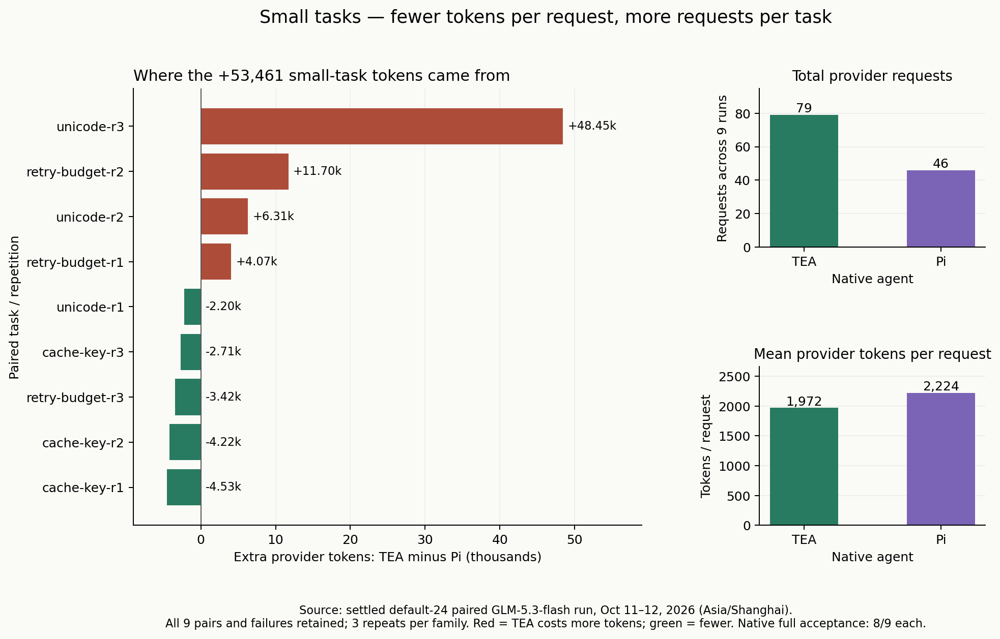
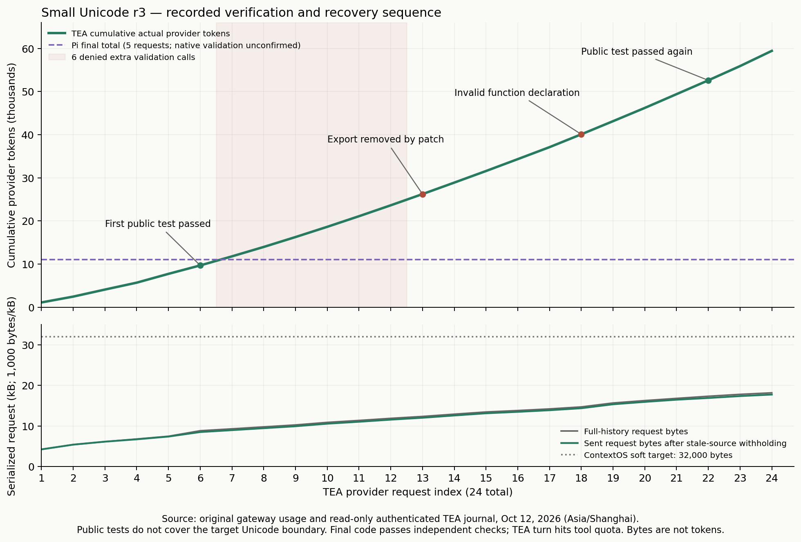

# Small-task token diagnosis: TEA ContextOS C / Pi

[中文](README.zh-CN.md)

## Findings

This is an observational diagnosis of all nine small pairs in the completed default-24 experiment, with zero new provider calls and no runtime change. Same GLM-5.3-flash enabled/low, 4,096 output cap, three self-authored JavaScript bug families and three repetitions each. Initial snapshots and frozen failures remain unchanged.

- TEA/Pi totals: **155,754/102,293 tokens**, TEA **52.26% more**; native full acceptance 8/9 each, independent code/scope 9/9 each.
- Requests: **79/46**, TEA **71.74% more**; mean tokens/request **1,971.57/2,223.76**, TEA **11.34% smaller**. This is an arithmetic decomposition, not an equivalent-position causal comparison.
- Cache-key totals: 21,653/33,105 (TEA −34.59%); retry: 46,101/33,749 (+36.60%); Unicode: 88,000/35,439 (+148.31%).
- Worst Unicode r3: 59,459/11,007; its +48,452 accounts for **90.63% of net extra tokens**. Excluding the entire pair as sensitivity only leaves 96,295/91,286 (+5.49%). This does not replace all-pair results or establish a realized improvement.

## Confirmed mechanisms and limits

**Capability mismatch and denied retry loops.** TEA recorded 21 denied shell calls, 20 after public validation had passed. Nineteen rejected shell characters/multiline commands; two required unavailable interactive approval. The whole-command string filter also rejects JavaScript semicolons and arrow functions inside quoted `node -e` input. Rewriting syntax does not enable the capability. Pi used native `--no-approve`; TEA retained its allowlist and headless approval restrictions. This comparison does not isolate memory as the cause, and Pi lacks complete retained command text for coverage reconstruction.

**Weak visible regression tests.** Unicode public assertions cover ASCII/zero limits, not surrogate pairs. Retry assertions omit zero budget and final-error propagation. The initially broken service passes public tests. Additional boundary verification was reasonable; immediate forced completion on a green public test would weaken quality.

**Recovery can regress already edited code.** Worst Unicode r3 first read back a flawed patch and fixed it, then passed the public suite after request 6. Requests 7–12 made six rejected boundary-check calls, including a Unix heredoc in the Windows profile. It then removed the export via `function __unused__`, failed a patch lookup, tried a denied `type` command and absolute read, and wrote the invalid declaration `function export`. Further patch/search work restored the exported function and passed public tests after request 22. Another denied shell call preceded exhaustion at 25 attempts / 24 executions. Final independent acceptance passed, but the native turn did not complete. The post-first-test requests 7–24 cost 49,778 tokens, including subsequent repairs and final-response opportunities; those tokens cannot all be labeled removable waste. API/syntax regressions are observable; psychological confusion or compression causation is unproven.

**Sparse edit and path feedback.** Five successful patches, two search-not-found errors and one absolute-path rejection occurred in that run. Patch receipts only return an updated path; schemas do not explicitly require relative paths. Propose before/after hashes, changed ranges and small current excerpts, plus safe workspace-contained path normalization. No successful no-op patch was observed; avoiding validation resets for no-ops is prevention, not an explanation of this dataset.

**Memory, cache and effort.** Maximum full request was 18,172 bytes, below the 32,000-byte target. Recoverable evictions and extra goal anchors were zero; stale source withholding reduced aggregate bytes 687,936 → 673,455 (2.10%). Bytes are not measured token savings. Stale-message behavioral effects require a separate experiment. Input accounts for 96.25% of TEA tokens; output including reasoning totals 5,848. Cache-read shares were TEA/Pi 82.70%/67.85%; all cache tokens count. Hypothetical input/cache-read/output rates 0.80/0.23/2.80 USD/M imply 0.065637/0.048237 USD, not an invoice. More requests remain costly despite cache hits. Preserve the model/effort comparison; reducing reasoning or paying for short-session summaries is not the first intervention. Stable prefixes are a secondary design consideration: [Anthropic's caching documentation](https://platform.claude.com/docs/en/build-with-claude/prompt-caching) requires matching cached content, without establishing GLM relay semantics.

**Quota and sampling.** A larger quota can extend a futile chain; a smaller quota can truncate valid repairs. Quota is a resource bound rather than completion logic. Three repeats per family and one dominant outlier cannot establish a general small-task disadvantage. Report code acceptance, task obligations, native validation uncertainty, failures and paired distributions separately.

## Proposed order; gains unmeasured

1. Capability declarations and typed non-retryable errors; deduplicate repeated capability denial using cause, source version and approval state, with executable alternatives.
2. Structured `program/args/stdin` validation under existing approval and file policies. Direct process arguments avoid shell quoting issues; they are not an OS sandbox. Support platform and framework variation rather than benchmark-specific rules.
3. Progress and completion logic based on requirements, current source and target verification; preserve incomplete states and permit legitimate extra checks. A denied capability must not be treated as a code-test failure or as evidence for editing source.
4. Versioned patch receipts and clear relative-path guidance; measure separately from other changes.

The underlying spawn already uses `shell:false` (with a separate Windows npm compatibility path). The proposed change concerns the single command-string protocol, filtering, argument parsing and capability negotiation. Removing character checks or opening arbitrary script execution is not the proposed remedy.

Compare each single change directly with current TEA before a native Pi reference. Freeze model, effort, output, tool budget, tasks, snapshots, acceptance and total cost; keep failed/unknown usage. Increase original small-family repetitions and add unseen real repositories/languages, with medium/large/long controls. A stronger visible test suite is a new cohort and must not rewrite old results. Quality must hold before token gains qualify. No improvement percentage is forecast.

## Evidence

All nine encrypted local TEA journals were read without writes; chains and authenticated artifacts were verified. All 79 native request hashes match original upstream gateway hashes, and journals remain unchanged. Exported data contains sanitized actions/version hashes and counts, not keys, signed thinking or full messages. 84 attempted tools versus 83 executed tools includes one quota denial.

[Diagnosis data](diagnosis.json) · [Original paired report](../contextos-c-vs-pi-default24-glm-20261011/README.md) · [SHA-256](evidence.sha256)
