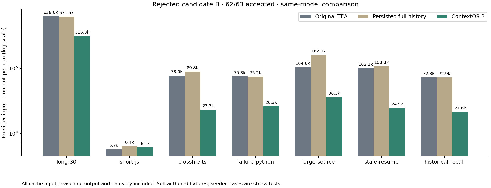
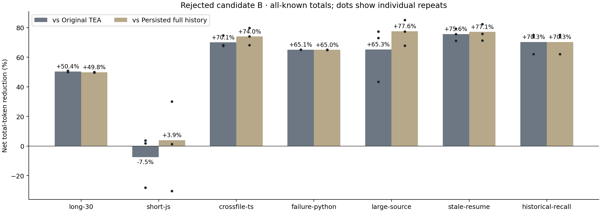
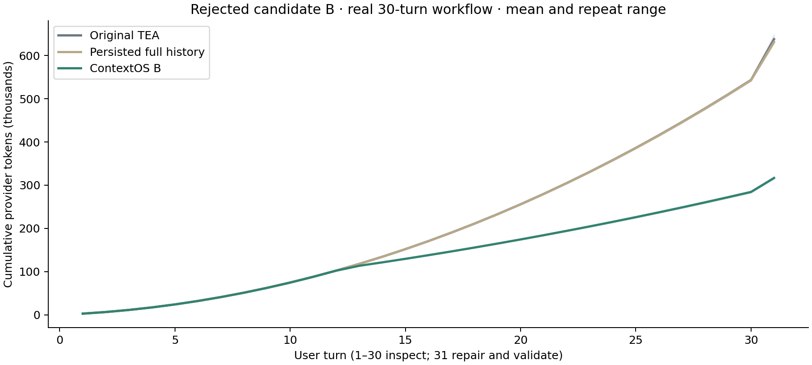

# TEA ContextOS 实验结果

[完整英文报告](README.md) · [逐轮用量与配置](candidate-b.json) · [失败候选和未知计费记录](candidate-a-aborted.json)

## 结论

B 因一个 TypeScript 运行修改范围外文件而淘汰；功能测试通过不等于满足任务。以下匹配通过样本的数值不能作为通过性能门槛的结论。

冻结门槛 **未通过**。B 共 63 次运行，62 次通过独立验收；所有输入、输出、缓存、恢复和失败调用均计入。长历史目标组中双方均通过的 11 对样本（剔除越界失败那一对）比旧版净减少 **54.59%**，比共用持久化的完整历史模式净减少 **57.66%**。从空会话开始的 30 轮真实检查加修复分别净减少 **50.35% / 49.84%**。每个场景重复三次。

## 失败尝试与费用

A 的短任务三次汇总比完整历史多用 **19.70%** Token，已淘汰。修正只存在失效源码时额外加入检索工具说明的问题。保留 11 次完整运行、被中断运行的 5 个已知请求和一个完整未知预留；没有将未知用量记作零。A+B 保守费用 **7.0620096 美元**，含未知预留，未超过 8 美元。费用为未打缓存折扣的估计，不是账单。

## 适用范围

七个自编场景，覆盖 JavaScript、跨文件 TypeScript、Python、12/120/1200 文件规模、30 轮真实交互、源码变化/日志恢复及历史回执检索。部分场景预置脚本化历史；Python 旧失败日志为显式合成。30 轮真实交互全部计费。每组同模型、思考等级及输出上限，三组并发费用分别预留。A/B 的说明注释长度、调度和场景数不同，不能比较其整体总量来证明改进。

离线回放的字节不是实际 Token；同一活跃源码的重复读取没有额外选择收益。TypeScript 没有独立类型检查，Java 没有真实编译。源码哈希不证明语义，完整历史仍驻留内存，已截断输出无法恢复。三个重复和自编任务不能证明所有真实项目都获益。短任务、负收益、各次重复、缓存、请求数、恢复、成功任务均摊费用、P50/P95 延迟与 Token 全部见英文报告和 JSON。默认完整历史，ContextOS 需主动开启。

## 补充检查任务审计

使用已有账本逐一核对 9 次运行的 270 个检查轮次：read_file 输出哈希均与对应完整文件输出一致，未执行 apply_patch/run_tests，无新 API 调用。[审计数据](inspection-audit.json)。此事后补查不改写原实验，也不推翻 B 的越界淘汰。
