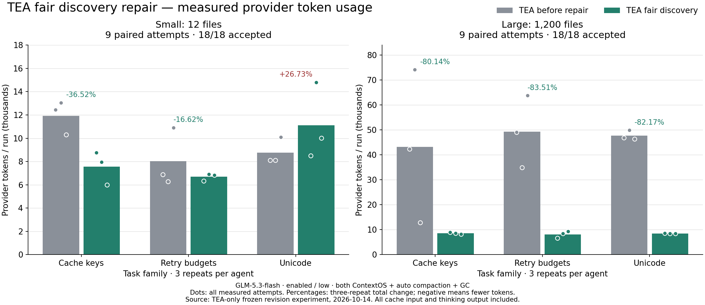

# Fair discovery repair — TEA-only provider comparison

[中文](README.zh-CN.md)

## Result

Baseline 990321e (previous GC version) versus repair d76f45f. Both have ContextOS, automatic compaction and GC enabled. All **36 attempts passed final acceptance**, all 226 provider requests have complete usage.

- Overall, 18 pairs: **506,421 → 151,678 tokens; 70.05% fewer**.
- Large, 1,200 files, 9 pairs: **420,295 → 75,583; 82.02% fewer**.
- Small, 12 files, 9 pairs: **86,126 → 76,095; 11.65% fewer**.

Individual three-repeat totals: large cache keys **80.14% fewer**, large retry budgets **83.51% fewer**, large Unicode **82.17% fewer**. Small cache keys **36.52% fewer**, small retry budgets **16.62% fewer**, but **small Unicode 26.73% more**. All nine large pairs decreased; 3 of nine small pairs increased. All points and regressions remain in the data.

This passes the measured large-task repair gate and the aggregate small-task guard, not an every-task or universal improvement gate. The earlier GC-only normal-workload regression remains recorded separately.

## What changed

Directory iterators rotate and discover child directories before their sibling files. A large directory cannot exhaust the initial candidate budget before small neighboring directories are visited. `list_files` defaults to at most 32 complete paths and roughly 2,048 UTF-8 body bytes, with one complete long-path exception. Explicit larger pages and `nextOffset` retain access to full results. Search has file/line continuation (`nextOffset`, `nextLine` → `startLine`). Offsets describe the live filtered traversal; restart after file-tree changes.

Small inventories retain the previous tool schemas until a search actually needs continuation. The two capability booleans persist across session restore. Compaction selection, GC policy, permissions and validation remain unchanged. There is no fixture path or language special case.

## Mechanism evidence

All 36 first request bodies were reconstructed and matched recorded provider-wire hashes. All nine small-task pairs were identical after workspace-path normalization. Actual initial large-task messages contain the target in **9/9 repaired runs versus 0/9 baseline**. Large model requests **87 → 44**, tool calls **106 → 45**, listing calls **26 → 0**, failed operations **4 → 0**. All successful edits remained in the allowed target paths in both arms.

Offline real-tool inspection independently found initial target coverage restored for all three large families. Default `list_files(src)` output dropped from 10,194 bytes to 1,453–1,461 bytes and included the target. Those are output bytes, not measured token savings. **No paid run compacted**, so the measured benefit is from discovery/interaction changes, not a summary call.

Small Unicode's costly second repaired attempt used eight requests rather than five, with repeated reads and a second patch. Initial small requests were equivalent, and these Unicode runs called neither listing nor search. The observed regression is retained; its causal attribution to discovery is not established.

## Controls, verification and limits

Same GLM-5.3-flash, enabled thinking / low effort, 4,096 output cap, endpoint, task prompts and initial source within pairs. Totals include uncached input, cache read/write input and output including thinking; summaries and failures would count. No Pi or Claude calls, no paid retries or excluded samples. Summary calls: zero. Conservative accounted cost USD **0.5504212**, not an invoice.

Three bug families at two repository sizes, three repeats: six self-authored JavaScript fixtures, 18 paired cases. Repository size adds unrelated files without making the defect more complex. No long-session, real-project holdout or all-language provider-performance claim. Rates and guards: USD 8 suite / 1.4 per run, 100 requests/run, 24 tools/turn, 180-second request / 300-second turn timeouts, 160,000-byte request guard, 32,000-byte ContextOS target. Unknown usage halts new paid calls; earlier unknown reservations remain separate.

**307/307 deterministic tests** and **36/36 native loopback contract runs / 144 requests** passed. One earlier contract wrapper hit its old 180-second total timeout; its zero-provider evidence was retained, then the wrapper was given 360 seconds for the two scales. It was not a paid retry or runtime deadline change.

[Full sanitized evidence](comparison.json) · [offline byte/coverage evidence](offline.json) · [frozen protocol and reproduction](../../../docs/DISCOVERY_REPAIR_EXPERIMENT.md) · [previous GC-only regression](../contextos-gc-tokens-20261014/README.md)

The repair stage is complete. Await review before the next optimization or merge.
