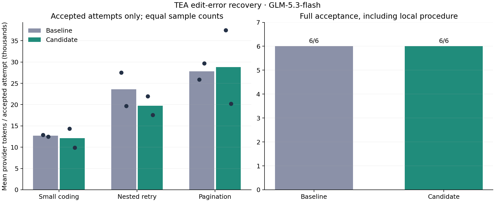

# 编辑错误恢复：真实任务对照

运行：`edit-recovery-screen-glm-20261017-v1`。完整：True。源码冻结校验：True。

3 道自编题，各组各重复 2 次；同模型、思考等级、流式和任务。仅比较错误恢复反馈，两组规则发现功能相同。

基线：`df89c92244c5d2381b5cb2b09d2e930ee5006d59`；候选：`55c0975cee9760af48316661a12f105e80dd6139`。

## 全尝试结果

- baseline：完整用量样本 6/6，这些样本合计 128,179 provider Tokens；含部分样本已报告用量的下界 128,179，未知请求 0；代码行为通过 6，完整验收通过 6；工具错误 3。
- candidate：完整用量样本 6/6，这些样本合计 121,349 provider Tokens；含部分样本已报告用量的下界 121,349，未知请求 0；代码行为通过 6，完整验收通过 6；工具错误 4。

Token 变化：-5.33%。
失败用量保留在全尝试统计中；用量未知不记为零。缓存读写按 ledger 规范化口径计入，思考不重复加算。

## 用量完整的配对样本

共有 6 对。基线 128,179 → 候选 121,349 Tokens（-5.33%）；完整验收 6/6 → 6/6。已覆盖计划的全部 6 对。

## 分题结果

- l1-narcissistic：完整用量样本成本 25,379 → 24,220 Tokens（-4.57%）；完整验收 2/2 → 2/2。
- instructions-nested-retry：完整用量样本成本 47,216 → 39,492 Tokens（-16.36%）；完整验收 2/2 → 2/2。
- instructions-nested-pagination：完整用量样本成本 55,584 → 57,637 Tokens（+3.69%）；完整验收 2/2 → 2/2。

## 重复间波动

- 重复 1：66,332 → 73,730 Tokens（+11.15%）。
- 重复 2：61,847 → 47,619 Tokens（-23.01%）。

## 过程审计

- baseline：适用规则在目标编辑前读取 6/6；已有文件误用新建 3；相同参数重复读取 2；工具结果中规则提示 8。
- candidate：适用规则在目标编辑前读取 6/6；已有文件误用新建 3；相同参数重复读取 0；工具结果中规则提示 4。

## 已有文件错误恢复

- baseline：已有文件错误暴露 3 次，成功补丁恢复 3 次；恢复前目标重读 1 次、列目录 0 次。
- candidate：已有文件错误暴露 3 次，成功补丁恢复 3 次；恢复前目标重读 0 次、列目录 0 次。

冻结数值门槛通过：True。完整覆盖、各题完整验收不下降且全尝试 Token 下降才通过；自然错误发生的任务与轮次不同，条件恢复统计仅供诊断。门槛通过不证明因果或稳定收益。

重复读取不必然无用；“读过规则”不保证遵守。审计工具顺序不等于还原内部思维链。

控制费用估算 0.235868 USD，非供应商账单。停止原因：None。

## 局限

仅 2 次重复，含复用的自编编码题及新增局部规则，不能泛化为生产正确率或普遍 Token 收益。普通测试断言错误导致的修复轮次变化，不直接归因于错误恢复反馈。详见同目录 summary.json 和仓库中的冻结协议。
