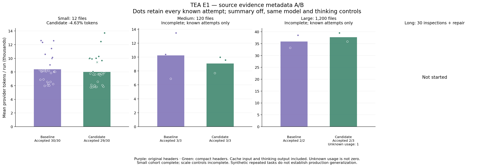

# E1: compact source evidence metadata

[中文](README.zh-CN.md)

## Result

**Runtime candidate reverted; source remains in Git history.**

71/102 planned runs; 375 submitted provider requests. Completed fixed experiment: False. All attempted work is retained.

- Fresh small tasks: 251876 → 240218 tokens; **reduced 4.63%**. Accepted baseline/candidate 30/30 and 29/30.
  Exploratory repeat bootstrap 95% interval: -6.09% to 14.28% reduction; p95 elapsed change +16.60%.
- Medium/large controls: incomplete (11/36 attempts). Missing provider usage prevents a complete-cohort token ratio. Accepted observed baseline/candidate 5/5 and 5/6; arm counts differ.

Stopped after 374 complete-usage requests and one unknown request: candidate large-unicode-r1 received upstream HTTP 502 on request six, before final usage. Its five earlier requests stay in the evidence. Unknown total tokens remain null, and USD 0.2674688 is reserved. Known conservative usage cost USD 0.6134700; known + reserved USD 0.8809388. No retry or later cohort launch; the long-session cohort was not started. The full planned experiment has no final overall reduction percentage.

Small-case small-cache-key-r6 passed both public and hidden code behavior. After positive native validation it attempted a patch that failed without changing source hashes; the frozen observer clears its validation marker on every edit attempt, so it failed the final validation dimension despite the runtime having already validated unchanged final code. This conservative grading limitation is recorded, not regraded; it is not evidence of lower code-behavior correctness. Both small arms passed code behavior 30/30. The declared paired-acceptance gate still failed.

## Change and integrity

The candidate removed the redundant full SHA-256 from source headers. Path, line range, 16-character display version and numbered source text remain. Full hashes stay in encrypted runtime metadata, including resume and finding versions. Metadata retention now follows canonical conversation lifetime instead of evicting at 128 outputs; this increases sidecar memory and journal metadata in long sessions. Missing compact metadata fails closed. Legacy headers continue to work. Tiny unchanged files may remain shorter than the existing reference notice and are returned verbatim by the unchanged shortest-output rule.

Baseline `f4589fa9bb0858902a804d926c142055bf135af2`; candidate `bd41742d683dfcda69f240223ff6b27815f3dd08`. Runtime changes are limited to tools, finding versions and ContextOS missing-sidecar handling; the offline memory checker also reads full hash sidecars. Fixed fixtures, native acceptance and live harness are unchanged. Paired frozen-acceptance regressions: 1; small-task code behavior remained 30/30 in both arms.

Candidate deterministic tests: 276/276, including eight new metadata checks. Native streaming loopback: 18/18 repairs, 72 requests, zero paid calls. Combination contract remains 17/18: its existing conditional post-summary history-tool gap persists. Do not call that contract fully compatible. Initial format-dependent assertion failures and an unrelated loopback bad-port failure are retained locally; final deterministic checks and all six candidate CI checks passed. No paid retries.

Conservative spent/reserved usage USD 0.8809388 under the frozen USD 8 suite guard; this is not an invoice. The earlier B1 unknown reservation remains separate.

Restored runtime tests: **268/268**, zero skips. Current Git src/package content matches the pre-experiment runtime; local line-ending conversion is recorded separately. Candidate implementation and metadata tests remain in commit bd41742.

## Limits

The plan covers three self-authored JavaScript defects repeated at 12/120/1200-file sizes plus one 30-inspection-and-repair workflow; the long-session cohort was not started. Repeats are not independent production tasks. Exploratory bootstrap samples repeat pairs within each fixture; intervals do not establish generalization. Serialized header savings are bytes, not provider tokens, and actual model trajectories may change. Provider cache state is not resettable by this harness. All uncached/cache-read/cache-write input and thinking output are included exactly once.

Same GLM-5.3-flash enabled/low, task output/thinking caps 4096/4095, ContextOS 32000-byte target, v1 inventory/read dedup, summary off, capability feedback on; 24 tools/turn, 100 requests/run, 160000-byte request guard, 180-second requests and 300-second turns. No routing or new tool schema.

[Summary](summary.json) · [All attempts](results.json) · [Native audit](native-audit.json) · [Functional checks](functional-checks.json) · [Frozen plan](frozen-plan.json) · [Protocol](frozen-protocol.md) · [Source audit](source-audit.json) · [Hashes](evidence.sha256)
