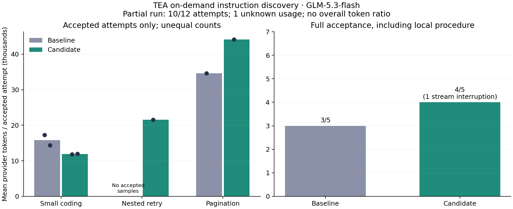

# 按需项目规则发现：真实任务对照

运行：`instructions-screen-glm-20261017-v1`。完整：False。源码冻结校验：True。

3 道自编题，各组各重复 2 次；同模型、思考等级、流式和任务。仅比较规则发现，不测试权限规则抑制率。

基线：`0b684437629ca3fbb9ea69d3de0bf049bee0950b`；候选：`039d2f77586504962b9e50025427e7463c1f9ba3`。

## 全尝试结果

- baseline：完整用量样本 5/5，这些样本合计 103,172 provider Tokens；含部分样本已报告用量的下界 103,172，未知请求 0；代码行为通过 5，完整验收通过 3；工具错误 3。
- candidate：完整用量样本 4/5，这些样本合计 89,464 provider Tokens；含部分样本已报告用量的下界 91,083，未知请求 1；代码行为通过 4，完整验收通过 4；工具错误 3。

覆盖不完整，不计算完整 Token 百分比。
失败用量保留在全尝试统计中；用量未知不记为零。缓存读写按 ledger 规范化口径计入，思考不重复加算。

## 用量完整的配对样本

共有 4 对。基线 86,446 → 候选 89,464 Tokens（+3.49%）；完整验收 3/4 → 4/4。仅代表这部分配对，不能代替计划的全部 6 对。

## 分题结果

- l1-narcissistic：完整用量样本成本 31,621 → 23,792 Tokens（-24.76%）；完整验收 2/2 → 2/2。
- instructions-nested-retry：完整用量样本成本 36,947 → 21,586 Tokens（用量覆盖不同，不计算百分比）；完整验收 0/2 → 1/2。
- instructions-nested-pagination：完整用量样本成本 34,604 → 44,086 Tokens（+27.40%）；完整验收 1/1 → 1/1。

## 过程审计

- baseline：适用规则在目标编辑前读取 2/5；已有文件误用新建 1；相同参数重复读取 0；工具结果中规则提示 0。
- candidate：适用规则在目标编辑前读取 4/5；已有文件误用新建 2；相同参数重复读取 1；工具结果中规则提示 4。

重复读取不必然无用；“读过规则”不保证遵守。审计工具顺序不等于还原内部思维链。

控制费用估算 1.179183 USD，非供应商账单。停止原因：unknown_usage_no_retry。

## 局限

仅 2 次重复，含复用的自编编码题及新增局部规则，不能泛化为生产正确率或普遍 Token 收益。普通测试断言错误导致的修复轮次变化，不直接归因于规则发现。详见同目录 summary.json 和仓库中的冻结协议。
