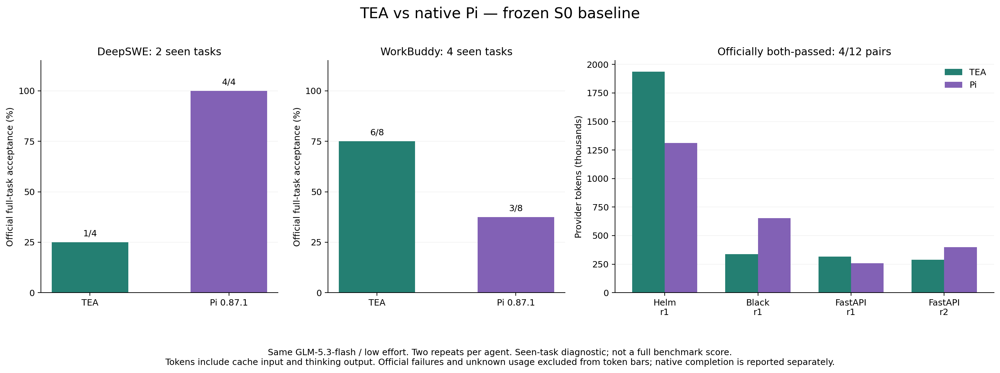

# S0 实测结果：TEA 与原生 Pi

已执行 24/24 次。任务均为此前见过的 6 道题，每个 Agent 每题重复两次；不代表完整基准分数或未见题泛化能力。

## 正确率优先

- DeepSWE / TEA：官方整题通过 **1/4**；已验收 4 次；原生完成且整题通过 0 次。
- DeepSWE / PI：官方整题通过 **4/4**；已验收 4 次；原生完成且整题通过 3 次。
- WorkBuddy / TEA：官方整题通过 **6/8**；已验收 8 次；原生完成且整题通过 5 次。
- WorkBuddy / PI：官方整题通过 **3/8**；已验收 8 次；原生完成且整题通过 3 次。

合计 TEA **7/12**，Pi **7/12**；观察到的通过率差为 **+0.00 个百分点**。这是小样本结果，不能据此证明统计等效。

**本轮 TEA 的长程任务通过率落后于 Pi，尚未达到目标。** 合计通过数相同不能代替分任务类型的判断。S0 建立了基线，没有修改 TEA 的解题代码。

WorkBuddy 官方平均得分（含部分通过）：TEA **0.9375**，Pi **0.6511**。这与整题通过率是不同指标，完整输出见 [官方统计](wb-official-metrics.json)。

## Token

双方整题都通过且初始状态、指令及独立用量核对一致的 **4/12 对**：TEA **2,878,108**，Pi **2,621,222**；TEA 总 Token **增加 9.80%**。该数字只适用于这些对应样本。

Token 包含输入、输出、缓存读取及缓存写入；思考已计入输出，不重复加算。失败不进入收益条形图，但保留在验收分母和完整记录中。未知用量保持 null，不能当作 0。

- deepswe：双方通过且完整计量 **1/4 对**，TEA Token **增加 47.67%**。
- wb：双方通过且完整计量 **3/8 对**，TEA Token **减少 28.13%**。

共 871 次提供商请求，21/24 次试验完成独立用量核对。3 次试验保留完整控制预留，合计 30 USD；这是预算预留，不是实际费用。**全量总 Token 未知，不能给出全量节省百分比。**

- TEA 全部尝试用量（含失败）：未知（存在不完整用量）；独立核对通过 10/12 次。
- PI 全部尝试用量（含失败）：未知（存在不完整用量）；独立核对通过 11/12 次。

## 每次结果

- deepswe · helm-unified-manifest-stream · r1 · tea：official=pass (新增 5/5；原有 2/2)；native=needs_validation；Token=1,936,867；工具报错=18；未提交保护=none。
- deepswe · helm-unified-manifest-stream · r1 · pi：official=pass (新增 5/5；原有 2/2)；native=completed；Token=1,311,650；工具报错=5；未提交保护=none。
- deepswe · mnamer-daemon-watch-lifecycle · r1 · pi：official=pass (新增 51/51；原有 319/319)；native=completed；Token=1,245,549；工具报错=7；未提交保护=none。
- deepswe · mnamer-daemon-watch-lifecycle · r1 · tea：official=fail (新增 48/51；原有 319/319)；native=completed；Token=659,879；工具报错=8；未提交保护=none。
- deepswe · helm-unified-manifest-stream · r2 · pi：official=pass (新增 5/5；原有 2/2)；native=failed/stream_incomplete；Token=unknown；工具报错=3；未提交保护=none。
- deepswe · helm-unified-manifest-stream · r2 · tea：official=fail (新增 0/5；原有 1/2)；native=cancelled；Token=unknown；工具报错=5；未提交保护=none。
- deepswe · mnamer-daemon-watch-lifecycle · r2 · tea：official=fail (新增 33/51；原有 319/319)；native=completed；Token=791,645；工具报错=8；未提交保护=none。
- deepswe · mnamer-daemon-watch-lifecycle · r2 · pi：official=pass (新增 51/51；原有 319/319)；native=completed；Token=689,642；工具报错=3；未提交保护=none。
- wb · bug_fix-medium-incorrect_linenos_on_fstring · r1 · tea：official=pass (6/6)；native=completed；Token=336,229；工具报错=7；未提交保护=none。
- wb · bug_fix-medium-incorrect_linenos_on_fstring · r1 · pi：official=pass (6/6)；native=completed；Token=652,746；工具报错=1；未提交保护=none。
- wb · python_port-medium-blog_tags · r1 · pi：official=fail (9/20)；native=completed；Token=42,647；工具报错=2；未提交保护=none。
- wb · python_port-medium-blog_tags · r1 · tea：official=fail (12/20)；native=failed；Token=unknown；工具报错=7；未提交保护=none。
- wb · feature-medium-add_support_for_dependencies · r1 · tea：official=pass (4/4)；native=completed；Token=315,358；工具报错=6；未提交保护=none。
- wb · feature-medium-add_support_for_dependencies · r1 · pi：official=pass (4/4)；native=completed；Token=256,899；工具报错=1；未提交保护=none。
- wb · product_analytics-hard-signup_funnel · r1 · pi：official=fail (7/13)；native=completed；Token=17,660；工具报错=0；未提交保护=none。
- wb · product_analytics-hard-signup_funnel · r1 · tea：official=pass (13/13)；native=completed；Token=76,064；工具报错=5；未提交保护=none。
- wb · product_analytics-hard-signup_funnel · r2 · pi：official=fail (2/13)；native=completed；Token=16,728；工具报错=0；未提交保护=none。
- wb · product_analytics-hard-signup_funnel · r2 · tea：official=pass (13/13)；native=completed；Token=234,727；工具报错=14；未提交保护=none。
- wb · feature-medium-add_support_for_dependencies · r2 · tea：official=pass (4/4)；native=completed；Token=289,654；工具报错=5；未提交保护=none。
- wb · feature-medium-add_support_for_dependencies · r2 · pi：official=pass (4/4)；native=completed；Token=399,927；工具报错=3；未提交保护=none。
- wb · python_port-medium-blog_tags · r2 · pi：official=fail (18/20)；native=completed；Token=79,132；工具报错=2；未提交保护=none。
- wb · python_port-medium-blog_tags · r2 · tea：official=fail (18/20)；native=completed；Token=81,668；工具报错=4；未提交保护=none。
- wb · bug_fix-medium-incorrect_linenos_on_fstring · r2 · tea：official=pass (6/6)；native=needs_validation；Token=503,563；工具报错=11；未提交保护=none。
- wb · bug_fix-medium-incorrect_linenos_on_fstring · r2 · pi：official=fail (1/6)；native=failed/wall_timeout；Token=2,226,438；工具报错=12；未提交保护=none。

## 解释边界

- 本轮只建立新的原生 Agent 基线，没有修改 TEA 的解题逻辑。先审核本轮，再决定 S1。
- 模型、上游思考预算及 effort 一致；原生提示词、工具、命令权限和压缩策略保留差异。TEA 命令策略比 Pi 原生 Bash 更受限，因此不能把差距全部归因于模型或 ContextOS。
- 新实验工具上限为 4096，主约束是 128 次提供商请求、1800 秒和每次 10 USD 控制预算。不能复用此前 96 工具上限的历史总量。
- 131072 是任务输出上限；Pi 会按原生上下文策略降低实际输出限额，双方摘要请求也有不同的原生限额。
- 两次重复、见过的任务和随机轨迹不足以证明普遍优劣。官方评分故障、执行失败和未知用量均保留，不能静默重试或改分。
- 详细协议、源码/镜像哈希见 [英文方法](README.md)，逐次标量见 [DeepSWE](deepswe-results.json)、[WorkBuddy](wb-results.json)。不发布模型推理或完整会话。

## 过程分析与下一步

见 [执行诊断与 S1 建议](DIAGNOSTICS.zh-CN.md)。重点是从公开需求建立可观察的验收项，验证持续行为，并保留崩溃场景的复验；本轮结果等待审核后再进入 S1。
