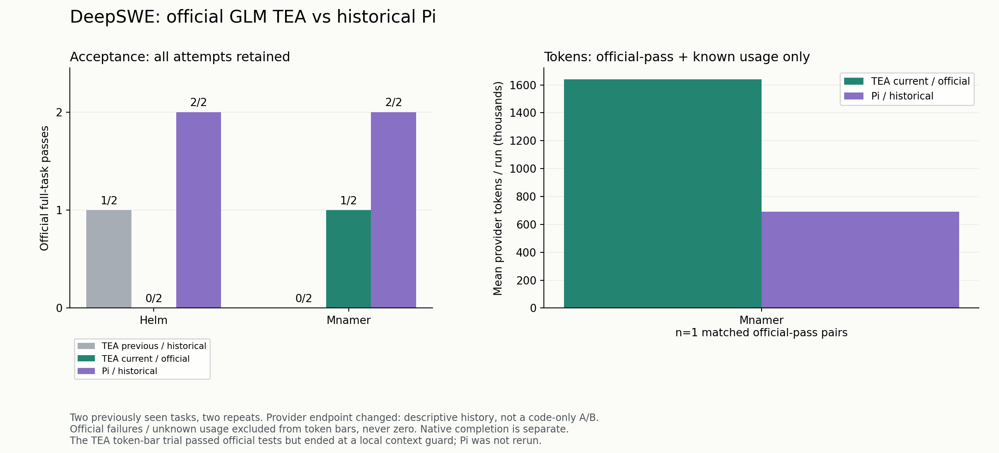

# TEA 官方 GLM 源 DeepSWE 复测

候选源码：`819bd728039a59ac7e9bb5ed1a0080c9f14ecbd8`；任务调用前协议冻结提交 `3b0215a`。两道已见题，各重复两次，共 4 次 TEA 尝试。Pi 未重测。

## 官方整题验收

- 新 TEA：**1/4**。
- 历史 TEA：**1/4**；历史 Pi：**4/4**。
- 与历史 TEA 的整题通过率相同；比历史 Pi 低 **75 个百分点**。由于更换了服务源，不能由此识别本次代码变动的独立效果。
- 只有新增功能和原有回归均满足官方要求才算整题通过；部分通过与客户端完成状态另列。

## 逐次结果

- helm-unified-manifest-stream / 第 1 次：新增 0/5，回归 2/2；原生状态 `failed`；45 次请求；Token 790,877。
- mnamer-daemon-watch-lifecycle / 第 1 次：新增 48/51，回归 319/319；原生状态 `completed`；54 次请求；Token 1,174,598。
- helm-unified-manifest-stream / 第 2 次：新增 0/5，回归 2/2；原生状态 `failed`；48 次请求；Token 987,923。
- mnamer-daemon-watch-lifecycle / 第 2 次：新增 51/51，回归 319/319；原生状态 `failed`；66 次请求；Token 1,639,847。

## Token 与历史 Pi 的描述性比较

仅双方整题通过且用量已独立核对的 **1/4 对**：新 TEA 1,639,847，历史 Pi 689,642，算术变化为 **+137.78%**。

该对是 Mnamer 第 2 次：TEA 的代码通过官方验收，但客户端最终被本地上下文检查中止，并非正常完成会话。此处遵循事先冻结的“官方整题通过 + 已知用量”定义。若另要求双方客户端正常完成，则本轮没有合格对，不计算比例。

全部 4 次 TEA 尝试累计 **4,593,245 Token、213 次请求**：非缓存输入 3,970,649、缓存输入 549,952、输出（含思考）72,644；缓存写入 0。全部用量独立核对完整，未重试，未出现未知用量。历史 Pi 有一次未知用量，因此不能计算双方所有尝试总量的增减百分比。

失败与未知用量不进入成功样本 Token 均值；全部尝试保留。历史 Pi 的 Helm 第 2 次用量未知，继续排除其 Token 比较，不补 0、不重跑。

**本轮同时更换源码与服务源，以上仅为历史描述性比较，不能将差异全部归因于本次代码修改。** 不同服务源还可能影响推理、缓存、分词及速度。正常完成、官方代码验收和计量完整性是不同指标。

上下文、思考请求参数、输出上限、命令权限、镜像、时间和请求控制沿用冻结协议。每次10USD、合计40USD为保守控制额度，不是官方人民币账单；另列端点探测16输入+3输出，不计入任务 Token。未知账单保留原预留，无自动重试。

原始对话与私有思考不公开；只分析可观察的工具操作、生成代码和验收反馈。没有读取隐藏测试实现或参考补丁。小规模已见题不等同于完整 DeepSWE 排行榜分数。

[冻结协议](protocol.json) · [离线基础设施预检](preflight.json) · [逐次数据与历史参照](results.json) · [官方接口](https://docs.bigmodel.cn/cn/guide/develop/claude/introduction)

## 执行过程：差距在哪里

### 1. 三次中止来自本地上下文保护，不是官方 API 断流

两次 Helm、Mnamer 第 2 次都由 `MODEL_CONTEXT_LIMIT` 中止，检查发生在提交下一次模型请求之前。估算输入分别为 85,525、87,497、80,953，上限均为 80,832。没有触发本轮 30 分钟 Agent 时限，也没有耗尽 128 次请求或 10 USD 控制额度。

实际算式为 `216000 - 131072 - 4096 = 80832`：当前实现从配置窗口中预留完整的最大输出和安全余量；自动压缩约在该输入上限的 80%（64,665，使用本地估算器）触发。不能将这个估算值说成官方实际报告的上下文耗尽。

历史 Pi 同样声明 216K 模型窗口，但采用自己的压缩与估算策略。核对与原冻结归档一致的 Pi 0.87.1 源码，默认压缩余量为 16,384，触发公式是 `contextTokens > contextWindow - reserveTokens`。TEA 还使用默认 32KB ContextOS 目标、近期两轮及活跃文件等保留规则。**这些是源代码层面的策略差异，不是同一估算口径下的实际可用容量测量，也不是组件消融结论。** 详见 [策略核查](context-policy-inspection.json)。

### 2. 摘要输出只有 1,200，上限截断后缺少恢复路径

本轮共发出 5 次摘要请求，仅采用 2 次；另 3 次均以 `max_tokens` 结束，输出达到 1,200，因摘要不完整而保留原历史。两个 Helm 各有一次成功摘要、一次被截断摘要；Mnamer 第 2 次的唯一摘要请求被截断，没有采用。

主任务的 131,072 输出上限不适用于摘要：`prepareCompaction()` 将摘要限制为 `min(maxOutputTokens, 1200)`。自动摘要返回 `unchanged` 后，本轮 `autoCompactionFailedThisTurn` 会禁止继续自动尝试；后续没有紧急恢复，最终由本地输入预算阻止下一次请求。

拒绝不完整摘要本身是在保护需求和历史，不能通过强行采用残缺内容解决。需要修正摘要预算、已知截断的有限恢复方式，以及压力下的回退行为。

### 3. 获取证据与开始实现之间仍有明显摩擦

Helm 第 1 次没有修改文件，导出补丁为空；第 2 次到第 91 次工具操作才首次尝试写入，最终只新增一个辅助文件，未完成各入口集成。两轮分别有 24、28 次重复参数的读取／搜索／召回。重复不一定无价值：已有内容被引用化后，模型可能必须重新取得细节；这里说明存在获取证据的往返，不能把每次重复都标为模型无效操作。

新的提示词没有消除这条执行路径。下一步应检验工作集保留、召回稳定性和渐进式实现，不能仅继续追加行为要求。

### 4. 后台实现有进展，需求覆盖仍不稳定

Mnamer 第 1 次使用 `os.fork()` 创建独立进程；旧版第 1 次失败的持续处理用例此次通过，因此不能继续归因为旧的守护线程生命周期错误。但两个重启用例和一个配置启动用例仍失败，Agent 却正常声明完成。

生成代码中的 `fork` 子进程没有重定向标准流。历史 Pi 两次实现均使用 `Popen`、`start_new_session=True` 和三个标准流的 `DEVNULL` 重定向。独立的 [Linux 进程实验](pipe-fixture.json) 验证：仅创建新进程或新会话、但继承捕获管道时，启动父进程已退出，调用者仍可能等待输出管道；重定向后调用者能及时返回。三个实验均为有限自退出进程、没有模型调用。这验证了该代码模式的风险，**不单独证明三个官方失败各自的完整原因**。

记录中的 CLI 实测主要涵盖 run-once、配置校验及负向参数等。不能仅凭显式工具命令清单断言 pytest 内部没有调用真实入口；能确定的是，本地通过没有覆盖住剩余官方行为。Mnamer 第 2 次采用独立 `Popen` 工作进程，最终官方新增 51/51、回归 319/319 全部通过，表明这一轮确实产出了符合官方要求的代码。

### 5. 代码通过验收，仍可能在额外验证中无法收尾

Mnamer 第 2 次保留了四条未解决检查：其中有检查路径 `tests/unit` 不存在的用法错误；广范围及特定 e2e 输出还包含对 OMDb／TMDb 的明确 DNS 解析失败。随后摘要截断、本地上下文超限，会话失败。

这些证据要求区分命令用法、外部依赖和源码失败；但不能因为日志出现网络错误，就把整条广范围检查全部判定为环境问题。官方指定验收通过也不等于项目所有额外检查都通过。当前的失败保留避免了掩盖已观察问题，同时暴露出检查选择、分类和有界收尾的成本。

另一个识别边界是项目自定义崩溃报告：第 1 次 Mnamer 的 run-once 曾以非零退出并将崩溃信息写入 stdout，随后 Agent 修复并重跑了同一命令。新入口检测主要识别 stderr 中的 Python／Node 异常，不能将这次自主复验直接归功于它，也不能宣称已覆盖所有入口失败形式。

## 下一阶段建议

1. 优先分离最大输出上限与每次输入预留，使用实际剩余空间规划输出；保持真实窗口和安全边界，避免为每次请求固定预留全部 128K。
2. 给思考与摘要正文足够的输出空间；对已知 `max_tokens` 截断提供有限恢复，区别于无收益压缩与未知账单，保留原历史和待验证状态。
3. 在有效容量内保留当前实现工作集，减少引用化后重复召回；先做组件对照，不直接关闭全部过期保护或无界保留历史。
4. 让后台启动、持续处理、重启及配置组合对应真实结果检查；将命令用法错误、环境限制与产品失败分开记录，防止以无关绿灯收尾，也避免无效命令永久消耗修复回合。
5. 新一轮 TEA 基线和候选都使用同一官方源做对照，Pi 仍可沿用历史参照。逐项修改、冻结配置、保留全部失败，再判定真实解题率和 Token 收益。

**结论：本轮没有达到 Pi 的水准，也没有证明 Token 优化收益。** 不应将此结果标为成功率／性能提升，或据此推荐整包合并。源码和服务源的独立贡献尚未识别；没有在本轮测试中途修改配置、覆写失败或追加付费重试。

[SVG](official-deepswe-history.svg) · [过程诊断](diagnostics.json) · [验证与哈希](verification.json)
