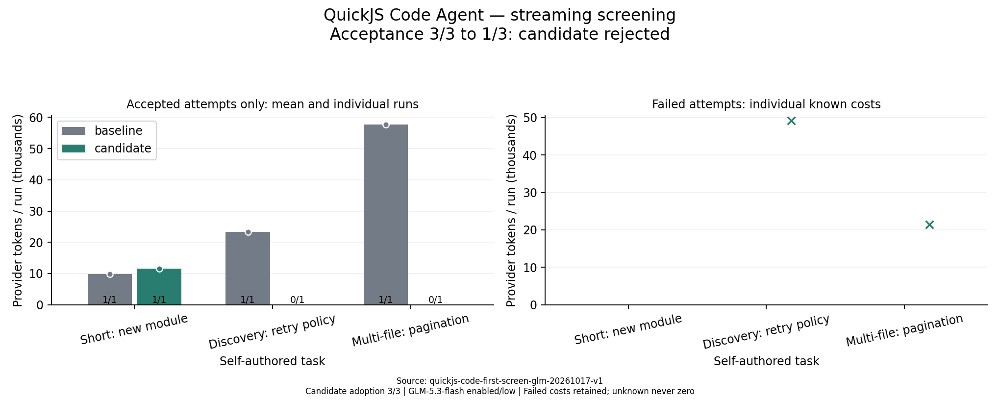

# QuickJS Code Agent：真实流式筛查

三题 × 一轮 × 两边，计划 6 次；完成 6 次，覆盖及用量完整：True。

本轮基线 dd19de3、QuickJS 候选 9c2eea6；候选及入口指纹见 summary.json。相同任务、模型、思考等级、流式与验收；候选替换检索入口、模式说明与能力声明，命令限于验证。比较整个模式，不只解释器。

全尝试已知 Token：91,008 → 82,349。完整组变化 **-9.51%**。

**本轮无有效优化：候选验收下降，运行时将撤销。漏写 await 导致 Promise 被序列化为空对象，不能把这些无报错结果当作有效证据。**

完整验收 3/3 → 1/3；代码行为 3 → 1。

模型请求数 26 → 33。候选采用 3/3；编排 25 次，错误 6 次，子操作 42 次，成功 41 次。

候选多子操作程序 8 次，其中无工具错误（不代表有效证据） 7 次；路由拒绝 1 次。

同题首次输入候选减基线：-42.67 provider Token（配对均值）。

质量门槛 False，完整覆盖、质量不下降且总量减少的筛选门槛 **False**。

以上为预先声明的数值门槛。代码优先还需要实际成功编排的机制证据；空目录创建任务允许不检索。若实际采用率为零，即使数值门槛通过，也没有编排减少往返的真实证据，不能据此默认开启或宣称 Code Agent 收益。

## 逐题结果

- Short: new module：验收 1/1 → 1/1；已知 Token 9,830 → 11,638；候选采用 1 次任务。
- Discovery: retry policy：验收 1/1 → 0/1；已知 Token 23,398 → 49,217；候选采用 1 次任务。
- Multi-file: pagination：验收 1/1 → 0/1；已知 Token 57,780 → 21,494；候选采用 1 次任务。

## 轮次和限制

- 第 1 轮：完成 3 / 3；已知 Token 91,008 → 82,349。

缓存输入和输出中的思考均包含且不重复累加；失败成本保留在总量，成功柱排除失败，未知不画成零。工具尝试包含子操作；外层调用与子操作分别报告。

只有三道先前已使用的自编 Node 任务、每题一次，不是保密留出或生产泛化证明。首次输入差和生成路径波动不等于全部涨跌的因果份额。重试题是检索密集对照，短任务用于观察固定开销。

每次 1 USD 预留、组上限 2 USD；请求 90 秒、命令 120 秒、任务 600 秒、工具上限 24（包括子操作）。用量未知保留预留并停止，不自动重试；预算价格非发票。源码、入口和任务指纹核对，真实用量及编排计数从 ledger 审计，编辑和验证计数由加密事件独立核对。

筛选结束等待审核，不自动部署、合并或开始下一阶段。运行时是否撤销及失败原因另见实验协议的实际结果节。

完整程序、错误和标记不完整的前缀由加密事件单独审计，见 summary.json 的 prefixAudit；无工具错误不自动等于程序完整。

[逐次数据](summary.json) · [设计、协议及实际决定](../../../docs/QUICKJS_CODE_FIRST_EXPERIMENT.zh-CN.md)
