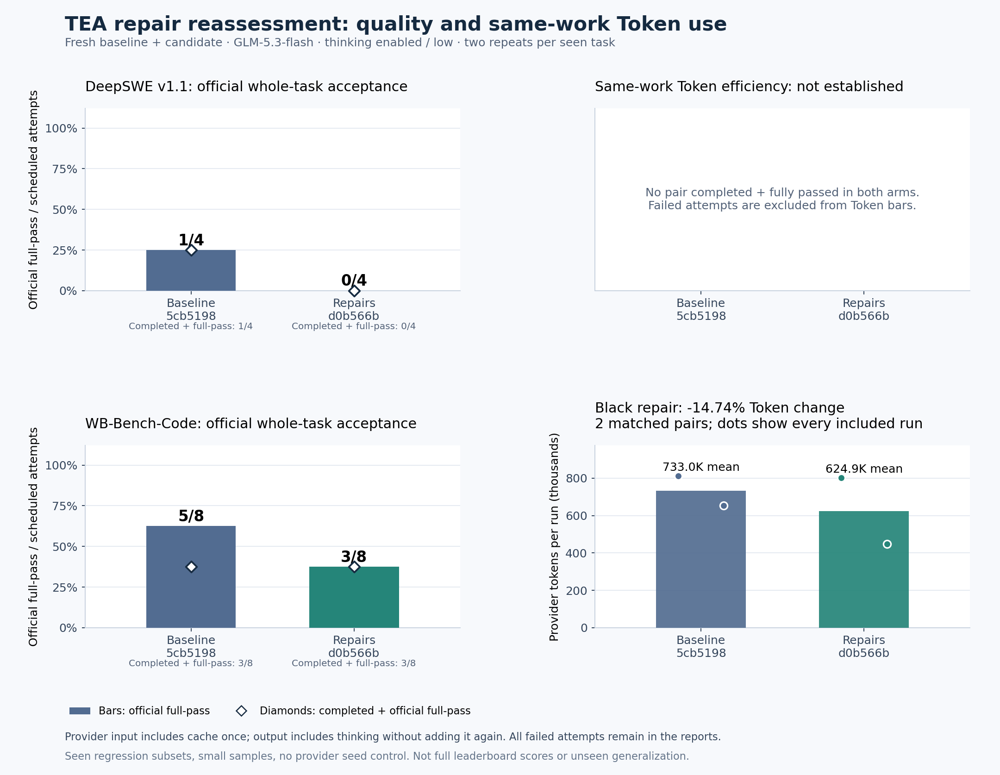

# Repair package: fresh DeepSWE and WB-Bench-Code reassessment

Status: **completed: 24/24 attempts, all 825 provider requests reconciled, zero unknown usage and zero paid retries**. Protocol snapshot committed before calls in `0b2a8a9`. Both native schedule processes exited successfully; that does not mean every task passed.

## Results: the package did not preserve task correctness

- DeepSWE subset: official whole-task acceptance **1/4 (25%) → 0/4 (0%)**, down **25 percentage points**. All-attempt consumption **3,359,152 → 2,609,223 tokens (−22.32%)**; no mutually completed, full-pass pair, so same-work efficiency is not established.
- WB-Bench-Code subset: official whole-task acceptance **5/8 (62.5%) → 3/8 (37.5%)**, down **25 percentage points**. Official mean reward **0.7875 → 0.7048**. All-attempt consumption **3,220,424 → 2,048,101 tokens (−36.40%)**; lower correctness prevents calling this an overall efficiency win. Completed + full-pass is **3/8 in both arms**, a separate metric.
- Black repair only: two mutually completed, full-pass pairs consume **1,465,967 → 1,249,870 tokens (−14.74%)**; individual changes **−1.30% / −31.42%**. This is a small, selected, single-task observation, not general savings.

Bars on the left show official whole-task acceptance; diamonds show completed + full-pass. Token bars include only eligible successful pairs. Failures remain in every per-attempt report, not as zero-token successful work.

[Chinese analysis and next steps](RESULTS.zh-CN.md) · [Methods](METHODS.zh-CN.md) · [DeepSWE results](deepswe-results.json) · [WB results](workbuddy-results.json) · [SVG](outcomes.svg)

## Frozen comparison

- Baseline: `5cb519899cccf5a0f91ab2ff74c215dd948f4448`, pre-repair production source (same runtime as `7bd236f`). Fresh attempts, not historical baseline reuse.
- Candidate: `d0b566b36c6babe287fb96e4b2f63c31af5a752c`, full repair package: runner-unavailability handling, bounded command settlement, safe file-scoped search and generic real-entry guidance.
- DeepSWE v1.1: the same two seen tasks, two repeats per arm, **8 attempts**.
- WB-Bench-Code: the same four seen tasks/categories and compatibility images, two repeats per arm, **16 attempts**.
- Both arms: GLM-5.3-flash, streaming, thinking enabled / low, maximum output 131,072, derived thinking budget 8,000, context 216,000, output reservation/input guard unchanged, ContextOS 32,000 bytes, automatic compaction/GC, 96 tools/128 requests, 900-second request deadline and 30-minute Agent wall.
- Control allocation: **10 USD per attempt, 80 + 160 = 240 USD maximum**; allocation/rates are not an invoice. Historical unknown reservations remain separate. No automatic retry of failed or unknown-billing attempts.

## Hypotheses

1. Missing test runners no longer trap the Agent in repeated unavailable commands; alternatives remain explicitly limited and cannot clear observed source failures.
2. Commands with inherited pipes can return feedback within bounds, allowing the Agent to continue.
3. File-level search removes a concrete invalid-input loop; entry-point guidance may improve coverage. Neither guarantees autonomous retrieval convergence or full correctness.
4. Reduced failed work or earlier stopping is not counted as efficiency. Whole-task quality is evaluated first.

## Comparability and integrity

Native frameworks, task instructions, source snapshots, images, command policies and official grading are unchanged from the [previous cohort](../workflow-native-screen-20261020/METHODS.zh-CN.md). All these tasks and past failures have been analyzed, so this is a **seen regression subset**, not unseen generalization or a full leaderboard score. No task-specific hints, hidden test implementation or reference answers are supplied to either model.

Both arms receive the same minimal TEA installation: runtime source and required benchmark helper scripts only, excluding TEA reports, repair-analysis docs, tests and reference answers. Each native trial starts from a fresh task container. The package comparison does not isolate individual fixes or prompt causality.

Shared harness additions are frozen before calls: preserve already-written request ledgers before native cleanup if a terminal result is missing; isolate post-inference native task failures so only the remaining predeclared independent schedule can proceed after the relay drains. Pre-inference infrastructure failures or an undrained relay stop the schedule. A failed attempt is never rerun or fabricated as a successful workflow.

## Reporting rules

- Official per-task full acceptance, partial checks, Agent completion status and execution failures are separate.
- Provider input includes cache once; output does not double-count thinking. Reconcile native ledgers with independent transport counts, hashes, usage and model controls.
- All-attempt tokens describe consumption, including failures. Unknown usage remains null with its full reservation.
- Same-work Token efficiency requires both arms completed, official full-pass, identical initial snapshot/instruction and complete reconciliation. Failed/unmatched attempts do not enter successful-work Token bars.
- Report every fixed attempt, variability across repeats, native environment adaptations, unavailable checks and remaining limits. Do not replace previous results or silently change task/model/limits mid-run.

[DeepSWE frozen protocol](deepswe-protocol.json) · [WB-Bench-Code frozen protocol](workbuddy-protocol.json) · [repair design](../../../docs/RUNTIME_REPAIR.zh-CN.md)
