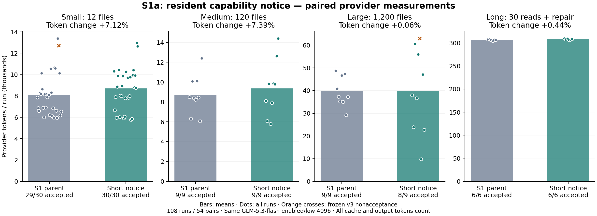
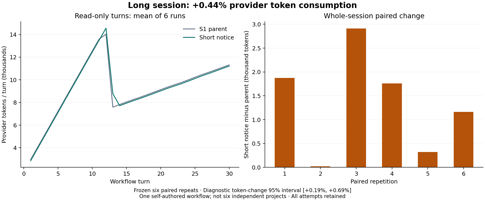

# S1a：缩短常驻能力说明的真实对照

[English](README.md) · [全部运行与请求](results.json) · [汇总](summary.json) · [冻结协议](frozen-protocol.md)

## 结果与处理

本轮仅实施方案 1：能力说明从 **699 → 398 UTF-8 字节（减少 43.06% 字节）**，其余详细错误反馈与实际执行策略保持原样。**这版已回退，不保留为正式优化。**

长会话实际 Token **1,840,548 → 1,848,598，消耗变化 +0.44%**。全部 108 次运行的消耗变化 **+1.25%**。正数表示增加，负数表示减少；字节减少不等于 Token 收益。

冻结数值门槛结果：**未通过：长会话总量减少、长会话重复区间、其他规模用量不增加、无配对质量下降、修改范围、P95 耗时**。另发现说明准确性问题：短句把 Windows 引号限制写成一般限制，实际只约束白名单命令。一次原生工具离线检查证明，明确批准的非白名单 `node -e` 命令带引号和括号仍能成功执行。这个问题需要修正，不能以 Token 更少代替准确说明。

该准确性发现单独列出；**没有改变冻结的数值门槛、验收分数或失败记录**。修正文本后的其他候选没有付费复测，不能沿用本轮百分比。

## 实验条件

父版 `eb39591bd7e6fcee354a5ee660abb356c936c701`，候选 `efc942daab0d09da196d515c8f0e7799833bf417`。这里比较的是当前 S1 完整说明与本轮短说明，不是 S0 或 Pi。双方从同一任务快照开始，GLM-5.3-flash、enabled/low、输出 4096、ContextOS 32,000 字节目标、24 工具/轮、100 请求/运行；90 秒请求及 180 秒单轮超时，语义摘要关闭，无交互批准。模型、思考、权限、工具、错误反馈、记忆选择和停止规则保持一致；说明变化会自然改变上下文替换时点。

固定 6 组长会话配对（12 次）、3 类小任务各 10 次重复（60 次）、中大型各家族 3 次重复（36 次），共 **108 次运行 / 54 组配对 / 1,366 个用量完整的付费请求**。每个规模下父版与候选任务数量相同，原生框架交替运行顺序。不同规模及重复不是独立项目。

共享保守费用 **USD 4.1605176 / 8**，每运行上限 USD 1.4；输入/输出预算费率 0.80/2.80 每百万，缓存输入按全价预留。这不是账单。没有丢弃负向样本、替换失败或静默重试。启动脚本首次检查准备状态时文本不匹配，在零 API 请求时修正，候选与计划不变。

## 分组结果

- **小型**：243,660 → 261,014，消耗变化 **+7.12%**。
- **中型**：78,542 → 84,344，消耗变化 **+7.39%**。
- **大型**：357,289 → 357,507，消耗变化 **+0.06%**。
- **长会话**：1,840,548 → 1,848,598，消耗变化 **+0.44%**。

全部尝试合计：输入 **2,495,635 → 2,524,209**，输出 **24,404 → 27,254**；模型请求 **668 → 698**，工具 **512 → 538**。输入含全部缓存读取和创建，输出含服务商计量的思考。

冻结完整验收 **53/54 → 53/54**。候选 `large-unicode-r2` 越界修改了受保护的 `tests/public.test.mjs`，对应父版范围通过，因此存在配对质量下降；基线 `small-unicode-r9` 隐藏正确性检查失败，候选对应通过。记录见 `summary.json`；源码解释性审计不重写保守 v3 分数。54 组中 **30 组 Token 增加**，全部保留。

## 长会话细分

前 30 轮读取：**1,653,055 → 1,645,601，消耗变化 -0.45%**。最后修复：**187,493 → 202,997，变化 +8.27%**。

六组配对重复自助法的 Token 减少比例 95% 诊断区间为 **[-0.69%, -0.19%]**；10,000 次采样、种子 20261012，按完整配对重采样。仅适用于这个工作流，不证明未见项目收益。

- long-30-r1：307,867 → 309,741, 消耗变化 +0.61%；验收 True/True。
- long-30-r2：307,996 → 308,015, 消耗变化 +0.01%；验收 True/True。
- long-30-r3：306,319 → 309,230, 消耗变化 +0.95%；验收 True/True。
- long-30-r4：304,458 → 306,218, 消耗变化 +0.58%；验收 True/True。
- long-30-r5：307,001 → 307,324, 消耗变化 +0.11%；验收 True/True。
- long-30-r6：306,907 → 308,070, 消耗变化 +0.38%；验收 True/True。

## 增耗的观察依据

- 长会话模型请求 **393 → 396**，修复阶段 **33 → 36**；工具 **214 → 217**。部分配对增加读取，部分改变工具组合，不能认定都是说明必然导致的固定策略变化。
- 长组能力说明累计序列化量减少 **117,087 字节**，但助手文本块累计增加 **34,574 字节**、工具结果增加 **57,404 字节**，实际总请求量增加 **22,153 序列化字节**。这些是字节分类，不能当成对应的精确 Token 因果比例。
- 六组首请求输入均 **1,222 → 1,170（减少 52 Token）**；移除说明并统一工作区字符串后，首请求哈希一致。后续上下文不同，不能把 52 直接乘请求数推断实际收益。
- 新说明在部分重复中推迟了旧输出替换时点；其后更多历史回复和修复往返抵消了输入节省。
- 小任务命令拒绝 **0 → 7**；全部是带运算符的内联 JavaScript，其中五次包含分号。原有“包括带引号 JavaScript”提醒被压缩为“even quoted”，具体示例和行动指引的丢失可能影响可靠性；未独立消融各句，不能指定唯一原因。逐项无原始命令的形状审计见 [small-denial-shapes.json](small-denial-shapes.json)。

## 准确性与验证

`approval-diagnostic.json` 记录 Windows 原生工具测试：批准回调调用一次，带引号与括号的非白名单命令退出 0，并输出预期值；新增 API 调用为零。工具运行策略没有改变，发现的是新说明没有保留白名单限定范围。

候选冻结前：**15/15 专项、269/269 完整测试、零跳过**，默认关闭请求与原父版精确一致；双原生版本合约 **18/18**，72 次脚本化请求。脚本化 Token 不计为收益。六项实现 CI 通过，见汇总链接。这些检查没有覆盖文案对批准命令的范围表达，后续离线检查补出了这一缺口。

候选回退后：完整确定性测试 **268/268**，新增批准命令/Windows 白名单说明范围回归检查通过。当前运行时代码恢复父版；试验提交仍留在 Git 历史中，后续文档和回归测试通过 PR 交付。

108 份关闭日志只读审计：全部 **1,366 个原生请求哈希**与网关匹配，日志字节未变。长组额外重建 **789/789** 个序列化请求，哈希与字节完全匹配；采用当时记录的源码有效性，避免用最终修复源码代替历史版本。

## 状态与限制

本轮代码改动已回退，实际数据与全部负向结果保留。方案 5/3/4 及 S2–S5 未开始，等待维护者审核。只有三个自编 JavaScript 缺陷家族、无关文件规模压力及一个反复读取工作流；付费结果都是批准不可用场景，不证明交互批准或真实未见项目收益。报告不含原始思考、签名、对话、凭据或私有绝对路径。

按 [SHA-256 清单](evidence.sha256) 核对文件。[源码一致性](source-audit.json)、[会话审计](journal-audit.json)、[长组重建](long-diagnosis.json) 和 [冻结配置](frozen-config.json) 可分别复核。
