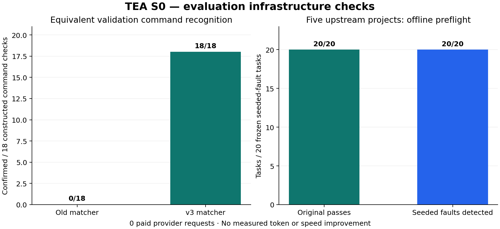

# S0：评测与记录实施结果

[English](README.md) · [脱敏数据](summary.json) · [源码/验收协议](../../../docs/REVISION_COMPARISON.md) · [阶段计划](../../../docs/SMALL_TASK_IMPROVEMENT_PLAN.zh-CN.md)

日期：2026-10-12。**S0 已完成，本阶段结束后停下，S1–S5 尚未实施。**

## 结论：评测有改进，真实 Token 收益未测量

S0 修复了评测识别与记录问题，未改变 Agent 的提示、执行权限、记忆策略或停止逻辑。直接父版 `ccc0d449371d9edd488b5e1c39cad7eb3fedf917` 与 S0 实现 `bc3d769cb5903e8a4f2230e1439ea024c109cae5` 的 **23 个非对比源码模块提交字节完全相同**，包括 Agent、工具、模型客户端、上下文和持久化模块。

- 构造的等价命令检查中，旧识别器确认 **0/18**，新识别器确认 **18/18**，确认率提高 **100 个百分点**。只有两种命令变体、三类任务、三重复；这个数字仅表示这组命令的识别修复。
- 最终本地双提交原生运行双方各 **9/9** 通过，六个验收维度均为双方 **9/9**。没有在这组检查中观察到验收下降。
- **真实 Token 改善百分比：未测量；速度改善：未测量；付费请求：0。** 双方 5,040 的 Token 是脚本填写的数值，只验证协议与计量，不能写成实际节省 0% 或 100%。
- 观察器新增本地源码读取/哈希开销：18 轮合计 **228.32 ms**，最大单轮累计 **15.69 ms**。它没有增加模型消息或请求；这不是服务商耗时对照，不能宣称速度提升。

## 都修改了什么

1. **同框架比较两个 Git 提交**：分别提取已提交源码，不受当前未提交文件影响；每次运行前和结束时检查源码哈希，同时保留外部对比脚本身份。无需安装 Pi 就能进行 TEA 父版/候选对照。
2. **测试识别与证据**：支持 `npm test`、解析后的 npm 脚本、相对/带空格路径、支持的参数顺序。必须有实际执行的正向测试数量、零失败、完整结束事件、对应源码稳定性；过滤/分片、内联执行、复合命令、零测试、缺失结果和失败退出保持未确认。
3. **源码变化使验证失效**：测试期间、之后或最终检查时的声明源码变化都会使旧验证失效。重复开始、未匹配结束、未结束工具不算完成。
4. **拆开六个质量维度**：代码正确（含隐藏完成见证）、修改范围、声明的完整读取要求、修改后原生验证、原生正常结束、用量完整。代码正确不能替代流程完成。
5. **脱敏执行记录**：保存程序名称、参数形状/哈希、命令哈希、观察到的批准结果、退出与完成时间、前后源码版本。公开记录没有原始命令正文、测试输出或凭据；未提供的批准/退出状态保留未知。
6. **固定后续任务与配置**：S1 调优前冻结 5 个真实仓库的 20 个注入故障任务，包括 JS/TS 多文件、Python、Go；固定仓库提交、源码、授权文件、精确故障与验收哈希。准备了原任务的小任务 60 次及保护组 42 次配置，尚未执行这些付费运行。

## 实际做了哪些测试

- **完整确定性测试 254/254，通过、零跳过**。新增覆盖等价命令、误判防护、事件完整性、部分读取、源码冻结/篡改、Git 符号链接、失败和未知用量、统一网关控制。相对原有 237 项新增 17 项。
- **双提交合约**：三类小任务 × 三重复 × 两侧 = 18 次，72 次脚本化 SSE 请求；双方所有质量维度 9/9、控制相同、引擎与对比脚本稳定、真实比例被正确屏蔽。[逐运行脱敏证据](native-contract.json)。
- **原生 TEA/Pi 合约**：打印模式双方共 8 次、三轮 RPC 会话双方共 16 次脚本请求，通过完整读取、会话复用、真实补丁与修改后验证检查。不是新 Pi Token 比较。
- **冻结任务预检 20/20**：原始版本 21 个检查全部通过，故障版本 21 个检查全部失败，合计 42 次程序执行；TS 样本同时检测实现和类型声明故障。语言环境实际执行过，Node 24.14.0、Python 3.13.9、Go 1.24.0、TypeScript 5.9.3。[预检证据](holdout-preflight.json)、[任务清单](../../holdouts/small-task-v1.json)。
- **零 API 配置准备**：10 个初始样本的公开测试通过、隐藏验收完成并检测故障、范围通过；小任务配置 60 次，保护配置 42 次，实际 Agent 运行 **0**。[准备记录](cohort-prepares.json)。

两次开发期双提交合约也都为 18/18；最终对照使用已提交的直接父版/实现版。三个合约尝试的全部记录保留在 `summary.json`，没有将它们当作独立真实样本。增加最终配置保护用例后曾出现一次 253/254：用例没有填写预算，被前置配置检查拒绝；补齐用例后最终 254/254，运行时代码没有因此放宽预算保护。

## 口径与尚存局限

新验收版本为 `native-positive-validation-v3`。模型控制固定为 GLM-5.3-flash、enabled/low、4,096 输出，24 次工具、100 次请求、160,000 UTF-8 字节输入保护、90 秒请求/180 秒单轮超时；S0 的服务端只是回环脚本。未来正式费用上限仍需在每一批调用前固定，失败和未知费用必须保留。

等价命令改善来自同一构造正向输出的识别重放，不是重算历史付费验收；旧 Pi 未确认例的原始命令没有保留，不能据此改为通过。原有付费报告和失败记录完全保留。

当前原生识别器覆盖 **Node/npm**，Python/Go 的原生验证适配和相同批准策略在 S5 付费前仍需实现。20 个任务是公开真实项目上的自编故障，预检不代表 Agent 已完成这些任务；没有操作系统隔离，也不是保密留出评测。源码观察发生在事件到达控制器时，不能证明任意脚本实际语义。声明读取要求也不等于自动理解所有自然语言义务。

**保留 S0 评测改动；停在 S0。** 下一阶段 S1 才会改变能力说明/错误反馈，并重新进行父版/候选实际 Token 对照。只有通过质量、Token 和时间门槛才保留运行时优化；不确定或负收益不能写成提升。
