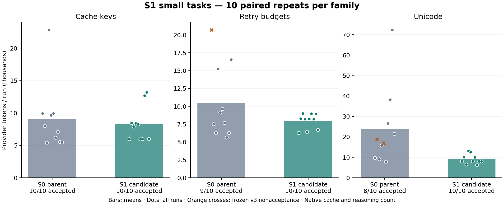
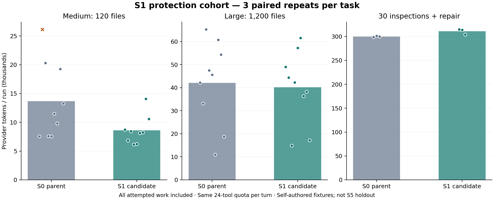

# S1: capability and failure feedback, measured provider comparison

[中文](README.zh-CN.md) · [Sanitized runs and requests](results.json) · [Summary/gates](summary.json) · [Frozen configuration](frozen-config.json) · [Read-only audit](journal-audit.json)

October 12, 2026. **S1 implementation and testing complete; awaiting maintainer
review. S2 has not started.** Experimental feedback is disabled by default;
enable using `TEA_CAPABILITY_FEEDBACK=1`.

Follow-up: [read-only long-session diagnosis](../small-task-s1-long-diagnosis-20261012/README.md) reconstructs all 393 long-session requests, explains repeated capability input, historical replies and repair grouping, and adds no provider calls or runtime changes. Frozen totals and acceptance remain unchanged.

## Result: net savings with a long-workflow cost

All **102 runs / 51 pairs**, including failures and retries: **1,833,377 →
1,624,669 provider tokens, 11.38% fewer** than the actual S0 parent. All cache
input and reasoning output count. The 47 both-accepted pairs separately save
9.25%; they do not replace the all-attempt result.

- Small: **431,852 → 252,914; 41.44% fewer**, 30 runs per arm.
- Medium: **123,003 → 77,351; 37.11% fewer**, nine per arm.
- Large: **378,554 → 361,416; 4.53% fewer**, nine per arm.
- Thirty inspections plus repair: **899,968 → 932,988; 3.67% more**, three per arm.

Protection overall saves 2.12%. The long-workflow increase is below the frozen
5% scale-group limit; no paired quality dimension declines and P95 passes the
10% regression limit. The planned point-estimate gates pass. **Retain the option,
leave it disabled by default and wait for review. Savings are not universal.**

## Changes

Versioned notices declare the actual platform, approval availability, relative
paths, existing command forms and Windows quoting restrictions. Availability is
not a claim that a runner is installed or a handler will approve. Notice identity
survives resume; changes announce once, and a new conversation declares again.

Failure feedback adds a stable code, same-condition `retryable`, missing
capability and next action while preserving original output. Categories cover
policy/approval denial, unavailable approval, input, source mismatch, validation,
missing executables, transient execution and cancellation. Enabled S1 marks
denied/nonzero commands as error results, retaining tool IDs, messages and signed
thinking. Success output and tool definitions are unchanged.

Command filters, authorization, process launch, quotas, budgets, validation
classification and stopping conditions retain existing logic. No execution rights
or new memory compression algorithm are introduced. A captured exact native
parent request fixture verifies disabled behavior without network/Git history in
CI. [Configuration guide](../../../docs/CAPABILITY_FEEDBACK.md).

## Frozen comparison

Parent `c97b950797294f48e31752508af11a80814e66d8`; candidate
`efaca4129ae2ea1fe58510749ada7464439daff7`. Acceptance
`native-positive-validation-v3`, identical initial Git content, hidden completion
witness/scope/read checks, alternate order, stable engine/harness hashes.

Both request GLM-5.3-flash, enabled/low, 4,096 output, 160,000 UTF-8 input-byte
guard, 24 tools per turn, 100 requests per run, 90-second request/180-second turn
timeout, opt-in ContextOS at 32,000 bytes, summaries off, no interactive approval.
The parent ignores the new setting; candidate S1 is on. Permissions are equal.

Three small families × ten repeats × two arms: 60 runs. Passing that cohort
starts the prespecified 36 medium/large plus six actual empty-start 30-inspection/
repair runs. S5's 20 upstream seeded faults are not used for tuning or paid tests.
**1,062 paid requests have complete usage.** Combined conservative spend is
**USD 2.8802688 / 8**, per-run limit 1.40, using the existing 0.80/2.80 input/output
budgeting rates. This is an estimate, not an invoice. No paid Pi rerun; historical
Pi data and acceptance remain unchanged.

## Quality and timing

Across 51 runs per arm, independent code correctness is **50/51 parent vs 51/51
candidate**. Scope, declared reads, native completion and known usage are 51/51
each. Frozen post-edit native validation is 48/51 vs 51/51. Full acceptance is
**47/51 vs 51/51**; no parent-passed/candidate-failed quality dimension appears.

Small P95: **89.80 → 35.49 seconds, 60.47% lower**; median 34.38 → 27.71.
Protection P95: **347.90 → 317.59 seconds, 8.71% lower**; median 45.86 → 40.06.
These observed native-work/acceptance timings do not establish other-project speed.

One parent Unicode repair mixes code-point indexes with UTF-16 `text.slice`
indexes and fails hidden tests; candidate passes that pair. Three other parent
validation grades follow a passed test with a failed, source-unchanged patch.
Frozen v3 invalidates that evidence. A separate read-only source-version audit
confirms a passed native test still matches final tracked source **51/51 per
arm**, without rewriting frozen grades. Acceptance improvement therefore includes
grading effects and is not entirely code-quality improvement.

## Mechanism and negative results

Requests **582 → 480 (17.53% fewer)**; observed denials **83 → 3 (96.39% fewer)**;
failed patches **8 → 1**. Small requests **225 → 151 (32.89% fewer)** and denials
48 → 1. This matches the reduced-unavailable-attempt hypothesis, but notice,
failure fields and error flags are tested together, without component ablations.

Small family savings: cache keys 8.12%, retries 24.27%, Unicode 61.67%. The largest
saving pair contributes 35.94% of net savings; removing that whole pair only as a
sensitivity check still saves 31.89%. Primary results retain every pair.

- **11/30 small pairs use more tokens**, worst increase 137.68%.
- Large retry-budget subgroup totals **5.19% more**, although the frozen large
  scale group saves 4.53%. The scale-group gate does not hide subgroup increases.
- Long workflow uses **3.67% more**. Declared capability text repeats in native
  input and costs tokens even during flows without denial. Its exact causal share
  of the increase has not been isolated.

Diagnostic small task-cluster bootstrap 95% interval: **8.12%–61.67% fewer**.
Only three families; repeats are not independent projects and the interval does
not guarantee at least 10%. Protection's interval includes zero, so its 2.12% net
benefit is not established as stable. Native cache and all variability remain.

## Verification and scope

Candidate **267/267 deterministic tests, no skips**, including 13 S1 checks;
18/18 frozen native revision contract tasks, 72 scripted requests; both actual
TEA/Pi print/RPC contracts; offline runtime acceptance 12/12 and replay checks.
These offline/scripted counts are not provider savings. A local fixture setup
initially used unsupported `full`; correcting it to `full-history` passes without
paid calls. Paid cohorts have no silent retries, selected reruns or revised gates.

Read-only encrypted-journal audit covers all 102 sessions: **1,062/1,062 native
request hashes match wire records**, journal bytes unchanged, no model calls.
All six implementation CI jobs passed Windows/Ubuntu Node 20/22/24:
[implementation CI](https://github.com/Wh0rigin/tea/actions/runs/38207149495).
Current documentation-head CI is shown on the PR.

Self-authored JavaScript bugs, unrelated-file size pressure and one workflow do
not prove unseen projects, other models, default full-history or interactive
approval provider benefits. Public acceptance lacks OS isolation; it is diagnostic,
not confidential/adversarial evaluation. S5 Agent holdout testing is pending.
**Stop after S1 and await review; do not automatically begin S2–S5.**

[Evidence SHA-256](evidence.sha256) · [Reproducible plots](../../../scripts/plot-small-task-s1.py)
