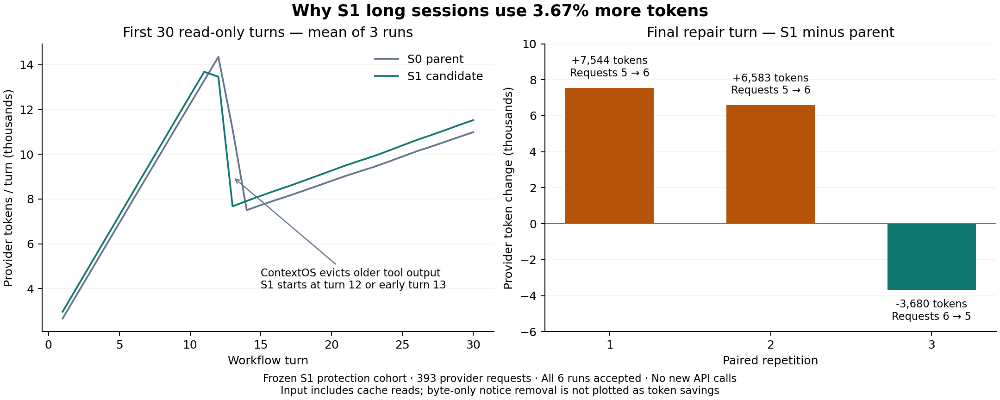

# S1 长会话增耗原因

[English](README.md) · [原始 S1 报告](../small-task-s1-glm-20261012/README.zh-CN.md) · [逐请求诊断数据](diagnosis.json)

## 结论

长会话实际 Token 从 **899,968 增至 932,988，增加 33,020（+3.67%）**。其中输入增加 **32,545，占增量 98.56%**；输出增加 475。六次运行全部通过冻结验收。

主要机制是：**能力说明属于运行环境信息，却被拼进第一条用户消息永久保留；以后每次请求都携带它。** 这组工作流没有工具失败或命令拒绝，S1 没有避免无效重试的收益。不同的工具组合、历史回复长度和旧输出替换时点也影响总量。不能把整个增量都归给能力说明。

本次仅分析原始记录：**新增 API 请求 0**，未修改 Agent 实现，未启动 S2，仍等待维护者审核。

## 范围与核对方法

固定来源：`small-task-s1-protected-glm-20261012-1791784495519984400` 中的 `long-30`，三次配对，每次先进行 30 轮原生文件读取，再进行一轮实际修复。父版 `c97b950797294f48e31752508af11a80814e66d8`，候选 `efaca4129ae2ea1fe58510749ada7464439daff7`。双方 GLM-5.3-flash、enabled/low、输出上限 4096、ContextOS 32,000 字节目标、24 工具/轮、语义摘要关闭；完整条件见原报告。

只读解密六份已关闭日志，验证事件链和文件 SHA-256。依据原始消息、工具记忆、运行状态以及当时记录的源码有效性，重建请求；**393/393 序列化请求的哈希和字节数与原始记录完全一致**，网关哈希也一致。历史源码有效性使用当时的诊断记录，不用已经修复的最终工作区代替。没有重跑模型或重新判定验收。

复现工具：[diagnose-s1-long.mjs](../../../scripts/diagnose-s1-long.mjs)。在保有原始私有日志的项目根目录运行 `node scripts/diagnose-s1-long.mjs`，输出到被 Git 忽略的 `.tea/s1-long-diagnosis.json`。公开报告仅含哈希、计数、工具名称和长度，没有原始对话、思考文本、签名、密钥或私有绝对路径。

## 1. 能力说明追加一次，发送了 197 次

`src/agent.mjs` 将说明追加到首条用户消息；`src/context-assembler.mjs` 保留全部用户原文，替换旧工具输出时也保留这条消息。它声明一次，并不代表只计量一次。

- 候选每个会话声明一次，共三次；每个候选请求都含完整说明，共 **197 次**。
- 说明正文 **699 UTF-8 字节**，含分隔符及 JSON 转义后，每次增加 **703 序列化字节**。
- 固定实际上下文和模型回复，只从已经还原的请求中删除这段说明，合计少 **138,491 字节**。
- 候选实际请求总字节数比父版多 **141,628**；上述说明字节相当于这一净增量的 **97.79%**。这是字节解释，**不是 97.79% 的实际 Token 增量归因，也不是已验证的优化收益**。
- 三对首请求输入均为 **1,073 → 1,223，增加 150 Token**。移除说明并统一工作区路径后，六个首请求内容的哈希一致。因此首请求仅有说明和工作区字符串差异；不能将 150 直接乘后续请求数，后续上下文及缓存不同。

## 2. 没有拒绝可避免，最后修复的组合不同

六次运行每次都调用 **36 个工具**：33 次 `read_file`、1 次 `search_code`、1 次 `apply_patch`、1 次 `run_tests`。均无失败、拒绝、恢复工具调用或语义摘要调用。

前 30 轮双方都是 **180 次请求**：父版 **811,565** Token，候选 **834,138**，增加 **22,573（+2.78%）**，占总增量 **68.36%**。请求数量没有增加，主要问题是每次输入携带更多内容。

最后修复阶段：父版 **16 次请求、88,403** Token，候选 **17 次、98,850**，增加 **10,447（+11.82%）**，占总增量 **31.64%**。逐对结果如下：

- 重复 1：修复请求 **5 → 6**，修复 Token **+7,544**；全会话 **298,969 → 314,797（+5.29%）**。
- 重复 2：修复请求 **5 → 6**，修复 Token **+6,583**；全会话 **301,204 → 313,970（+4.24%）**。
- 重复 3：修复请求 **6 → 5**，修复 Token **−3,680**；全会话 **299,795 → 304,221（+1.48%）**。

例如重复 1，父版在一个响应内执行两次读取，候选将读取分散到不同响应；重复 2，父版把读取与测试合并，候选分开；重复 3，候选合并了最初的两次读取和搜索。因此工具数一样也可能请求数不同，额外请求会再次发送当时的完整组装上下文。**这些是观察到的模型调用选择，尚未证明是 S1 必然导致的固定策略变化。** 修复阶段的全部差额也不能等同于那一次净额外请求的成本。

## 3. 历史回复反复输入，但较早替换旧工具输出抵消了部分开销

ContextOS 主要替换较旧的工具结果，历史用户文字和助手回复仍留在请求中。前 30 轮助手文本正文的累计生成字节数为：

- 重复 1：**2,310 → 3,010（+700）**。
- 重复 2：**2,636 → 2,640（+4）**。
- 重复 3：**1,920 → 2,404（+484）**。

这些文本随后重复输入。全部请求的助手文本块累计序列化量 **+46,146 字节**；这是三对运行的观察差额，没有独立证明说明造成了文本变长。历史工具调用参数、ID 和消息结构也有差异。

增加的输入更早触及旧输出替换条件：重复 1 候选第 12 轮开始替换，其他两次候选第 13 轮首请求开始，父版均在第 13 轮第二个请求开始。旧工具结果累计 **减少 67,592 序列化字节**，同时引入更多目录、锚点和恢复工具定义；第 12/13 轮的一些候选 Token 反而下降。**较早替换提供了抵消，不能据此判断压缩失效，也不能把全会话上升全部解释成压缩时点变化。**

## 4. 缓存没有被丢失计量，也不能按 Token 百分比推断账单

输入统计采用原始规则：未缓存输入加缓存读取及缓存创建。该六次运行缓存创建为零。

- 未缓存输入：**479,972 → 485,253（+5,281）**。
- 缓存读取：**415,168 → 442,432（+27,264）**。
- 输出：**4,828 → 5,303（+475）**。

缓存读取仍是模型接收的 Token，必须包含在用量中。缓存 Token 增加不代表缓存失效；有更多内容命中缓存，同时总输入仍变多。没有实际账单和已核实缓存费率，不能把 **+3.67% Token** 写成 **+3.67% 费用**。

## 后续可验证的改进方向

1. 将用户任务原文与版本化运行能力分开管理。当前能力必须可靠可见，但旧版环境说明不应作为用户任务永久携带。仅换成另一条用户消息仍会被原文保护，不能直接解决问题。
2. 缩短常驻能力说明，把详细限制放在相关操作的反馈中；保持命令、批准和验证规则一致。长会话中“完全无拒绝”和“确实发生拒绝”的任务都要对照，检查是否将输入节省换成失败重试。
3. 研究与用户原文分开处理已经完成的简短助手回复，保留必要结论、签名协议和可恢复来源。不能按这组重复读取流程的模板硬删所有历史回复。
4. 检查无依赖工具的并行组合，避免因分散调用反复发送上下文；读取与依赖读取结果的编辑、编辑后的验证必须维持顺序。重复 3 已更省请求，因此不能把这一点宣称为当前 S1 的确定性缺陷。

这些是实验建议，**没有实施或测得 Token 收益**。仅一个自编工作流、三次重复，不足以给出全局精确因果比例或保证改动有效。S1 仍默认关闭，S2–S5 未开始，等待审核。

## 证据

[diagnosis.json](diagnosis.json) 包含六次运行、393 个请求、逐轮用量、字节分类及工具响应形状；[绘图脚本](../../../scripts/plot-s1-long-diagnosis.py) 仅绘制原始实际 Token。[SHA-256 清单](evidence.sha256) 覆盖报告、数据、图片和复现脚本。原始 S1 结果及冻结验收不变。
