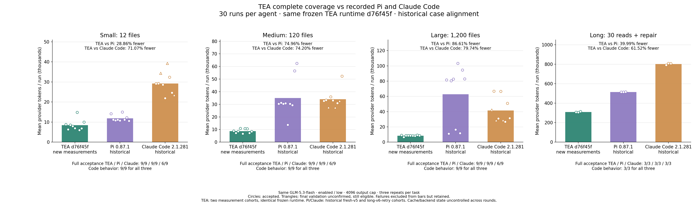

# TEA complete coverage versus recorded Pi and Claude Code

[简体中文](README.zh-CN.md)

Current TEA runtime **d76f45f** now has **30 measured runs**: small/medium/large nine each, long-session three. Small/large come from the accepted discovery repair cohort; medium/long were newly measured. Pi 0.87.1 and Claude Code 2.1.281 reuse historical fresh-v5 and authorized long-v6-retry data. This is a **case-aligned cross-round comparison**, not a simultaneous rerun.

## Provider token results

- **small**: TEA 76,095; 28.86% fewer than Pi, 71.07% fewer than Claude Code.
- **medium**: TEA 78,913; 74.96% fewer than Pi, 74.20% fewer than Claude Code.
- **large**: TEA 75,583; 86.61% fewer than Pi, 79.74% fewer than Claude Code.
- **long-session**: TEA 926,679; 39.99% fewer than Pi, 61.52% fewer than Claude Code.

- **All 30 attempts per agent:** TEA **1,157,270**, Pi **2,530,728**, Claude Code **3,349,998**. TEA uses **54.27% / 65.45% fewer** tokens.
- **27 fresh tasks:** TEA **230,591**, Pi **986,602**, Claude Code **942,024**: **76.63% / 75.52% fewer**.
- Includes provider input, all cache input and all output including thinking. All **90 runs / 1,048 request records** are retained and known.

The previous 77.41% / 76.16% figures covered only 18 small/large attempts. Adding medium and long changes the workload weighting; those ratios are not directly comparable. Long accounts for 80.07% of current TEA tokens.

## Quality and chart policy

Full acceptance TEA/Pi/Claude: **30/30, 30/30, 21/30**. Code behavior: **30/30 each**. Nine historical Claude fresh attempts have final native validation unconfirmed; their triangles remain eligible, and they are not relabeled as passes or code failures. All long workflows passed 3/3 for each agent.

Bars include known completed accepted or validation-only-unconfirmed workflows. Other failures are excluded from means but remain plotted and recorded. Unknown usage is never zero; this selected cohort has none. There are no failure crosses. Both-fully-accepted Claude diagnostic: 21 matched cases, **65.05% fewer**; this does not replace the all-30 figure. Historical interrupted cohorts and their unknown reservations remain separate.

## Controls and provenance

GLM-5.3-flash, enabled thinking, low effort, 4096 output cap / normalized 4095 thinking budget; identical prompts and initial source for all ten tasks. 160,000-byte request guard, 100 requests/run, 300-second turn timeout and 180-second request timeout. TEA uses ContextOS with 32,000-byte target, automatic compaction and memory GC enabled, 24 tools/turn. ContextOS remains an explicit benchmark policy, not the default CLI memory policy.

Supplementary measurement froze harness **8835492**, engine **d76f45f**, four tasks, three repetitions, USD 8 suite / USD 1.4 per-run finite guards. **241 real requests**, **12/12 passed**, estimated configured cost **USD 0.8205616**, no paid retries or unknown usage. The suite cap was not reached. Native loopback **12/12, 228 scripted requests, zero paid calls**; relevant tests **30/30**, full suite **307/307**.

Five fixture/grade source components match historical long-v6 byte for byte; small/large retain the previously published grading audit. Effective request controls match all 1,048 records; task/source/prompt hashes match. Source engine and harness remained unchanged throughout the live supplement.

## Retained negative diagnostic

Against the earlier GC runtime's recorded TEA cohort, medium **69,880 → 78,913 (+12.93%)**, long **922,476 → 926,679 (+0.46%)**. Same cases, but separate rounds and different runtime versions: this is a historical diagnostic, not a paired causal gate. It does not establish every scale improved. The previously retained small Unicode regression remains in the discovery repair report.

The new 12 runs triggered **zero semantic compactions**. They exercise ContextOS and normal execution but do not measure the benefit of triggered automatic compression or GC. See the earlier GC pressure ablation for that distinction. Cache state, backend sampling and load were not fixed across rounds. Fixtures are self-authored JavaScript defects scaled by unrelated files, not production holdouts.

## Reproduction and evidence

Run `python scripts/compare-complete-coverage.py` from the repository to aggregate committed data and regenerate PNG/SVG without network access or new provider calls. Raw histories, credentials and private workspaces are excluded.

[Summary](summary.json) · [All records](results.json) · [Alignment](alignment.json) · [Chart policy](chart-audit.json) · [SVG](three-agents.svg) · [SHA-256](evidence.sha256) · [Supplement](../tea-coverage-completion-20261014/README.md)
