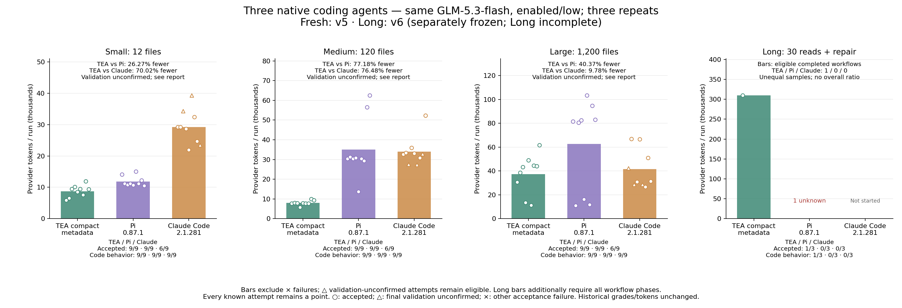

# Current measured comparison: fresh v5 / long v6

[中文](README.zh-CN.md)

Two independently frozen cohorts: 81 fresh v5 runs and a planned nine-run Long v6 cohort. Same archived TEA bd41742 / Pi 0.87.1 / Claude Code 2.1.281, GLM-5.3-flash enabled/low, output/thinking caps 4096/4095, task prompts and initial source. This is not one unified 90-run source freeze. The superseded v5 Long cohort remains in its report.

## fresh

- teaVsPi: 50.60% fewer (full all-attempt totals); both-accepted diagnostic subset 50.60% fewer (27 pairs).
- teaVsClaude: 48.26% fewer (full all-attempt totals); both-accepted diagnostic subset 47.07% fewer (18 pairs).
- tea: tokens 487388; acceptance 27/27; behavior 27/27; workflow completion 27/27; declared read compliance 27/27.
- pi: tokens 986602; acceptance 27/27; behavior 27/27; workflow completion 27/27; declared read compliance 27/27.
- claude: tokens 942024; acceptance 18/27; behavior 27/27; workflow completion 27/27; declared read compliance 27/27.

## long

**Long v6 is incomplete: 2/9 planned runs attempted. TEA completed one (309,457 tokens); a Pi streaming request has unknown usage and triggered the halt. Claude was not started. Reservation retained; no paid retry, zero imputation or complete Long reduction.**

- teaVsPi: unknown (full all-attempt totals); both-accepted diagnostic subset unknown (0 pairs).
- teaVsClaude: unknown (full all-attempt totals); both-accepted diagnostic subset unknown (0 pairs).
- tea: tokens unknown (cohort incomplete); acceptance 1/3; behavior 1/1; workflow completion 1/1; declared read compliance 1/1.
- pi: tokens unknown (cohort incomplete); acceptance 0/3; behavior 0/1; workflow completion 0/1; declared read compliance 0/1.
- claude: tokens unknown (cohort incomplete); acceptance 0/3; behavior 0/0; workflow completion 0/0; declared read compliance 0/0.

## Markers, grading and limits

Claude Code fresh uncertainty fell from 26/27 to 9/27; full acceptance rose from 1/27 to 18/27. Common recognition failures are fixed, not all complex-command uncertainty. Historical grades are unchanged. Circles passed, triangles have only final validation unconfirmed and remain eligible, crosses are failures excluded from bars. All attempts/unknown usage remain recorded. Bar subsets are separate from full totals; unfiltered ratios are not annotated on failure-filtered bars.

v6 continues normally completed turns with complete tool events; missed reads, read-only violations and workspace changes still fail compliance. Runtime/protocol failures, exceptions, timeouts and usage/budget guards still stop. Continuation never grants a pass.

This compares agent software: Claude Code uses the same GLM, not an Anthropic Claude model. Native core prompts/tools retained; host personalization and cross-session memory disabled. Self-authored JavaScript defects and unrelated-module scaling do not establish production generalization. Gaps do not isolate metadata shortening; the default runtime candidate remains reverted.

Displayed cohort known conservative cost USD 2.3114312; all v5/v6 attempted-work cost USD 5.7977560; configured rates, not invoice. Reservations USD 0.2674688; earlier reservations separate.

[Fresh v5 evidence](../tea-pi-claude-v5-glm-20261013/README.md) · [Long v6 evidence](../tea-pi-claude-v6-glm-20261014/README.md) · [Full displayed records](results.json) · [Chart audit](chart-audit.json) · [Summary](summary.json) · [Hashes](evidence.sha256)
