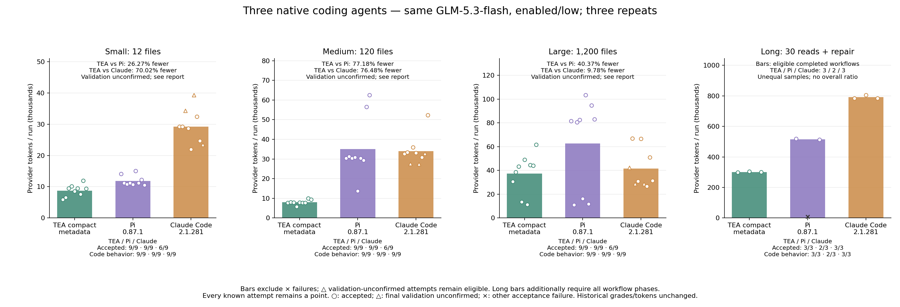

# TEA / Pi / Claude Code 三方实测

[English](README.md)

计划 90 次运行，实际 90 次；1027 次已提交请求，0 次用量未知。全部计划完成：True。

## fresh

- small: TEA vs Pi 减少 26.27%; TEA vs Claude Code 减少 70.02%.
  tea: tokens 78872, accepted 9/9, code behavior 9/9.
  pi: tokens 106969, accepted 9/9, code behavior 9/9.
  claude: tokens 263065, accepted 6/9, code behavior 9/9.
- medium: TEA vs Pi 减少 77.18%; TEA vs Claude Code 减少 76.48%.
  tea: tokens 71945, accepted 9/9, code behavior 9/9.
  pi: tokens 315208, accepted 9/9, code behavior 9/9.
  claude: tokens 305902, accepted 6/9, code behavior 9/9.
- large: TEA vs Pi 减少 40.37%; TEA vs Claude Code 减少 9.78%.
  tea: tokens 336571, accepted 9/9, code behavior 9/9.
  pi: tokens 564425, accepted 9/9, code behavior 9/9.
  claude: tokens 373057, accepted 6/9, code behavior 9/9.

- teaVsPi: 全部计划任务 Token 减少 50.60%; known pairs 27/27.
  双方均验收通过的诊断子集：减少 50.60% (27 pairs); 不替代整组结果。
- teaVsClaude: 全部计划任务 Token 减少 48.26%; known pairs 27/27.
  双方均验收通过的诊断子集：减少 47.07% (18 pairs); 不替代整组结果。
- tea: attempted 27/27, accepted 27/27, code behavior 27/27, native final validation 27/27, compactions 0, known conservative cost USD 0.4066404, reservation USD 0.0000000.
- pi: attempted 27/27, accepted 27/27, code behavior 27/27, native final validation 27/27, compactions 0, known conservative cost USD 0.8042676, reservation USD 0.0000000.
- claude: attempted 27/27, accepted 18/27, code behavior 27/27, native final validation 18/27, compactions 0, known conservative cost USD 0.7869292, reservation USD 0.0000000.

## long

- long-session: TEA vs Pi 减少 13.18%; TEA vs Claude Code 减少 61.89%.
  tea: tokens 904069, accepted 3/3, code behavior 3/3.
  pi: tokens 1041288, accepted 2/3, code behavior 2/3.
  claude: tokens 2372334, accepted 3/3, code behavior 3/3.

- teaVsPi: 全部计划任务 Token 减少 13.18%; known pairs 3/3.
  双方均验收通过的诊断子集：减少 41.89% (2 pairs); 不替代整组结果。
- teaVsClaude: 全部计划任务 Token 减少 61.89%; known pairs 3/3.
  双方均验收通过的诊断子集：减少 61.89% (3 pairs); 不替代整组结果。
- tea: attempted 3/3, accepted 3/3, code behavior 3/3, native final validation 3/3, compactions 0, known conservative cost USD 0.7332972, reservation USD 0.0000000.
- pi: attempted 3/3, accepted 2/3, code behavior 2/3, native final validation 2/3, compactions 0, known conservative cost USD 0.8389044, reservation USD 0.0000000.
- claude: attempted 3/3, accepted 3/3, code behavior 3/3, native final validation 3/3, compactions 0, known conservative cost USD 1.9141232, reservation USD 0.0000000.

## 未通过记录

- `small-unicode-r1/claude`: completed, tokens 34306; nativePostEditValidation.
  代码行为通过，最终原生验证未确认，保留保守判分，不称为代码错误。
- `medium-unicode-r1/claude`: completed, tokens 27568; nativePostEditValidation.
  代码行为通过，最终原生验证未确认，保留保守判分，不称为代码错误。
- `large-cache-key-r1/claude`: completed, tokens 42189; nativePostEditValidation.
  代码行为通过，最终原生验证未确认，保留保守判分，不称为代码错误。
- `large-unicode-r1/claude`: completed, tokens 28571; nativePostEditValidation.
  代码行为通过，最终原生验证未确认，保留保守判分，不称为代码错误。
- `small-unicode-r2/claude`: completed, tokens 39273; nativePostEditValidation.
  代码行为通过，最终原生验证未确认，保留保守判分，不称为代码错误。
- `medium-unicode-r2/claude`: completed, tokens 27400; nativePostEditValidation.
  代码行为通过，最终原生验证未确认，保留保守判分，不称为代码错误。
- `large-unicode-r2/claude`: completed, tokens 28709; nativePostEditValidation.
  代码行为通过，最终原生验证未确认，保留保守判分，不称为代码错误。
- `small-unicode-r3/claude`: completed, tokens 23435; nativePostEditValidation.
  代码行为通过，最终原生验证未确认，保留保守判分，不称为代码错误。
- `medium-retry-budget-r3/claude`: completed, tokens 32735; nativePostEditValidation.
  代码行为通过，最终原生验证未确认，保留保守判分，不称为代码错误。
- `long-30-r2/pi`: failed, tokens 9294; codeCorrect, declaredReadRequirements, nativePostEditValidation, nativeCompleted.
  长会话未完成全部阶段，完成量不同；不能将 Token 差距等同于相同已完成工作的效率。

## 条件与限制

共同 GLM-5.3-flash、enabled/low、输出/思考上限 4096/4095，相同任务与初始源码。TEA 受测版本为归档的缩短元数据候选 bd41742，ContextOS 32000 字节、能力反馈开启、模型摘要关闭、24 次工具/轮；默认运行时未重新启用候选。Pi 0.87.1 使用原生 RPC；Claude Code 2.1.281 使用原生 safe-mode CLI（非 bare），保留核心提示与 Bash/Edit/Glob/Grep/Read/Write。关闭宿主个性化配置和跨会话自动记忆；保留原生会话历史与自动压缩。这里比较编程 Agent 软件，使用的是同一个 GLM 模型，不是 GLM 与 Anthropic Claude 模型的比较。

三方全部重新运行，没有混用旧样本。输入含全部缓存读写，输出含思考；轮换顺序但无法重置供应商缓存。三类自编缺陷，每规模三次重复，规模靠无关模块扩展，不能证明生产泛化。原生提示/工具/缓存策略不同，整体差距不能归因于元数据单项。源码、框架及二进制指纹冻结；Claude 行号只做可核查呈现转换，不补齐缺失源码。

Known conservative cost USD 5.4841620; unknown reservation USD 0.0000000; not invoice. USD12 shared guard, USD1.4/run, 100 requests/run, 160000-byte input guard, request/turn timeout 180/300 seconds. Previous unknown reservations remain separate. No paid retry after unknown usage.

Deterministic tests: 280/280. Native continuation contract: 9 workflows, 567 scripted requests; deliberately missed first reads still fail acceptance but reach repair. Native three-agent loopback: 27/27, 108 scripted requests; Claude multi-turn: 8 scripted requests. Zero paid calls in functional checks. Initial Windows short-path and mock SSE-header failures retained and corrected before paid calls. Scripted usage is not performance evidence.

[All attempts](results.json) · [Summary](summary.json) · [Accounting audit](accounting-audit.json) · [Frozen plan](frozen-plan.json) · [Protocol](frozen-protocol.md) · [Functional checks](functional-checks.json) · [Hashes](evidence.sha256)

Protocol Markdown only rebases relative links for publication; [exact frozen source](frozen-protocol-source.txt) SHA-256: `2bf0e618e68b1c80f95a40fdf8f4edce293cf2760d3b2eb9e9c15f539f97c63d`.
