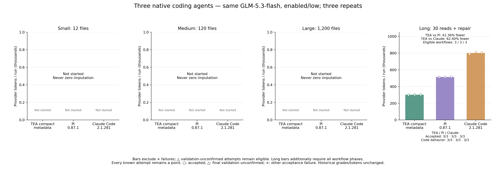

# TEA / Pi / Claude Code 三方实测

[English](README.md)

计划 9 次长会话运行，实际 9 次；587 次已提交请求，0 次用量未知。全部计划完成：True。

## long

- long-session: TEA vs Pi 减少 41.36%; TEA vs Claude Code 减少 62.40%.
  tea: tokens 905432, accepted 3/3, code behavior 3/3.
  pi: tokens 1544126, accepted 3/3, code behavior 3/3.
  claude: tokens 2407974, accepted 3/3, code behavior 3/3.

- teaVsPi: 全部计划任务 Token 减少 41.36%; known pairs 3/3.
  双方均验收通过的诊断子集：减少 41.36% (3 pairs); 不替代整组结果。
- teaVsClaude: 全部计划任务 Token 减少 62.40%; known pairs 3/3.
  双方均验收通过的诊断子集：减少 62.40% (3 pairs); 不替代整组结果。
- tea: attempted 3/3, accepted 3/3, code behavior 3/3, native final validation 3/3, compactions 0, known conservative cost USD 0.7341716, reservation USD 0.0000000.
- pi: attempted 3/3, accepted 3/3, code behavior 3/3, native final validation 3/3, compactions 0, known conservative cost USD 1.2436748, reservation USD 0.0000000.
- claude: attempted 3/3, accepted 3/3, code behavior 3/3, native final validation 3/3, compactions 0, known conservative cost USD 1.9434452, reservation USD 0.0000000.

## 未通过记录

## 条件与限制

共同 GLM-5.3-flash、enabled/low、输出/思考上限 4096/4095，相同任务与初始源码。TEA 受测版本为归档的缩短元数据候选 bd41742，ContextOS 32000 字节、能力反馈开启、模型摘要关闭、24 次工具/轮；默认运行时未重新启用候选。Pi 0.87.1 使用原生 RPC；Claude Code 2.1.281 使用原生 safe-mode CLI（非 bare），保留核心提示与 Bash/Edit/Glob/Grep/Read/Write。关闭宿主个性化配置和跨会话自动记忆；保留原生会话历史与自动压缩。这里比较编程 Agent 软件，使用的是同一个 GLM 模型，不是 GLM 与 Anthropic Claude 模型的比较。

三方全部重新运行，没有混用旧样本。输入含全部缓存读写，输出含思考；轮换顺序但无法重置供应商缓存。三类自编缺陷，每规模三次重复，规模靠无关模块扩展，不能证明生产泛化。原生提示/工具/缓存策略不同，整体差距不能归因于元数据单项。源码、框架及二进制指纹冻结；Claude 行号只做可核查呈现转换，不补齐缺失源码。

Known conservative cost USD 3.9212916; unknown reservation USD 0.0000000; not invoice. USD6 shared guard, USD1.4/run, 100 requests/run, 160000-byte input guard, request/turn timeout 180/300 seconds. Previous unknown reservations remain separate. No paid retry after unknown usage.

Deterministic tests: 280/280. Native extra-shell continuation contract: 9 workflows, 576 scripted requests; deliberate first-turn shell noncompliance still fails acceptance but reaches repair. Native three-agent loopback: 27/27, 108 scripted requests; Claude multi-turn: 8 scripted requests. Zero paid calls in functional checks. Initial Windows short-path and mock SSE-header failures retained and corrected before paid calls. Scripted usage is not performance evidence.

[All attempts](results.json) · [Summary](summary.json) · [Accounting audit](accounting-audit.json) · [Frozen plan](frozen-plan.json) · [Protocol](frozen-protocol.md) · [Functional checks](functional-checks.json) · [Hashes](evidence.sha256)

Protocol Markdown only rebases relative links for publication; [exact frozen source](frozen-protocol-source.txt) SHA-256: `12001442075525f2f93813f0b383e5181f80ff465bfcef14172775c8f816900b`.

本次为用户明确授权的独立新组重测：9/9 完整通过，587 笔请求用量已知，无未知请求。上次中断组仍单独保留，已知费用 USD 0.3135940、未知预留 USD 0.2674688 不并入本次完整 Token 降幅；不以新用量填补旧请求。

[Prior interrupted cohort](../tea-pi-claude-v6-glm-20261014/README.md)
