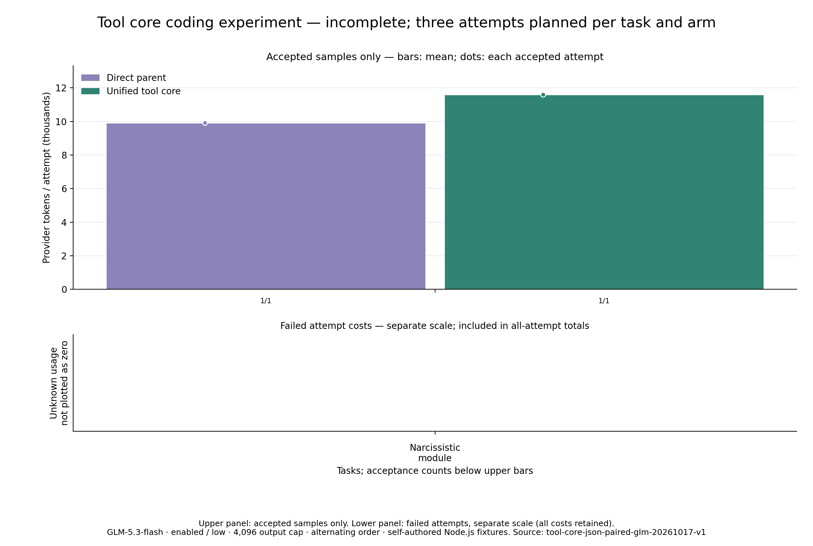

# 统一工具层：非流式单对诊断（非生产收益结论）

2026-10-17：双方 `stream=false`。用户强调生产使用流式后，本轮在当前配对完成、用量结算后主动停止；未中断请求、未启动第三次任务，源码哈希重新核对通过。仅完成水仙花数一题各一次，两边均通过，候选用量增加 **16.95%**。不能代替流式评测，也不足以证明重构导致增加。此前流式未知用量保留在独立记录中。

候选为 ToolContext / ToolSpec / ToolService 架构重构，模型侧参数与工具语义保持一致。离线等价检查不是 provider 用量测量，本报告记录真实独立任务轨迹。

原八道自编 Node.js 编码题 × 三轮 × 两版本，共计划 48 次；结束 2 次，覆盖/用量完整：False。

覆盖或用量不完整，不给整组收益百分比；未知不按零。

总体及逐题质量门槛：False；完整用量、质量不下降且 Token 更低的数值门槛：False。

Token 包含全部缓存输入、输出中的思考；缓存和思考不重复累加。独立随机生成的差额不等于内部架构重构的因果效应。

## 每题结果

- 新建水仙花数模块：双方各执行 1 次、各通过 1 次；各余 2 次未执行。累计 Token 9913 → 11593。

## 每轮结果

- 第 1 轮仅完成 1/8 题：双方均验收通过；余 7 题未执行。已执行样本 Token 9913 → 11593；变化 +16.95%。

双方均通过 1 对：Token 9,913 → 11,593；变化 16.95%。子集不替代全量；单对变化中位数 16.95%。

## 请求、输入与执行审计

- baseline：模型请求 4；输入 8803、输出 1110、缓存读取 5824；工具调用 7、错误 0、创建遇到已有文件拒绝 0；成功编辑 2、验证结果 2、命令超时 0。
- candidate：模型请求 5；输入 10638、输出 955、缓存读取 7424；工具调用 6、错误 0、创建遇到已有文件拒绝 0；成功编辑 2、验证结果 1、命令超时 0。

首次输入配对差均值 **-2.00 provider Token**，范围 -2–-2（候选减基线）。独立工作区标识可能带来少量分词差异。

两版冻结源码离线比较 64 组工具视图、11 个受控请求逐字节一致；其中模型及验证回复固定构造，不能作真实收益或正确率。

真实用量从 ledger 核对；编辑、验证和超时计数与加密工具事件独立审计一致。

## 未通过样本

## 解释与限制

相同 GLM-5.3-flash、enabled thinking / low、4096 输出、初始源码及验收；交替先运行版本，每次新工作区。源码、任务、入口冻结，先检查初始与参考实现。每请求 90 秒、命令 120 秒、任务 10 分钟，单次预留 1 USD、全组 8 USD；未知保留预留并停止，不重试。

全量包含失败费用；成功柱排除失败，失败成本在独立刻度展示；未知不填零。原计划三次重复，但实际只执行单题一对；自编题目、极小样本及外部缓存状态限制了泛化和因果解释。

架构未改变受控模型输入，无法根据独立轨迹的一个汇总百分比声称节省。需要结合请求数、每轮方向、具体失败及重复试验判断；不把质量下降解释为减少工作量的收益。

[公开逐次数据](summary.json)；原始工作区、模型交互与日志私有。协议见 [真实实验说明](../../../docs/TOOL_CORE_TOKEN_EXPERIMENT.zh-CN.md)。

## 采用与审核

覆盖或用量不完整，无法评估 Token 优化门槛；架构保留与性能结论分开审核，不自动合并。

阶段结束等待用户审核，不启动下一个改进。
