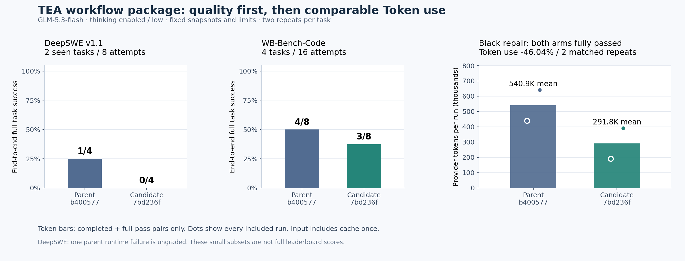

# TEA 工作流版本：专项测试、DeepSWE 与 WB-Bench-Code 对照

报告日期：2026-10-21。固定的 24 次真实任务全部结束；本轮没有追加失败重试，也没有混入新的生产代码修复。

## 1. 结论

**当前组合没有通过“保持解题能力、降低 Token”的整体验收。** Black 缺陷修复表现出稳定的局部收益，但大型仓库检索、接口覆盖、真实入口验证和环境失败恢复仍有问题。

- DeepSWE：父版本成功完成并整题通过 **1/4**，候选 **0/4**。全部尝试消耗 **2,970,434 → 3,725,034 Token，增加 25.40%**。其中父版本一次执行故障没有原始官方判分；把它作为端到端未成功保留，不能伪造为已判零分。没有双方都完成且通过的配对，不能计算同等工作量的节省比例。
- WB-Bench-Code：官方平均 `reward` **0.7611 → 0.7043**，整题通过 **4/8 → 3/8**，下降 **12.5 个百分点**。全部尝试消耗 **2,441,127 → 1,777,033 Token，减少 27.20%**，但完成质量下降，这个比例不能宣传为整体有效优化。
- 可比较的完整成功工作只有 Black 修复题的两次重复：双方均为 6/6 检查通过，累计 **1,081,718 → 583,671 Token，减少 46.04%**。这是同一道题重复两次的结果，尚不能推广到其他编码任务。

图中的 Token 柱只包含双方完成并整题通过的配对。失败样本没有进入成功工作量柱；它们的实际消耗在下文和 JSON 中全部保留。

## 2. 测了什么，如何保证可比

父版本为 `b400577185f0b224850540cc9289672f62450f33`，候选为 `7bd236f4d548af1214ddf498ccaf7a5c3b928100`。候选同时包含三项变化：简洁工作流指引、同文件批量替换、未解决验证命令的持久化。**本轮评价这个组合，不能把结果单独归因于批量修改。**

两边使用同一 GLM-5.3-flash、enabled thinking / low effort、流式传输、相同任务说明、初始源码与工具权限；每次新建隔离容器。输出上限 131,072、思考预算 8,000、总上下文配置 216,000、ContextOS 目标 32,000 字节；自动压缩与 GC 开启。96 次工具、128 次请求、单请求 900 秒、任务 30 分钟的限制在调用前冻结。

当前为最大输出预留空间，实际输入保护额度为 `216000 - 131072 - 4096 = 80832` 估算 Token。这一共享限制影响长任务，不代表模型获得了 216K 输入空间。

DeepSWE 是两道已见题各重复两次；WB-Bench-Code 从官方 80 道 Code 题中按预先冻结的哈希顺序选取四个不同类别，各重复两次。WorkBuddy 采用原生 Harbor Trial、官方 CompositeVerifier 与 scorer；服务器兼容适配和自定义串行调度均已记录于[方法说明](METHODS.zh-CN.md)，不是完整官方榜单提交。

## 3. 专项测试结果

- 原有专项回归 **176/176 通过**。
- 完整回归 **411 通过、0 失败、1 项因本机缺少 Go 跳过，共 412 项**。
- 真实双版本生命周期预检通过；脚本提供模拟 SSE，真实执行编辑、验证和补丁导出，不产生供应商用量，不计作基准题成功。
- 新增的独立进程边界检查：Windows Node 24.14.0、Linux Node 20.18.1 / 24.12.0，两个源码版本分别测试超时和取消，共 **12 个行为失败**。这些用例复现了既有缺陷，不能写成“全部专项测试通过”。

进程缺陷的触发条件是：直接子进程已经退出，但后台后代仍持有 stdout/stderr；工具等待 `close`，超时只杀直接子进程，管道没有关闭。用例设置 300ms，到 1,200ms 仍未返回，清理用例自己创建的后代才结束。[复现数据与脚本](pipe-repro.json)不调用模型。原有套件通过说明其覆盖范围内的机制成立，不说明真实工作流没有问题。

## 4. DeepSWE：每次结果

以下 Token 为供应商实际报告总量，输入含缓存一次。F2P 是新需求相关检查，P2P 是原有行为检查，整题成功还需要官方完整 reward 和 Agent 正常完成。

### Helm：统一 manifest 流

- 第 1 次：父版本 **856,486** Token，F2P **2/5**、P2P **2/2**，达到 96 次工具限制；候选 **921,856**，F2P **0/5**、P2P **2/2**，同样耗尽工具。消耗 **+7.63%**，双方均未完成。
- 第 2 次：父版本 **660,604**，F2P **0/5**、P2P **2/2**，因 `MODEL_CONTEXT_LIMIT` 停止；候选 **838,882**，F2P **0/5**、P2P **2/2**，达到工具限制。消耗 **+26.99%**，双方均未完成。

候选两次各读取文件 58 次；同版本同范围完整重复读取分别为 37 / 21 次。第一次到第 76 个已完成工具才有首个成功修改，只新建了辅助文件；第二次没有成功修改。两次均没有申请 `apply_patch`，因此批量替换能力根本未被使用。父版本第一次也到第 80 个工具才开始成功修改。

可见瓶颈是检索没有收敛到整合与验证。候选虽成功采用了四次压缩，却仍然没有完成任务；“压缩成功”不是“解题成功”。父版本第二次摘要触及自身输出上限而未采用，随后估算输入 91,757 超过 80,832 的保护额度；这是共享容量与摘要恢复问题，不能只靠继续放大生成上限解决。

### mnamer：daemon / watch 生命周期

- 第 1 次父版本：**626,135** Token，后台 daemon 命令卡住，外层超时后缺少必须的补丁导出，原始官方判分缺失。38 次完整请求从已落盘账本和独立传输记录恢复，用量已核对；运行仍是失败，10 USD 历史预留仍保留。
- 第 1 次候选：**1,114,821**，Agent 正常完成，自测通过；官方 F2P **50/51**、P2P **319/319**。遗漏的是 `test_daemon_batch_size_zero_processes_no_files`。不能把接近全部检查通过写成整题通过。
- 第 2 次父版本：**827,209**，Agent 正常完成，F2P **51/51**、P2P **319/319**，完整 reward 为 1。
- 第 2 次候选：**849,475**，Agent 正常完成，F2P **50/51**、P2P **319/319**；遗漏 `test_daemon_logs_respects_state_path_with_subdirectory`。消耗比父版本 **+2.69%**，且少通过一个需求检查。

候选两次实际采用批量补丁，共 **21 次调用、40 个替换项**，但仍各漏掉一个不同边界。合并编辑可以减少往返，不能替代需求覆盖。

对第一次卡住的父版本另做了 **零模型调用的事后诊断**：在固定原始源码上重放八个已记录成功的编辑，再运行官方验证，得到 F2P **47/51**、P2P **319/319**。原容器已被框架清理，无法恢复全部运行时生成文件，因此它不是原终态的完整复原，也不能替代原始缺失成绩。它至少说明：仅修好执行器，不能证明原代码已经完整解题。[诊断声明](deepswe-postmortem-diagnostic.json)

## 5. WB-Bench-Code：四类任务与重复结果

官方 scorer 的 `reward` 是平均任务得分，`pass_rate` 是整题满分比例；二者分别报告。两边均有四题、每题两次、八份官方评分，没有缺题或 build-error 记录。以下先列通过检查数，再列 Token；两版初始镜像与说明逐对一致。

### 缺陷修复：`bug_fix-medium-incorrect_linenos_on_fstring`

- 第 1 次：父 **6/6，439,628**；候选 **6/6，191,866**，Token **−56.36%**。
- 第 2 次：父 **6/6，642,090**；候选 **6/6，391,805**，Token **−38.98%**。
- 两次合计 **−46.04%**，按总量比计算，不是把两个百分比直接取平均。模型请求 **83 → 52**，工具 **97 → 60**，验证尝试 **7 → 3**。候选修改实际 tokenizer 源码并补测试，不是只改测试；共 5 次批量调用、6 个替换项。

这组表明候选能在某类定位明确的修复中减少往返。两边都没有摘要压缩请求；不能把这组下降归功于新触发的自动压缩，也不能从组合对照中证明批量补丁是唯一原因。

### 功能开发：`feature-medium-add_support_for_dependencies`

- 第 1 次：父 **2/4，502,163**；候选 **4/4，502,348**，用量 **+0.04%**，候选解决得更完整。
- 第 2 次：父 **1/4，363,970**；候选 **1/4，405,147**，用量 **+11.31%**。
- 类别平均 reward **0.375 → 0.625**，但表现不稳定。候选第二次在 `test_index`、`test_routerindex`、`test_routerprefixindex` 出现接口 TypeError；只跑一次自己的验证并通过，未证明路由全部入口兼容。

两版都修改了 `fastapi/applications.py`、`fastapi/routing.py` 并补测试。不存在只改测试就算完成的情况；实际问题是接口与集成覆盖不足。

### Python 迁移：`python_port-medium-blog_tags`

- 第 1 次：父 **16/20，57,422**；候选 **17/20，47,909**。
- 第 2 次：父 **20/20，126,570**；候选 **3/20，39,121**。
- 类别平均 reward **0.900 → 0.500**。第二次的巨大用量下降伴随严重功能缺失，**不能算节省收益**。

第二次候选改到了正确的 `target_python/main.py`、`builder.py`，自己的简化样例通过，真实构建入口却在模板渲染时触发 **`KeyError: 'tags'`**，进而没有生成多数页面。这不是改错目录或被权限完全阻止，而是自测没有覆盖真实模板契约。第一次还遗漏正文 Markdown 与站点标题相关检查。

### 产品数据分析：`product_analytics-hard-signup_funnel`

- 第 1 次：父 **7/13，154,900**；候选 **6/13，112,780**。
- 第 2 次：父 **13/13，154,384**；候选 **12/13，86,057**。
- 类别平均 reward **0.7692 → 0.6923**。候选两次最终均为 `needs_validation`，不是成功完成。

两边环境均没有 pytest，候选第一次反复执行缺失的 `python -m pytest`；第二次改用 unittest 成功，却仍保留原 pytest 命令义务，随后再次执行缺失命令失败。主程序的真实问题也未全部消除：第二次官方检查 `steps are stable` 因 **`KeyError: 'steps'`** 失败。

这个结果揭示了新验证机制的局限：它能阻止“较窄通过覆盖较广失败”，但目前也把**测试工具缺失**当作必须原命令重跑的代码失败，没有等价入口或环境异常的可靠解除方式。需要区分这两类原因，同时保留真正的源码失败，不能简单把全部失败清掉。

## 6. Token 核对与操作轨迹

- DeepSWE：父输入 **2,913,562**、输出 **56,872**；候选输入 **3,655,446**、输出 **69,588**。请求 **154 → 191**。候选增加主要是累计输入；失败、提前停止与不同完成度同时影响总量。
- WB-Bench-Code：父输入 **2,385,864**、输出 **55,263**；候选输入 **1,733,020**、输出 **44,013**。请求 **263 → 186**，`run_tests` 工具次数 **41 → 16**。调用减少既包含有效合并，也包含验证不足或较早结束，不能全部解释成“更高效”。
- 两组总共 **794 次请求**的数量、请求哈希、供应商用量、流式结束和模型控制参数均与独立传输核对。原先缺失终态的 38 次请求已恢复；目前没有未对账的请求用量。历史未知预留仍在原记录中，不能将它当作额外已花费账单。
- 输入包含缓存读取、缓存写入一次；供应商输出中的思考不重复相加。本轮未单列报告推理 Token 时，不虚构独立思考用量。预算和控制费率不是实际发票。

还有共同的工具适配开销：`search_code.path` 只接受目录，模型多次传具体文件；原生 grep 等又被冻结的基准命令白名单拒绝。此类错误产生额外往返。两边权限完全相同，因此不是人为给候选放宽；但结论也只适用于这套受限执行环境，不是任意原生终端下的结论。

真实补丁在隐藏测试注入前保存，16 份均存在，并修改了对应产品代码；没有只靠测试修改取得满分的证据。补丁还包含部分生成物或字节码，不能把 `changedFiles` 的源码列表当作完整导出清单。[补丁元数据](workbuddy-patch-metadata.json)记录文件数、文本增删、二进制项和哈希，避免混淆“模型主动编辑的文件”与“实际导出的全部变动”。

## 7. 按优先级改什么

1. **先修执行器的有界结束。** 对直接进程退出、后代持管道、超时、取消分别处理；限定输出排空时间并清理工具拥有的进程组。保留已采集输出，及时把失败反馈交还 Agent。验收需要让现有 12 个失败边界检查通过，并确认不杀其他任务进程。
2. **区分验证失败的来源。** 将源码断言失败、零测试、依赖缺失、权限拒绝分开记录。允许有证据地替换不存在的测试入口，同时不能用窄测试掩盖真实广范围失败。针对本轮 analytics 的 pytest → unittest 轨迹补专项，验证恢复、压缩、GC 后仍正确。
3. **减少无效检索并推动最小闭环。** 支持安全的文件级搜索或给出可执行纠正；在检索反复无新增证据时，提示基于已知入口实现一组改动并验证。用 Helm 重复读取数、首个修改位置和整题验收判断效果，避免用强制编辑配额逼模型猜改。
4. **按真实入口建立覆盖检查。** 迁移题验证真实模板/构建，API 题验证应用与路由组合，数据题验证输出结构和时序边界。将需求映射到证据与检查，不把自写测试通过等同于需求齐全；未来盲测不能把本轮隐藏失败答案塞给模型。
5. **拆分输出允许上限与输入预留，修摘要恢复。** 保留用户要求的较大输出能力，对每请求合理预留；摘要触顶时有界降级并保留完整历史。用相同源码、模型和窗口单独对照，不能继续同时改变多个参数后归因。

这些是依据本轮证据提出的下一阶段计划，**尚未混入冻结版本或补跑成绩**。当前组合保留待审，不作为已经证明整体提效的版本宣传；局部修复与机制正确性仍可分别评审。

## 8. 证据与范围

- [DeepSWE 全部记录](deepswe-results.json) · [WB-Bench-Code 全部记录](workbuddy-results.json)
- [父版官方 metrics/report](workbuddy-baseline/report.md) · [候选官方 metrics/report](workbuddy-candidate/report.md)
- [操作与验证轨迹](visible-operation-diagnostics.json) · [官方失败输出摘要](failure-signatures.json)
- [本地检查](local-checks.json) · [完整方法与冻结协议](METHODS.zh-CN.md)

小样本、已见 DeepSWE 题、无随机种子控制、两次重复间的较大波动，以及 WorkBuddy 环境适配，均限制推广范围。这组结果不能替代完整 DeepSWE、完整 WB-Bench-Code 得分，也不能更新过去与 Pi / Claude 的百分比。
