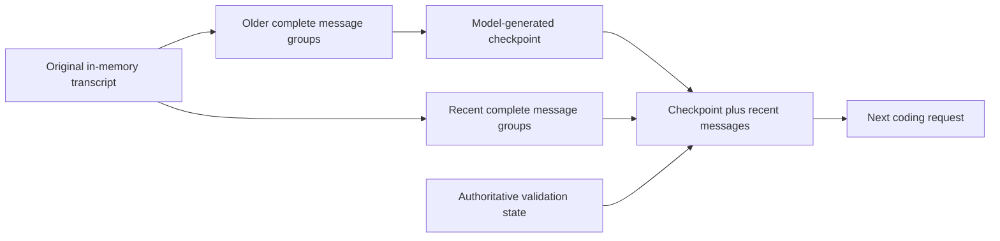

# Conversation compaction

[简体中文](COMPACTION.zh-CN.md)

TEA can summarize older conversation history and send a checkpoint plus recent messages to its next coding request. This is a separate capability from `compact-tools`, which shortens selected old tool results without an LLM summary.

The design follows [Pi 0.87.1's compaction reference](https://github.com/earendil-works/pi/blob/v0.87.1/packages/coding-agent/docs/compaction.md): find a safe retained boundary, carry the previous summary forward, generate structured context, and preserve the original transcript. The implementation is TEA's own; it does not import Pi code.

## Usage

In an interactive session:

```text
/compact
/compact Preserve the API compatibility requirements and unresolved failures.
/status
```

Manual compaction works with automatic compaction disabled. Enable automatic compaction at startup:

```sh
tea --interactive --compaction auto --max-cost-usd 0.10
tea "Fix the retry budget" --compaction auto --max-cost-usd 0.10
```

Normal live credentials are required. Prices are optional without a monetary cap; explicit cost caps and live experiments require prices. The offline terminal demo does not generate summaries.

## Context and original history



- With default checkpoint GC, covered original messages remain in encrypted storage while the live array retains the suffix. With `--memory-gc off`, the original array stays intact. Requests retain the summary, verbatim requirements and recent suffix.
- A tool-call batch and its matching results form one indivisible group. Ambiguous IDs, orphan results and unfinished batches prevent compaction.
- The newest complete group is always retained, even if it exceeds the recent-byte target. Older complete groups are added only while they fit that target; one oversized older batch cannot force itself into the retained suffix. When the latest user request falls inside the summarized prefix, its original text is also included in the next request.
- Repeated compaction passes the previous checkpoint to the summarizer and summarizes messages after its previous retained boundary. It does not resend already summarized raw history.
- The summary covers Goal, Constraints, Progress, Decisions, Next steps and Critical context. Runtime changed-file and validation state is inserted separately and is never inferred from the summary.
- The default Pi-style policy retains historical tool output and patch parameters in the summary input, subject to complete-group input and wire checks. Legacy reserved-output configurations keep bounded excerpts. Ordinary user text is never truncated to fit.
- A successful compaction clears source-read reference caches. A subsequent read returns source again instead of referring to lines that may have been omitted from model context. Learned conversation vocabulary and outstanding validation survive.
- `/new` clears the checkpoint and conversation vocabulary. Adapter spending and outstanding edits remain.

Original history, checkpoints and runtime state support local resume; default GC releases archived resident bodies. See [memory and disk GC](MEMORY_GC.md). Default ledgers store checkpoint hashes/counts, not raw summaries. `TEA_STORE_RAW=1` adds the summary and attempted file-operation paths to local checkpoint records, in addition to existing raw request storage.

## Automatic trigger and bounds

Automatic compaction is enabled by default. The CLI uses Pi-style Token scheduling at `window - reserve`, with separate wire and resident-memory guards. See [current defaults and compatibility](CONTEXT_BUDGET.md). TEA uses calibrated local estimates rather than Pi's identical estimator.

Configuration:

- `--compaction off|auto` / `TEA_COMPACTION`: default `auto`.
- `--compaction-keep-recent-bytes N` / `TEA_COMPACTION_KEEP_RECENT_BYTES`: explicit byte retention overrides the CLI token-retention default; a positive safe integer.
- `TEA_COMPACTION_TRIGGER_RATIO`: CLI default `1`, greater than zero and at most one; legacy reserved-output defaults to `0.8`.
- `TEA_COMPACTION_MAX_PER_TURN`: no CLI default count cap; explicit values 1–8 bound attempts across the whole submitted task. Legacy reserved-output defaults to `2`. A manual command makes at most one summary request.
- The legacy `TEA_MAX_REQUEST_INPUT_TOKENS` setting supplies the serialized-input byte guard; its name must not be interpreted as an exact tokenizer limit.

The summary uses the existing adapter, model and effort. Its output limit is `min(TEA_MAX_OUTPUT_TOKENS, floor(0.8 * TEA_COMPACTION_RESERVE_TOKENS))`; enabled thinking derives its budget from that limit as in ordinary requests. No tools execute during summarization.

If the desired prefix cannot fit the summarization request, TEA selects the longest complete prefix that fits. Such a checkpoint is marked partial; another automatic attempt may advance the boundary. A very large oldest user message may make summarization unavailable. A recent group may still exceed the request guard after compaction, in which case the ordinary guard stops the coding request.

## Accounting and failure handling

Summary requests use the same adapter and hard spending/input caps as coding requests. Their provider usage is included in the main totals and separately identified by `purpose: "compaction"` and `compactionRequests`, `compactionInputTokens`, and `compactionOutputTokens`. Incomplete compaction usage makes these actual token fields `null`; `reportedCompactionInputTokens` and `reportedCompactionOutputTokens` retain reported lower bounds. Scripted usage is not published as actual provider tokens. A rejected summary still costs its actual request usage.

A checkpoint is adopted only when the response has all required sections in order with content, finishes normally, requests no tools, and reduces the next serialized coding request. This size check includes the checkpoint wrapper, latest-user reminder, runtime state and any enabled `compact-tools` projection. It does **not** establish net provider-token savings or semantic completeness.

Cancellation observed before the checkpoint ledger commit, incomplete summaries, missing sections and non-reducing output preserve the previous projection and original history. Once the ledger write succeeds, that checkpoint is adopted even if cancellation arrived during the write, like a completed tool operation. Adapter errors stop the current task; unknown usage retains its full reservation. TEA does not retry a provider overflow with uncertain billing. Recovery currently happens before submission through the local byte trigger.

Paid evaluation must include summary usage, task acceptance, repeated runs, and identical starting snapshots and controls. The [2026-10-11 validation report](../benchmarks/reports/compaction-glm-20261011/README.md) records 41 dedicated tests and paired GLM-5.3-flash measurements: 72.33% fewer total provider tokens in scripted seed stress and 63.14% fewer in model-generated inspection/repair workflows, including summary costs. All 16 re-run tasks passed acceptance. These self-authored JavaScript fixtures use two repeats per case and a 35% experimental trigger; they do not establish default-profile savings or unseen-repository generalization. The measured engine and later offline UTF-8 fix are identified separately in the report.


A 4 MiB serialized resident-history threshold also triggers automatic compaction; it is not a hard process-heap limit.

## Summary output budget

Summary requests use `min(TEA_MAX_OUTPUT_TOKENS, floor(0.8 * TEA_COMPACTION_RESERVE_TOKENS))`, following Pi 0.87.1's reserve-based budgeting approach. The summary reserve defaults to 16,384 tokens (summary ceiling: 13,107); the CLI output default of 4,096 still limits summaries to 4,096 unless configured higher. Set `TEA_COMPACTION_RESERVE_TOKENS` to an integer of at least 2 to override it. This is separate from `TEA_CONTEXT_RESERVE_TOKENS` and does not change the main-request trigger or input guard.

The former 1,200-token summary cap and 350-word target are removed. Truncated or malformed summaries remain rejected, and checkpoints must still reduce the next request size. A larger ceiling is not a requirement to fill it and is not evidence of measured token savings; no new live benchmark is claimed by this change.

Current CLI budgeting and compatibility: [Pi-style context budget](CONTEXT_BUDGET.md). This policy update has offline regression coverage only; previous live measurements are not measurements of this new policy.
