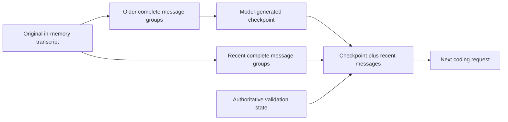

# Conversation compaction

[简体中文](COMPACTION.zh-CN.md)

TEA can summarize older conversation history and send a checkpoint plus recent messages to its next coding request. This is a separate capability from `compact-tools`, which shortens selected old tool results without an LLM summary.

The design follows [Pi 0.87.1's compaction reference](https://github.com/earendil-works/pi/blob/v0.87.1/packages/coding-agent/docs/compaction.md): find a safe retained boundary, carry the previous summary forward, generate structured context, and preserve the original transcript. The implementation is TEA's own; it does not import Pi code.

## Usage

In an interactive session:

```text
/compact
/compact Preserve the API compatibility requirements and unresolved failures.
/status
```

Manual compaction works with automatic compaction disabled. Enable automatic compaction at startup:

```sh
tea --interactive --compaction auto --max-cost-usd 0.10
tea "Fix the retry budget" --compaction auto --max-cost-usd 0.10
```

Normal live credential and price configuration is required. The offline terminal demo does not generate summaries.

## Context and original history



- The original `session.messages` array stays intact. A checkpoint records `firstKeptIndex`; the request projection starts with its summary and retains the suffix verbatim.
- A tool-call batch and its matching results form one indivisible group. Ambiguous IDs, orphan results and unfinished batches prevent compaction.
- The newest complete group is always retained. Retention is a target, so a large group can exceed it. When the latest user request falls inside the summarized prefix, its original text is also included in the next request.
- Repeated compaction passes the previous checkpoint to the summarizer and summarizes messages after its previous retained boundary. It does not resend already summarized raw history.
- The summary covers Goal, Constraints, Progress, Decisions, Next steps and Critical context. Runtime changed-file and validation state is inserted separately and is never inferred from the summary.
- Historical tool output is bounded to approximately 2,000 UTF-8 bytes plus an omission/hash marker per result during summarization. Large patch text is also bounded. Ordinary user text is not truncated to fit the summary request.
- A successful compaction clears source-read reference caches. A subsequent read returns source again instead of referring to lines that may have been omitted from model context. Learned conversation vocabulary and outstanding validation survive.
- `/new` clears the checkpoint and conversation vocabulary. Adapter spending and outstanding edits remain.

The transcript and checkpoint currently live in process memory. This feature does not add session resume or a branch tree. Default ledgers store checkpoint hashes/counts, not raw summaries. `TEA_STORE_RAW=1` adds the summary and attempted file-operation paths to local checkpoint records, in addition to existing raw request storage.

## Automatic trigger and bounds

Automatic compaction is opt-in. Before a coding request, TEA measures the **serialized wire request in UTF-8 bytes**, including system prompt, tool definitions and controls. It triggers at 80% of the configured byte guard. This is different from Pi's model-context token threshold: TEA currently has no native tokenizer or provider context-window catalog.

Configuration:

- `--compaction off|auto` / `TEA_COMPACTION`: default `off`.
- `--compaction-keep-recent-bytes N` / `TEA_COMPACTION_KEEP_RECENT_BYTES`: defaults to 30% of the request byte guard; a positive safe integer.
- `TEA_COMPACTION_TRIGGER_RATIO`: default `0.8`, strictly between zero and one.
- `TEA_COMPACTION_MAX_PER_TURN`: default `2`, range 1–8. This limits automatic attempts across the whole submitted task, including unsuccessful attempts. A manual command makes at most one summary request.
- The legacy `TEA_MAX_REQUEST_INPUT_TOKENS` setting supplies the serialized-input byte guard; its name must not be interpreted as an exact tokenizer limit.

The summary uses the existing adapter, model and effort. Its output limit is `min(TEA_MAX_OUTPUT_TOKENS, 1200)`; enabled thinking derives its budget from that limit as in ordinary requests. No tools execute during summarization.

If the desired prefix cannot fit the summarization request, TEA selects the longest complete prefix that fits. Such a checkpoint is marked partial; another automatic attempt may advance the boundary. A very large oldest user message may make summarization unavailable. A recent group may still exceed the request guard after compaction, in which case the ordinary guard stops the coding request.

## Accounting and failure handling

Summary requests use the same adapter and hard spending/input caps as coding requests. Their provider usage is included in the main totals and separately identified by `purpose: "compaction"` and `compactionRequests`, `compactionInputTokens`, and `compactionOutputTokens`. Incomplete compaction usage makes these actual token fields `null`; `reportedCompactionInputTokens` and `reportedCompactionOutputTokens` retain reported lower bounds. Scripted usage is not published as actual provider tokens. A rejected summary still costs its actual request usage.

A checkpoint is adopted only when the response has all required sections in order with content, finishes normally, requests no tools, and reduces the next serialized coding request. This size check includes the checkpoint wrapper, latest-user reminder, runtime state and any enabled `compact-tools` projection. It does **not** establish net provider-token savings or semantic completeness.

Cancellation, incomplete summaries, missing sections and non-reducing output preserve the previous projection and original history. Adapter errors stop the current task; unknown usage retains its full reservation. TEA does not retry a provider overflow with uncertain billing. Recovery currently happens before submission through the local byte trigger.

Paid evaluation must include summary usage, task acceptance, repeated runs, and identical starting snapshots and controls. This capability has no measured provider-token savings result yet.
