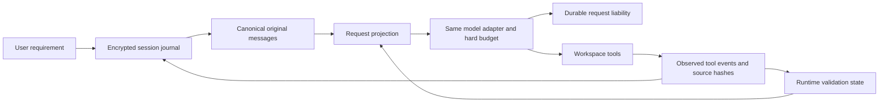
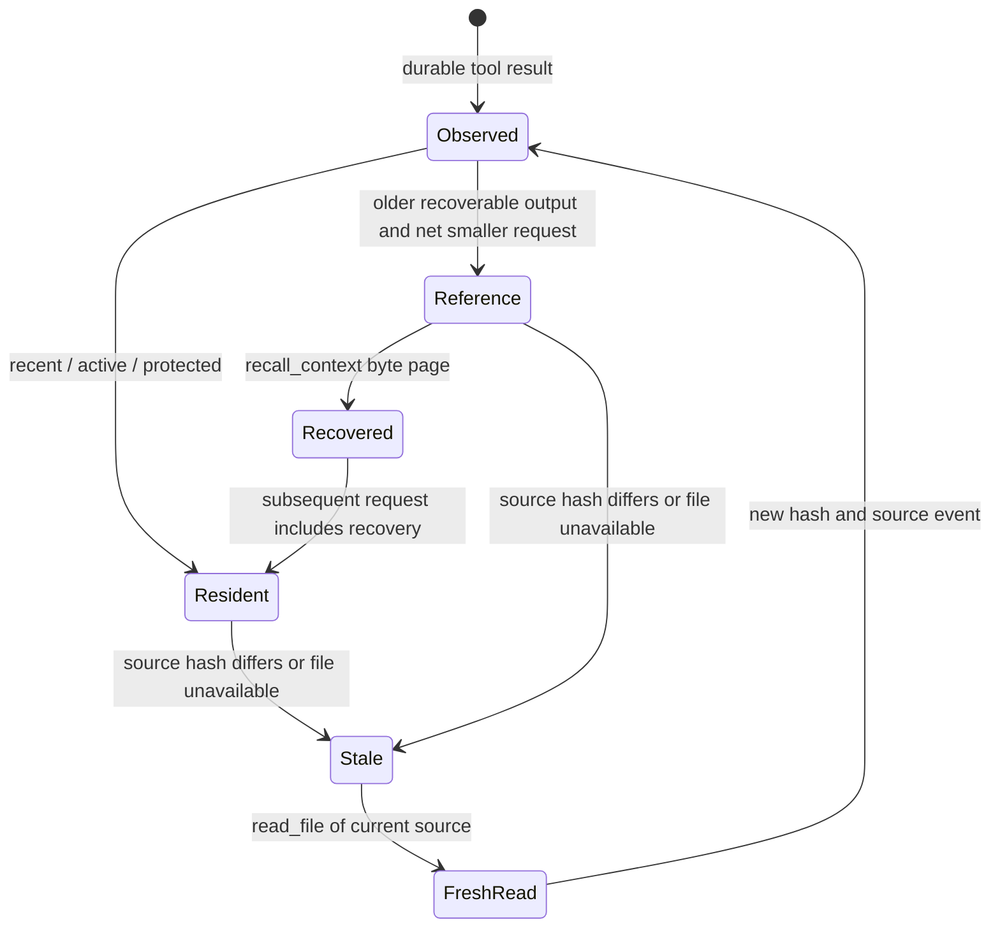

# ContextOS contracts and actual architecture

The supplied ContextOS proposal describes goals. This document records the implementation and its limits; planned features are not treated as existing behavior.

## Current data flow

`session-journal.mjs` implements schema 1 ordered hash-linked JSONL metadata. Each payload uses authenticated AES-256-GCM, a per-session 32-byte local key and a content-addressed artifact. API configuration is never persisted; only the model, endpoint fingerprint and budget controls are recorded. The key and artifacts are under ignored `.tea/sessions/<id>/`, with owner-only POSIX creation modes. Windows uses inherited local permissions. This is local at-rest encryption, not protection from an administrator or a user who can read both the key and ciphertext. No key, artifact or raw transcript is published or uploaded to a memory service.

Each event has a session ID, ordered event ID, schema, timestamp, prior event hash and authenticated artifact reference. Payloads are written and flushed before their metadata commit; metadata is flushed before external operations continue. An incomplete final JSONL line is discarded on resume. A corrupt complete row, missing artifact, invalid schema or authentication failure stops recovery. A single writer lock rejects live writers; a dead PID lock can be reclaimed. Corrupt lock metadata fails closed. Filesystem/power-loss guarantees depend on the host; file flushes do not constitute a full transactional database or hardware durability guarantee.

The journal records original messages, tool intents/results, request intents/settlements, resets and runtime state. A pre-submission intent preserves the worst-case liability if the process dies before usage arrives. Known counters and reservations survive restart; unresolved billing blocks further provider calls. Original cost/input caps can be reduced, not silently increased. `/new` preserves spending and pending edits.

Resume verifies the original workspace, model and endpoint, compares Git HEAD and content fingerprints, clears stale caches/checkpoints and requires fresh validation after changes. Current implementation bounds fingerprinting to 10,000 files and excludes standard generated directories, agent/Git storage and credential paths. It does not claim to detect changes in excluded dependencies. Interrupted tool batches are paired with explicit uncertain results and require inspection instead of automatic replay. Learned terms retain their source occurrence evidence; semantic equivalence remains the model's responsibility.

## Facts and inferred state

User requests remain user-confirmed requirements. Tool operations, hashes and actual tests are observations; model text and summaries are inferred claims. Only actual successful relevant validation can clear pending edits. A restored summary cannot certify a test. Phase labels are descriptive hints and do not constrain exploration to a fixed pipeline.

TaskState stores the latest goal, source event IDs, active files, observed operations, inferred decisions, failures, pending validation and evidence references. Every original user message also remains pinned. This is a provenance-aware runtime record, not a model-certified semantic graph. A data-only `memoryHandoff` interface preserves provenance, obligations and accounting for future routing; it performs no model switch or provider request.

## Working set and memory lifecycle

The assembler indexes canonical call/result pairs and inferred assistant notes. It retains every user requirement, original assistant thinking/signature, recent two result rounds, active/changed source, AGENTS/README, failures, side effects and edit receipts. Older source reads, discovery and successful validation logs may become content-addressed historical references above a soft target. Unsigned rounds consisting entirely of tool calls and their matching selected results can be paged together, with a reference directory. Rounds containing thinking, signatures or assistant text keep their original assistant blocks. Retained calls and results stay paired in their original order. Reference schemas/guidance and recovery follow-up requests are part of total measured overhead. A non-reducing projection falls back to full history. Evicting a source also invalidates the normal read cache so an omitted body cannot leave an unresolvable 'unchanged' receipt.

When valid recoverable references exist, candidate C repeats the current user goal verbatim and already observed, version-valid AGENTS rules near the latest result. Rules remain subordinate workspace evidence. This adds measured request bytes and is a hypothesis for reducing scope mistakes, not an enforcement guarantee. Every original user text is also reinserted if an optional semantic checkpoint has omitted it. No domain keywords or hand-written scope parser decide which requirements matter.

Every source unit, including pinned source, is checked for freshness. Read/search snapshots are captured from the same decoded content used to produce the output and retained across resume. Recalled source pages and search previews inherit source dependencies; any changed, inaccessible or protected dependency withholds the old lines. Unversioned old search snippets are withheld conservatively. Freshness checks decode UTF-8 consistently, include BOM handling and cache each file hash within one assembly. Version identity does not prove semantic correctness or lock external writers.

`recall_context` returns bounded UTF-8 pages without re-executing historical tools. `search_history` uses literal multilingual words/path matching, bounded previews and observed/inferred labels. Stale source previews are withheld. It uses no hand-written domain synonym list, embeddings or additional summary model. Existing session vocabulary still requires a source occurrence and version check; hash validity alone does not prove the model's semantic mapping.

The inspector reports unit IDs, provenance, version, inclusion reason, byte/heuristic diagnostics, freshness and recovery counts. Byte diagnostics use the complete native wire request; provider tokens are recorded separately. The canonical original history remains in RAM and on disk; request selection does not bound process RAM. The journal preserves exactly the agent-visible output. Existing command truncation is earlier in the tool pipeline, so omitted raw stdout is not recoverable from the journal. Freshness is checked at read time without locking external writers. These limits remain explicit.

## Recovery and rollback

On restart: lock → authenticate events → restore original messages/state/accounting → preserve unknown liabilities → compare workspace identity → invalidate stale checkpoint/cache → fill interrupted tool pairs with uncertainty → require inspection/validation. No edit or command is automatically replayed. Unknown billing blocks provider requests. Corrupt committed storage fails closed; incomplete final metadata can be repaired. `/new` records a reset while preserving costs and edits. `full-history` provides a feature-level rollback with the same persistent session.

## Research considered

[MemGPT (2023/2024)](https://arxiv.org/abs/2310.08560) motivates separating resident context from retrievable storage. [LightMem (2025/2026)](https://arxiv.org/abs/2510.18866) motivates separating filtering and consolidation from online inference. [A-MEM (2025)](https://arxiv.org/abs/2502.12110) explores structured linked memory. TEA will first test deterministic references and source validation without an embedding service or another paid summarizer. These are design inspirations, not reproduced paper results or established TEA gains.

[ACE (2025, revised 2026)](https://arxiv.org/abs/2510.04618) treats context as an evolving structured playbook and preserves detail through incremental updates; it motivates keeping requirements and observed facts separate from replaceable inferred notes. C does not implement ACE's generation/reflection pipeline or claim its published results. [Lost in the Middle (2023)](https://arxiv.org/abs/2307.03172) reports position sensitivity in long-context retrieval; it motivates testing placement, but is not evidence that attention position caused B's scope error. B's exact reconstructed requests kept both instructions, including a user goal near the end, so an instruction-deletion explanation is contradicted by the trace.
