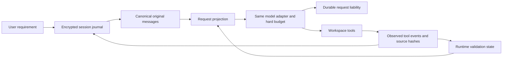

# ContextOS contracts and actual architecture

The supplied ContextOS proposal describes goals. This document records the implementation and its limits; planned features are not treated as existing behavior.

## Current data flow

`session-journal.mjs` implements schema 1 ordered hash-linked JSONL metadata. Each payload uses authenticated AES-256-GCM, a per-session 32-byte local key and a content-addressed artifact. API configuration is never persisted; only the model, endpoint fingerprint and budget controls are recorded. The key and artifacts are under ignored `.tea/sessions/<id>/`, with owner-only POSIX creation modes. Windows uses inherited local permissions. This is local at-rest encryption, not protection from an administrator or a user who can read both the key and ciphertext. No key, artifact or raw transcript is published or uploaded to a memory service.

Each event has a session ID, ordered event ID, schema, timestamp, prior event hash and authenticated artifact reference. Payloads are written and flushed before their metadata commit; metadata is flushed before external operations continue. An incomplete final JSONL line is discarded on resume. A corrupt complete row, missing artifact, invalid schema or authentication failure stops recovery. A single writer lock rejects live writers; a dead PID lock can be reclaimed. Corrupt lock metadata fails closed. Filesystem/power-loss guarantees depend on the host; file flushes do not constitute a full transactional database or hardware durability guarantee.

The journal records original messages, tool intents/results, request intents/settlements, resets and runtime state. A pre-submission intent preserves the worst-case liability if the process dies before usage arrives. Known counters and reservations survive restart; unresolved billing blocks further provider calls. Original cost/input caps can be reduced, not silently increased. `/new` preserves spending and pending edits.

Resume verifies the original workspace, model and endpoint, compares Git HEAD and content fingerprints, clears stale caches/checkpoints and requires fresh validation after changes. Current implementation bounds fingerprinting to 10,000 files and excludes standard generated directories, agent/Git storage and credential paths. It does not claim to detect changes in excluded dependencies. Interrupted tool batches are paired with explicit uncertain results and require inspection instead of automatic replay. Learned terms retain their source occurrence evidence; semantic equivalence remains the model's responsibility.

## Facts and inferred state

User requests remain user-confirmed requirements. Tool operations, hashes and actual tests are observations; model text and summaries are inferred claims. Only actual successful relevant validation can clear pending edits. A restored summary cannot certify a test. Phase labels are descriptive hints and do not constrain exploration to a fixed pipeline.

## Research considered

[MemGPT (2023/2024)](https://arxiv.org/abs/2310.08560) motivates separating resident context from retrievable storage. [LightMem (2025/2026)](https://arxiv.org/abs/2510.18866) motivates separating filtering and consolidation from online inference. [A-MEM (2025)](https://arxiv.org/abs/2502.12110) explores structured linked memory. TEA will first test deterministic references and source validation without an embedding service or another paid summarizer. These are design inspirations, not reproduced paper results or established TEA gains.
